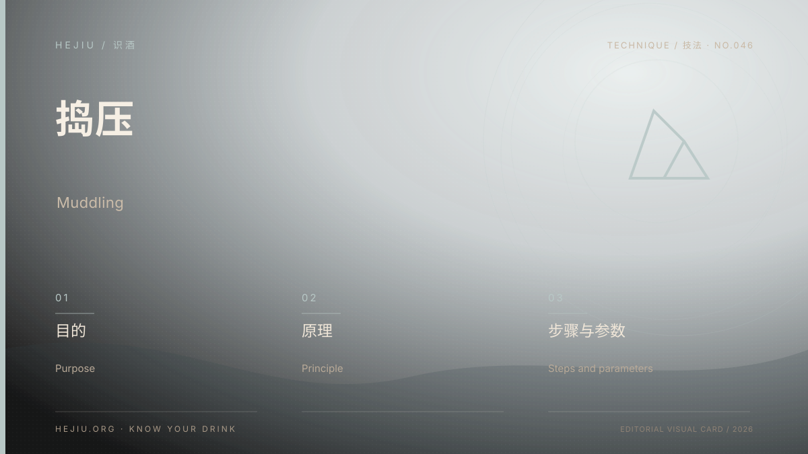

# Muddling

Muddling is the bartending technique of gently pressing herbs, fruit or sugar cubes in a glass with a muddler so that aroma and juice are released. It is part of building a drink in the glass and appears most often in recipes such as the Mojito and the Mint Julep, where fresh plant aroma is the point. It looks simple, yet the wrong force, order or tool can ruin a drink quickly.

Figure: thematic illustration for Muddling. Image: AI-assisted illustration generated with Doubao Seedream 5.0 (project-owned); not a photograph of the subject.

## Purpose

Muddling answers a practical question: how do you get flavour out of a fresh ingredient without heating it or steeping it for a long time? Mint leaves, basil, lime wedges, berries and sugar cubes release flavour slowly if left whole in liquid. A gentle press ruptures some of the plant structure so that essential oils and juice meet the liquid. Muddling also helps to mix: pressing sugar with lime juice at the bottom of the glass encourages the sugar to dissolve and makes later stirring more even.

It is not juicing and it is not grinding. The aim is to open the aroma, not to destroy the plant tissue. Once that is clear, the idea that harder pressing must be better becomes obviously wrong.

## Principle

Plant aroma sits mainly in oil glands on the surface of leaves and in oil cells in the outer layer of citrus peel. Pressure breaks these structures and lets the oils into the drink; fruit cells also break and release juice. With too much pressure, bitter compounds from the leaves and the inner peel, along with breakdown products from chlorophyll, enter the drink as well, and the aroma turns muddy.

The key is therefore to press without shredding. Mint leaves that are pounded into fragments oxidise at the cuts, darken, and shift from bright and clean to green and bitter. Press citrus into the white pith and bitterness rises sharply. Sugar at the bottom of the glass provides abrasion that helps oils and juice integrate faster, but sugar itself does not create aroma. Temperature and time matter too: muddling is usually done at room temperature for a very short time, and volatile aroma components keep escaping if the drink sits afterwards.

## Steps and parameters

First, prepare the ingredients as the recipe directs. Mint is usually picked leaf by leaf, with coarse stems removed; limes are cut into wedges that are easy to press; whether berries should be crushed first depends on whether the recipe wants fruit texture or a clearer drink.

Second, put the ingredients into the glass or mixing vessel that will be used. In recipes with sugar, add the sugar and a little acid juice first so that there is an abrasive layer at the bottom; in recipes without sugar, add the herbs directly.

Third, hold the glass steady and keep the muddler vertical. Press down with a short, controlled motion, twist slightly, then lift. The number of presses should follow the aroma and the state of the leaves rather than a fixed count. Stop when the leaves have darkened and their edges have softened but are still intact.

Fourth, add the liquid and ice and continue with stirring or shaking as the recipe requires. Muddling is preparation, not the end of mixing.

Fifth, remove the muddler and wipe or rinse it before the next drink. A muddler covered in citrus and sugar is sticky, and residue contaminates the next glass.

There is no universal pressure or press count, because herb variety, leaf age, glass shape and recipe intent all differ. Treating "press it five times" as a fixed parameter is less reliable than watching the leaves. If a recipe states an order and quantities, follow the recipe first.

## Where it applies and alternatives

Ingredients that suit muddling include mint, basil and thyme, lime and lemon wedges, berries, and sugar cubes that need to be crushed with citrus. Their common feature is that aroma sits in fragile structures and the recipe wants freshness.

Ingredients that do not suit muddling include flower petals, very tender herbs, pre-chopped peel, and recipes that are meant to stay clear. Bitter citrus pith and seedy fruit should also not be pressed hard.

There are several alternatives. Shaking herbs briefly with the liquid releases aroma, but fragments end up in the drink and need straining. Extracting aroma in advance with a syrup or an infusion gives a more stable result but less freshly made brightness. Stirring instead of muddling releases less aroma. The choice depends on whether the recipe wants the sharpness of fresh plants or repeatable stability.

In recipes such as the [Mojito](ref:mojito), muddling works together with stirring; in recipes that need clarity, it may be replaced by shaking and double straining. Techniques are not substitutes for one another so much as tools for different finished results. For the wider process, see [cocktail basics](ref:basics).

## Common failure points

First, pressing too hard. Mint turns to fragments, the drink becomes grassy and bitter, and the colour darkens.

Second, pressing into the white pith of citrus. Bitterness overwhelms the aroma and the drink loses balance.

Third, pressing too lightly. The leaves stay whole but almost no aroma reaches the liquid, and the result tastes like soda with mint in it.

Fourth, using a glass that is too thin or too narrow. Force concentrates at one point and the glass may break; the muddler may also jam.

Fifth, using a dirty muddler. Fruit and sugar residue from the previous drink brings off-flavours and raises hygiene concerns.

Sixth, getting the order wrong. Adding ice before muddling blocks the pressure and makes the muddler slip; the usual order is to treat the fresh ingredients first, then add ice and liquid.

Seventh, treating muddling as mandatory. Not every mint recipe needs it; some rely more on shaking or infusion.

## Practice

Practise with water and mint and watch how the leaves change under different pressures: a light press darkens them while keeping them whole, while a hard press produces fragments and dark cuts. Smell both results and learn the difference between clean and grassy.

Then make the same recipe twice, one with a light press and one with a hard press, keeping every other step identical, and compare aroma and bitterness. This kind of controlled comparison builds feel better than counting presses. Practise with the glasses you actually use, so that the angle and travel of the muddler match the rim and depth; a muddler that is too short or too long changes how easily force is controlled.

Finally, practise cleaning and rhythm: wipe the muddler immediately after use and rinse it when changing glasses, until it becomes a fixed habit. Consistent technique comes from consistent movement, not from one unusually strong press.

## Common misconceptions

First, "the harder you press, the more flavour you get". Muddling is meant to release aroma, not destroy tissue; excess force brings bitterness and cloudiness.

Second, "everything should be muddled". Petals, tender herbs and pre-chopped peel are not suitable and lose aroma when pressed.

Third, "muddling replaces shaking". Muddling only treats the fresh ingredients; chilling, dilution and overall mixing still need later steps.

Fourth, "mint should be muddled until shredded". Shredded leaves oxidise and lose aroma quickly, leaving a dull drink.

Fifth, "a heavier muddler is always better". Weight affects control; a heavy muddler is hard to stop in a thin glass and increases the risk of breakage.

Sixth, "a muddled drink can wait". Aroma keeps escaping, so the remaining steps should follow promptly in recipe order.

## See also

- [Mojito](ref:mojito): a built recipe centred on mint and lime.
- [Mint Julep](ref:julep): another long drink built around mint aroma.
- [Muddler](ref:muddler): length, material and grip.
- [Shaking](ref:shaking): an alternative when herb fragments need straining.
- [Aroma](ref:aroma): the basics of plant aroma and volatility.
- [Cocktail basics](ref:basics): the overall flow of building, shaking and stirring.

**In brief:** A bartending technique in which herbs, fruit or sugar are gently pressed in the glass with a muddler to release aroma and juice; the key is to press without shredding, since force brings bitterness and cloudiness.
