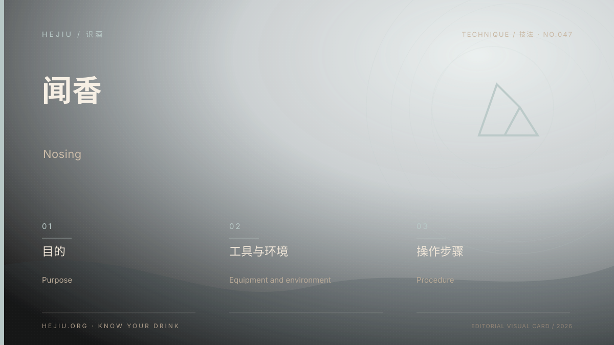

# Nosing

Nosing is the technique of judging condition, aroma layers and intensity before the first sip. It gives more information than colour and is safer than tasting: a small amount of volatile aroma is enough to form a judgement without swallowing any liquid. The point of nosing is not to smell for as long as possible, but to work in a sequence, record what you find and be able to repeat it.

Figure: thematic illustration for Nosing. Image: AI-assisted illustration generated with Doubao Seedream 5.0 (project-owned); not a photograph of the subject.

## Purpose

The first purpose is judging condition. Cork taint, excessive oxidation, high volatile acidity and residual sulphides often show first in the aroma. The second is identifying layers. Fruit, floral, spice, fermentation, cask and aged notes help infer variety, method and age. The third is building expectations. Aroma intensity and openness shape how the palate will be read.

Nosing is not a guessing game. Describing a wine as "nice" or "very aromatic" cannot support comparison. Recording specific smell terms, the order in which they appear and their intensity builds a reference across wines.

## Equipment and environment

The essential tool is a suitable glass. A slightly narrowed rim gathers aroma, while a bowl with enough volume lets the liquid contact air. Different drinks have customary shapes, but comparisons should use one shape.

The environment matters more than the equipment. Perfume, hair products, tobacco, cooking fumes, cleaning products and flowers all contaminate judgement. Taste in a ventilated, odour-free room with a stable temperature. A cold, a blocked nose or a recent spicy meal lowers sensitivity; in that state, soften your conclusions or postpone the session.

Temperature determines release. Cold closes aroma; heat speeds volatilisation but pushes alcohol forward. White and sparkling wines are usually served cooler than reds, while spirits are often tasted at room temperature or slightly cooled. Confirm the temperature before nosing and write it down.

## Procedure

First, pour about one third of the glass so aroma has room to gather. Second, without swirling, place your nose above the rim and approach slowly from a distance, so a concentrated burst of alcohol does not shock the sense of smell.

Third, record the "still" aroma: what appears first, how intense it is and whether it is clean. Fourth, swirl gently to leave a film on the glass and increase the surface for evaporation, then nose again and record what changed. Fifth, if needed, take one short, deeper sniff to confirm the middle notes; do not keep sniffing hard, which causes olfactory fatigue.

Sixth, record the aroma by layer: primary notes tend towards fruit, flowers and plants; secondary notes towards fermentation, yeast and dairy; tertiary notes towards cask, age, dried fruit, spice and leather. The categories are a structure for notes, not a doctrine.

## Reading the parameters

Intensity is how obvious and penetrating the aroma is. High intensity is not automatically high quality; it may simply come from alcohol or particular volatile compounds. Complexity is the number of distinguishable layers and how they change; cleanliness is the absence of off-flavours, faults or masking.

Openness is how readily the aroma escapes. Some wines are closed just after opening and open with swirling or decanting; others are generous at first and fade within minutes. Recording change by the minute is more useful than writing only a final impression.

Temperature, glass shape, volume and swirl strength all change the result. Fix these for any comparison. When tasting one wine at different temperatures, go from cool to warm so residual aroma does not interfere.

## Failure cases

First, putting your nose into the glass and sniffing hard. High alcohol briefly dulls the sense of smell and makes heat feel like intensity. Second, swirling too vigorously. Liquid spills and aroma is released all at once, which makes layers harder to separate.

Third, nosing in a room with perfume or cooking fumes. Ambient smell mixes with the drink and produces wrong conclusions. Fourth, nosing a dozen wines without a break. Olfactory fatigue makes later judgements coarser; breathe fresh air and record between wines.

Fifth, treating "no aroma" as a fault. Cold, a just-opened bottle or the wrong glass can all close a wine down. Sixth, recording only good or bad without conditions. Without temperature, glass and timing, an aroma note cannot be reproduced.

## Practice

Start by building vocabulary. Gather reference smells such as lemon peel, green apple, black pepper, vanilla, coffee, leather and wet cardboard; smell each and write your own description. The words need not be poetic; consistency and shareability matter more.

Second, taste the same wine at two temperatures, one at room temperature and one slightly cooler, and compare intensity and layers. Third, run a triangle test: two glasses of the same wine and one of another, find the different one by smell, then confirm on the palate.

Fourth, practise blind notes. Look only at the glass, not the label, and write down layers, intensity, cleanliness and a possible drink type before checking the answer. The goal is consistent, accurate description, not brand guessing.

## Relationship to other steps

Nosing follows [observing colour](ref:observing-colour) and prepares the palate. Colour suggests age and depth, but nosing should follow what the nose actually receives rather than letting expectation override it. After the first sip, aroma judgements are corrected by texture: a wine that smells sweet may taste dry.

[Decanting](ref:decanting) changes aroma significantly. Reductive notes from a just-opened bottle may disperse after decanting, or turn flat and vinegary with excessive oxidation. Record before and after separately so that "change" is not mistaken for "improvement".

## Common misconceptions

First, stronger aroma is better. Intensity and quality are different, and strong volatiles may come from alcohol or a fault.

Second, the longer you nose, the more accurate you are. Continuous hard sniffing causes fatigue; short, spaced sniffs are more reliable.

Third, only professional vocabulary counts as a record. Stable everyday description works too; the key is specificity and repeatability.

Fourth, failing to smell anything means a poor nose. Temperature, glass, environment and experience all matter, so check the conditions first.

Fifth, every fault can be smelt. Some faults are hidden by cold or by a particular glass and only appear on the palate or later.

**Short definition:** A tasting technique for judging condition, layers and intensity through aroma gathered at the rim of the glass; nose still first, then swirl, approach from a distance and record specific smells rather than "good" or "bad".

## Further reading

- [Aroma](ref:aroma): definitions, layers and description.
- [Finish](ref:finish): how aroma and palate continue after swallowing.
- [Wine](ref:wine): the basic sources of wine aroma.
- [Whisky](ref:whisky): common approaches to nosing and dilution.
- [Baijiu](ref:baijiu): aroma-family characteristics in baijiu.
- [First tasting](ref:tasting): the complete beginner sequence.
- [Whisky introduction](ref:whisky-guide): starting spirits with the nose.
