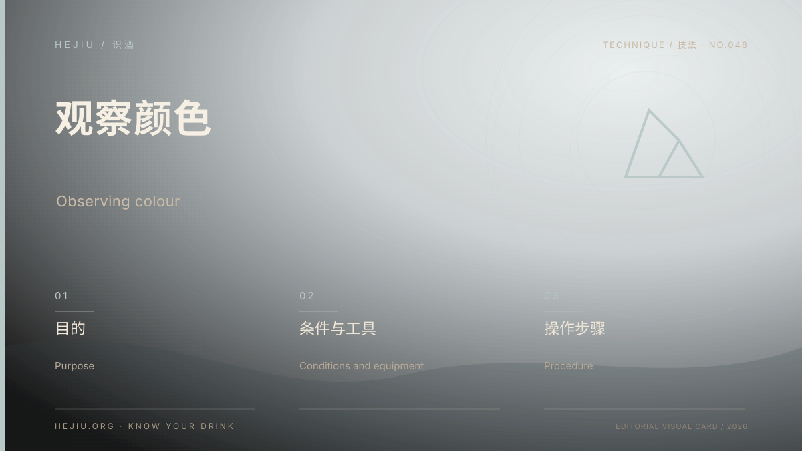

# Observing colour

Observing colour is the first step in tasting: after pouring and before nosing, use your eyes to judge clarity, hue and depth. It cannot tell you whether a drink tastes good, but it offers clues about age, variety, skin contact and cask ageing. Treating colour as a clue rather than a conclusion is the premise of this technique.

Figure: thematic illustration for Observing colour. Image: AI-assisted illustration generated with Doubao Seedream 5.0 (project-owned); not a photograph of the subject.

## Purpose

The first purpose is checking condition. Cloudiness, suspended particles, unusual sediment, or the behaviour of bubbles in a sparkling wine can point to filtration, transport, storage or conditions inside the bottle. The second is building expectations. A deeply coloured red usually implies more skin contact and tannin, while a white shifting from green-tinged to gold suggests ageing. The third is leaving a comparable record. The more specific the colour description, the better you can compare vintages of one wine or one variety across regions.

Colour is not a quality score. Depth and intensity have no direct link to good or bad; the same variety can look completely different in another region or year. Drawing a conclusion from colour alone is the most common misuse.

## Conditions and equipment

Observation needs controlled conditions. Use a white or light grey background, such as white paper or a white tablecloth, and natural light or a white light with good colour rendering. Avoid coloured lamps, neon and strong reflections. The glass should be clean, free of water stains and detergent residue, and ideally the same shape across the wines being compared, because wall thickness and rim shape change what you see.

The tools are simple: a clear glass, a sheet of white paper, a steady light and something to write with. For photographs, put the white paper behind the glass and keep a fixed distance between lens and glass, so automatic white balance does not shift the colour. When comparing two drinks, use the same glass shape, the same volume and the same tilt.

## Procedure

First, pour a small amount, about one third of the glass. Filling it higher compresses the viewing angle and makes swirling risky. Second, hold the glass by the stem rather than the bowl, and tilt it about forty-five degrees so the liquid forms a thin arc against the wall.

Third, look at the centre of the arc first, then at the rim. The centre shows the depth and main hue; the rim is thinner and more transparent and reveals subtle shifts in hue. Fourth, set the glass against the white paper and look straight on at clarity: suspended particles, sediment, bubbles or material attached to the glass.

Fifth, swirl gently so the liquid leaves a film on the wall, and watch how the streaks run down. These "tears" are only a reference for physical properties such as alcohol and sugar; they are not a quality indicator. Sixth, record the result under separate headings: clarity, hue, depth, bubbles, other.

## Reading the parameters

Hue carries the most information. White wines commonly move from green-tinged and lemon-yellow towards gold and amber, and eventually brown; reds move from purple and ruby towards garnet and brick, with an orange rim. Sparkling wines usually deepen from pale yellow towards gold with age. Hue is shaped by variety, skin contact, cask ageing and bottle ageing, so it cannot be attributed to age alone.

Depth means how dark and opaque the colour is. In reds it is influenced by skin contact time, grape skin thickness and ripeness; in whites by pressing, any skin contact and cask ageing. Depth is not the same as body, and it is not the same as quality.

Clarity requires separating normal sediment from abnormal cloudiness. Pigment and tartrate sediment at the bottom of an old bottle is common and can be left behind when pouring. If cloudiness comes with off-flavours, flocculent particles or rapid deterioration after opening, a fault is more likely. Bubbles in a sparkling wine should be fine, persistent and rising in strings; coarse, sparse bubbles that vanish quickly may point to pressure or a poorly cleaned glass.

Tears relate to alcohol, residual sugar and temperature. They are usually more visible when the drink is cold and high in alcohol. They can support a judgement but cannot replace the assessment of body in the mouth.

## Failure cases

First, observing under coloured light. The light itself has a colour and can gild a white wine or flatten a red into black. Second, holding the bowl. Hand warmth raises the temperature, leaves fingerprints and changes how bubbles behave.

Third, pouring too full. When the liquid sits near the rim, the tilt is limited, the rim colour disappears and swirling spills. Fourth, comparing two drinks in different glasses. Wall thickness, rim narrowing and capacity all change the apparent depth.

Fifth, treating colour depth as body. Colour is an optical effect; body is the weight of the drink in the mouth. They correlate but are not the same. Sixth, treating all sediment as a fault. Sediment in old wine is normal; the question is whether it comes with off-flavours and cloudiness.

Seventh, photographing without correction. Automatic white balance and filters alter hue, so images from different sessions cannot be compared.

## Practice

Start with two vintages of the same wine from one producer, several years apart, and observe them side by side in the same glass shape with the same volume. Record hue and the changes at the rim. Next, compare one variety from two regions with different climates, looking at depth and hue.

Third, build a photographic record. Fix the white paper, distance and light, take a front view and a tilted side view, and name each file with the wine, vintage, date and whether it was decanted. Fourth, practise blind: look only at colour, write down a guess about age and method, then check the label. The aim is to know what you actually saw, not to guess correctly.

Remember that glass shape and light strongly affect colour. Any conclusion should carry its observation conditions, or it cannot be reproduced.

## Relationship to other steps

Observing colour prepares the ground for [nosing](ref:aroma) and for the first sip. The age and depth suggested by colour shape your expectation of aroma intensity and body. Expectations can bias you, so record colour honestly first, nose second, and let the palate correct earlier impressions.

Colour also relates to [decanting](ref:decanting) and temperature. Decanting changes contact with air; hue rarely shifts within minutes, but clarity may change if sediment is re-suspended. When a white wine is colder, its aroma closes down while the colour may look paler. Put these conditions in the record or comparisons lose their meaning.

## Common misconceptions

First, the darker the colour, the better the drink. Depth depends on variety, method and vintage, not on quality.

Second, paler white wine is always younger. Some varieties and methods are naturally pale, so hue alone cannot date a wine.

Third, more tears mean a richer drink. Tears mainly reflect alcohol and sugar and cannot replace the palate.

Fourth, sediment means the bottle is bad. Sediment in old wine is normal; judge it together with smell and clarity.

Fifth, restaurant lighting is good enough. Coloured or dim light systematically distorts judgement; use white paper and natural light where possible.

## Further reading

- [Wine](ref:wine): the basic categories and winemaking framework.
- [Red wine](ref:red): skin contact, tannin and colour.
- [White wine](ref:white): pressing, skin contact and hue.
- [Sparkling wine](ref:sparkling): bubbles and how ageing changes colour.
- [Aroma](ref:aroma): the next sensory step after colour.
- [First tasting](ref:tasting): the beginner sequence from colour to nose to palate.
- [Choosing a glass](ref:glass): how glass shape affects colour and aroma.
