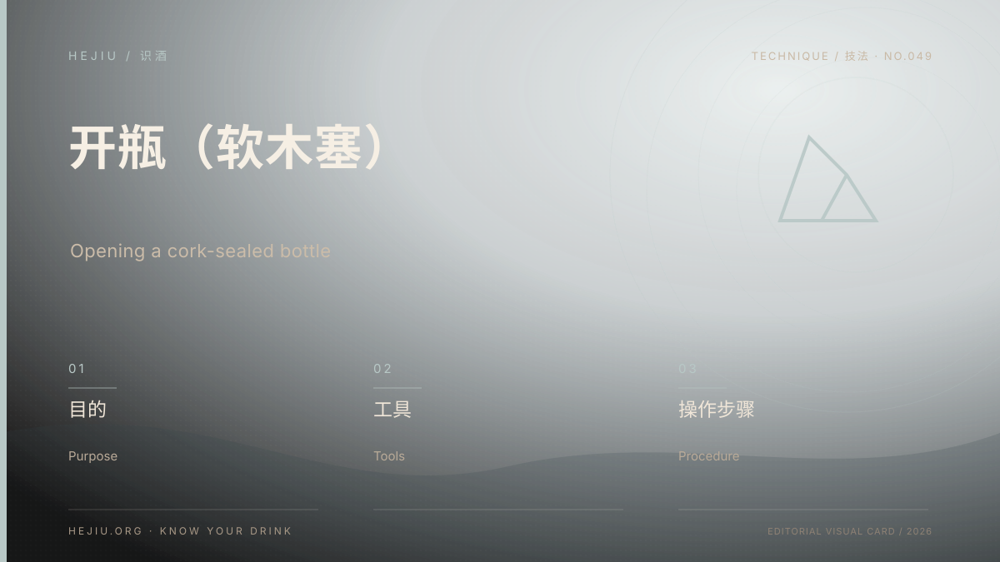

# Opening a cork-sealed bottle

Opening a bottle means removing the cork intact while keeping crumbs out of the liquid. It looks like a matter of force, but it is really about tool choice, auger placement and the rhythm of the pull. The common failure is not "cannot open it" but a broken cork, crumbs in the wine, or sediment stirred up by a shaken bottle.

Figure: thematic illustration for Opening a cork-sealed bottle. Image: AI-assisted illustration generated with Doubao Seedream 5.0 (project-owned); not a photograph of the subject.

## Purpose

First, remove the cork intact. Keeping it whole serves hygiene and allows later inspection. Second, avoid contamination. The auger should not push crumbs into the liquid, and dust or foil residue around the rim should be cleaned first. Third, check condition. The removed cork shows moisture, elasticity and smell, offering clues about storage and faults.

Fourth, prepare for what follows. After opening, the bottle is usually [decanted](ref:decanting) or [poured](ref:pouring), so whether the bottle was shaken and whether sediment was disturbed directly affects the result.

## Tools

The commonest tool is the waiter's friend, also called a wine key: an auger at one end, a small blade and a two-stage lever at the other. A double-hinged opener gives two lifting points and suits everyday use. For old wine, a two-pronged cork puller grips the cork on both sides and removes it by friction, reducing the risk of breaking an aged cork.

You also need a clean cloth, a light and a vessel if the wine will be decanted. The cloth cleans the rim and bottle; the light is used to watch sediment at the shoulder; the vessel holds the wine or serves as the decanter. Do not substitute a key, screwdriver or table edge, which damage corks and risk injury.

Some bottles use synthetic corks, screw caps or pull tabs. Their handling differs: screw caps simply unscrew, synthetic corks still need an opener but feel slippier, and pull tabs follow the packaging instructions. Adjust the technique to the closure rather than applying cork experience to every bottle.

## Procedure

First, check the bottle. Confirm it is sound, not leaking and clearly labelled; if decanting or separating sediment, stand it upright in advance. Second, cut the foil around the neck with the opener's blade, taking care not to cut too deep and scratch the rim or push foil fragments in.

Third, wipe the outside and inner edge of the rim. Fourth, place the auger at the centre of the cork, start at a slight angle and then turn it upright; it should follow the axis rather than enter from the edge. Fifth, leave one turn of auger outside so crumbs are not pushed into the wine.

Sixth, lift the cork gently with the lever. With a two-stage opener, use the shorter lever first, then the longer one; keep the bottle steady and do not twist forcefully. Seventh, when only a short piece remains, hold the cork with your hand or a cloth and turn it out slowly instead of letting it pop. Eighth, wipe the rim and smell the cork, checking for off-odours, leakage or unusual softness.

## Parameters and judgement

Auger placement decides whether the cork is pierced through. Ideally it enters at the centre, follows the axis and leaves one turn outside; if it enters near the edge, the pull is uneven and the cork may tear. The pull should follow the bottle's axis; pulling at an angle increases the risk of breakage.

Old corks soften and weaken with age, and a standard opener is more likely to break them. For older vintages, use a two-pronged puller, move slowly and grip alternately if needed. If the cork has already broken, strain the wine through a clean filter or pourer before deciding whether to serve it.

The cork itself carries information. It should be moist but not dripping, with normal elasticity and no obvious mould or off-smell. If the cork smells wrong, judge the wine's aroma before concluding cork taint; cork smell alone is not enough.

## Failure cases

First, an off-centre auger. Entering at the edge makes the pull uneven and the cork may break or drop crumbs. Second, piercing all the way through. Pushing through the base sends cork fragments straight into the wine.

Third, shaking the bottle while pulling. Sediment in old wine is stirred up and later pouring and decanting suffer. Fourth, pulling with brute force. The cork breaks, the rim is damaged and hands can be injured.

Fifth, not cleaning the rim first. Dust, mould and residue under the foil enter the glass with the wine. Sixth, tapping the bottle against a table edge. This can chip the rim and push fragments into the wine.

Seventh, treating opening as decanting. Removing the cork is not decanting; whether to decant and for how long depends on the condition of the wine.

## Practice

First, practise with an empty bottle and old corks. Push a cork back into an empty bottle and rehearse auger placement, pull angle and the final hand removal. Second, practise different closures: natural cork, synthetic cork and longer corks all feel different.

Third, practise the two-pronged puller. Simulate an aged cork with an ordinary one, move slowly and feel how the metal prongs enter the rim. Fourth, rehearse the post-opening check: wipe the rim, smell the cork, watch the shoulder, in a fixed order.

Fifth, record real openings. Note the wine, vintage, cork condition and whether the opening went smoothly; over time, differences in tools and technique become visible. The aim is consistency, not speed.

## Relationship to other steps

Opening precedes [decanting](ref:decanting) and [pouring](ref:pouring). Whether the bottle was shaken or the cork broke changes whether filtering is needed and whether sediment was disturbed. For wines that need sediment separation, stand the bottle upright before opening and keep it steady afterwards.

Opening also relates to [vintage](ref:vintage). Old corks are more fragile and call for a gentler approach, while young wines can take a standard opener. Including age in the decision reduces unnecessary failures.

## Common misconceptions

First, the harder and faster you open, the better. Corks need a steady, slow pull; force only increases breakage.

Second, the deeper the auger, the better. Piercing through pushes crumbs into the wine; leaving one turn outside is safer.

Third, every closure is opened the same way. Synthetic corks, screw caps and old corks need different handling.

Fourth, smelling the cork tells you whether the wine is good. Cork smell is only a clue and must be read with the wine's aroma and palate.

Fifth, opening is decanting. Opening only removes the cork; decanting is a separate technique.

[Wine](ref:wine) and [White wine](ref:white) are the nearest useful comparisons: one clarifies object, the other tests key action.

## Further reading

- [Wine](ref:wine): packaging and service basics.
- [Red wine](ref:red): opening and decanting scenarios.
- [White wine](ref:white): temperature and opening points.
- [Fortified wine](ref:fortified): closures and service for sweet and fortified drinks.
- [Decanting](ref:decanting): separating sediment and contacting air after opening.
- [Pouring](ref:pouring): measuring and hygiene after opening.
- [Vintage](ref:vintage): how age affects the way a bottle is opened.
