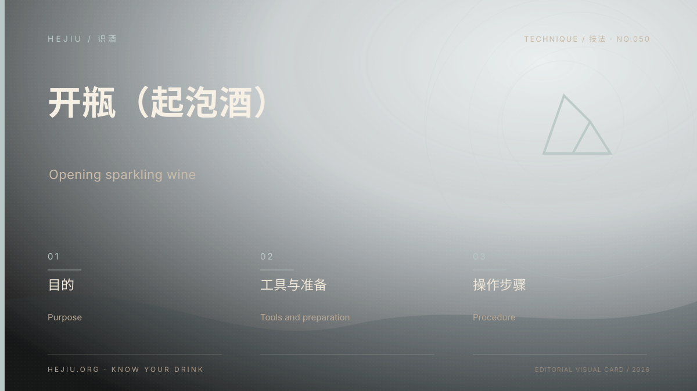

# Opening sparkling wine

A sparkling wine bottle is under noticeable pressure. Without control, the cork can fly out like a bullet and the wine can spray. The right approach is not to twist the cork off but to let the gas escape slowly, so the cork leaves the bottle inside your hand. The process should be safe, quiet and as gentle on the bubbles as possible.

Figure: thematic illustration for Opening sparkling wine. Image: AI-assisted illustration generated with Doubao Seedream 5.0 (project-owned); not a photograph of the subject.

## Purpose

First, safety. A flying cork can injure someone, especially the eyes and face; pointing the bottle the wrong way is the commonest cause of sparkling-wine accidents. Second, preserving bubbles and aroma. A violent opening releases carbon dioxide quickly and carries off aroma. Third, grace and occasion. A quiet opening suits a table and a celebration, and makes the following [pour](ref:pouring) easier.

## Tools and preparation

You need a deep ice bucket or refrigeration, a clean cloth and suitable sparkling-wine glasses. Chill the bottle thoroughly before opening; lower temperature reduces pressure and stabilises the bubbles. Sparkling wines are usually served cooler than reds; the exact range varies, and the aim is thorough chilling without freezing the wine.

The cloth dries the bottle, wraps the cork and helps control slipping. Keep fragile or easily knocked objects out of the way, stand firmly and point the bottle towards an empty, safe direction with no people or glass. Outdoors or in a tight space, check the surroundings first.

## Procedure

First, chill in advance or in an ice bath, with iced water covering most of the bottle; time depends on the starting temperature. Second, do not shake it after removing it; let it stand briefly so the bubbles settle. Third, dry the bottle with the cloth, especially near the neck, so hands do not slip.

Fourth, undo the foil and the wire cage. Keep one hand pressing lightly on the cork throughout so it cannot pop early. Fifth, tilt the bottle about forty-five degrees, hold the base with one hand and control the cork with the palm and thumb of the other. Sixth, turn the bottle slowly rather than the cork, so the cork edges out under pressure.

Seventh, as the cork is about to leave, press it with the palm so it releases with a whisper rather than a bang. Eighth, wipe the rim and let the bottle stand briefly before pouring, so the first glass is not all foam.

## Parameters and judgement

Temperature is the most important controllable parameter. Warmth raises pressure and bubble activity and makes control harder; cold keeps pressure steadier and bubbles finer. Do not freeze the wine just to make opening easy, and do not leave it at room temperature just for drama.

Angle and rotation decide safety. Tilt the bottle, point it away from people and turn the bottle rather than the cork so pressure releases evenly. The sound is a useful signal: a soft sigh indicates good control, while a loud bang means pressure was released too fast.

Bubble behaviour also shows whether the opening went well. The foam should be fine and moderate, fading quickly into a steady stream of small bubbles. Coarse, surging foam suggests the wine was too warm or the bottle was opened too violently.

## Failure cases

First, shaking the bottle. Shaking raises pressure and almost guarantees a spray. Second, pointing the bottle at people. Even without a flying cork, the jet of wine can injure eyes.

Third, pressing the cork with the thumb from the front. Control it from the side with palm and thumb; a frontal press takes the full force when the cork slips. Fourth, not chilling enough. A warm sparkling wine is more pressurised and lively, and much harder to control.

Fifth, cutting the cork with a sabre. The cinematic sabrage is a performance skill requiring training and should not be imitated at an ordinary table. Sixth, filling glasses immediately. Bubbles are most active just after opening; wait briefly for the foam to settle.

## Practice

First, practise with inexpensive sparkling wine. The goal is not speed but whether the cork can leave quietly without a spray. Second, practise hand position: tilt the bottle, wrap the palm around the cork and feel it move as the bottle turns.

Third, compare temperatures. Open the same wine well chilled and slightly warmer, and observe pressure, sound and foam. Fourth, rehearse the link to pouring: wipe the rim, pause, pour down the wall, in a fixed order.

Fifth, keep notes. Record the wine, temperature, sound and foam; over time you can judge whether your technique is stable. Do not attempt performance openings until you are confident.

## Relationship to other steps

Opening leads into [pouring](ref:pouring). Sparkling wine is poured differently: down the wall, in stages, never straight at the bottom, to keep the bubbles. If too much gas was lost at opening, no care at pouring can bring it back.

Opening also connects directly to [temperature](ref:temperature) management. A chilled bottle warms once out of the ice; pace opening and pouring accordingly. In a warm room, open earlier rather than waiting until the wine is too warm.

## Common misconceptions

First, the louder the pop, the more festive. A bang means pressure was released too fast and bubbles and aroma are lost.

Second, shaking before opening makes it livelier. Shaking only raises pressure and the risk of a spray.

Third, a cork that flies proves the wine has bubbles. Whether bubbles are fine and persistent depends on how the bottle is opened, not on how far the cork travels.

Fourth, every sparkling wine is opened the same way. Pressure, bottle shape and cork type all call for adjustments in force and angle.

Fifth, an opened sparkling wine keeps well. Bubbles decline after opening, so drink it soon.

**Short definition:** A serving technique for safely opening a pressurised sparkling wine; the essentials are thorough chilling, a steady bottle and hand control over the cork so gas escapes with a whisper rather than firing the cork across the room.

**Key facts.**

| Item | Detail |
| --- | --- |
| In one line | A serving technique for safely opening a pressurised sparkling wine; the essentials are thorough chilling, a steady bottle and hand control over the cork so gas escapes with a whisper rather than firing the cork across t… |
| Applies to | Sparkling wine |

**Sources and limits.** The key claims about Opening sparkling wine are checked against the following sources: Oxford University Press (Consulted for entries on sparkling wine, bottle pressure and service; Migrated from the former reference list at the end of the article; access date not re-verified), OIV (Used to check the definition and process framework for sparkling wine), Comité Interprofessionnel du Vin de Champagne (Consulted for public guidance on serving temperature and opening) and 5 sources in total. Prices, batches and status change; the body is project-written and does not reproduce source text.

## Further reading

- [Sparkling wine](ref:sparkling): types, pressure and service basics.
- [Dom Pérignon](ref:domperignon): one specific sparkling-wine example.
- [Ice and temperature](ref:temperature): how temperature shapes bubbles and aroma.
- [Pouring](ref:pouring): pouring sparkling wine and keeping the bubbles.
