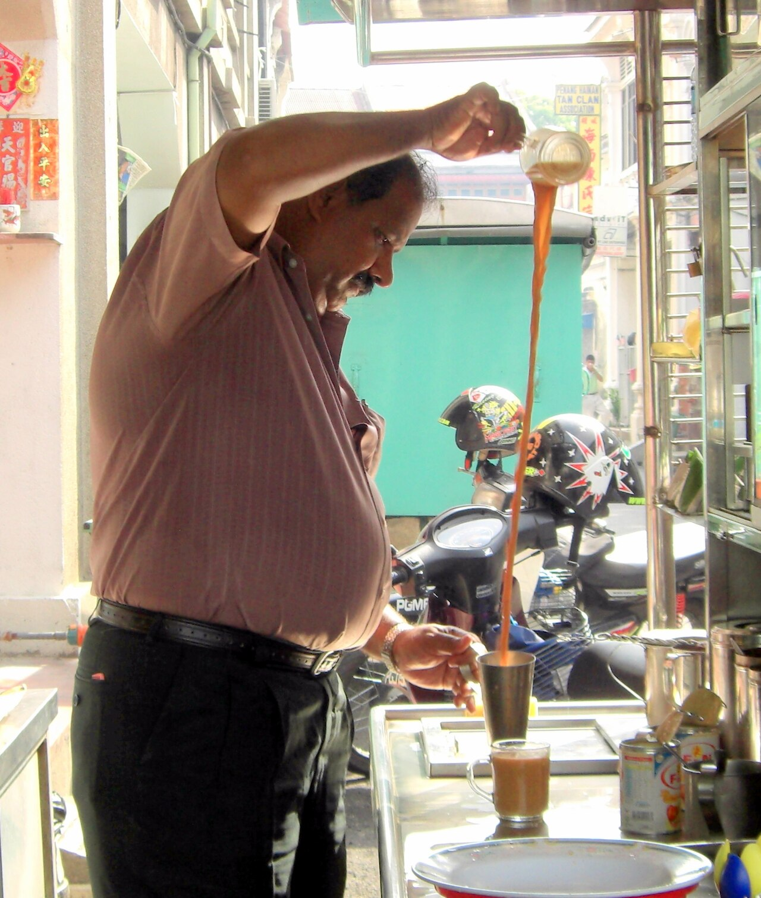

# Pouring

Pouring is the act of measuring wine from bottle to glass. It looks simple, yet it involves volume control, sediment management, bubble preservation and hygiene. Overfill the glass and aroma has nowhere to gather and swirling spills; pour too fast and sediment is stirred up and bubbles are broken. A good pour makes the colour, nose and palate that follow more accurate.

Figure: Pouring. Image: Cheng from Austin, US, CC BY-SA 2.0, via Wikimedia Commons ([source page](https://commons.wikimedia.org/wiki/File:Teh_tarik_man_pulling_tea.jpg)).

## Purpose

First, measure. The right amount per glass makes tasting practical and avoids waste. Second, protect the drink. A slow pour down the wall reduces impact, keeps sediment down and preserves bubbles. Third, hygiene. The bottle rim should not touch the glass rim, and nothing should run down the bottle afterwards.

Fourth, presentation. Pouring is part of service; a steady action and a clear order show the condition of the wine and make sharing easier.

## Tools and preparation

The basics are glasses, a napkin or cloth and, when needed, a decanter or pourer. The cloth wipes the rim and catches the last drop when the bottle is lifted; the decanter separates sediment; a pourer controls flow but also changes aroma release, so use it with a trade-off in mind.

Glass shape affects volume. A wide bowl with a narrowed rim gathers aroma and suits a small pour; a tall or straight glass distributes the same volume differently and may look fuller. When comparing wines, use the same shape and volume.

Before pouring, confirm that the rim is clean and the glass free of water stains and detergent. After opening, wipe the rim; if the wine has sediment, stand it upright beforehand and watch the shoulder while pouring.

## Procedure

First, stand steady and keep the bottle at a sensible distance from the table rather than high above it. Second, bring the bottle mouth close to the glass without touching it, usually starting at one side so the liquid runs down the wall.

Third, control the flow. Start a little faster, slow down near the target volume and avoid a sudden overshoot. Fourth, watch the level and stop at the intended point. Fifth, turn the bottle neck slightly as you lift it so the last drop returns to the rim, then wipe with the cloth.

Sixth, pour for others in order, usually guests before host or according to the host's arrangement. Seventh, set the bottle down steadily with the label facing where it can be read.

## Parameters and judgement

Volume varies by drink and occasion. Wine is usually poured to about one third of the glass, leaving room for aroma and swirling. Sparkling wine can take a little more but should be poured in stages to avoid overflow. Baijiu and spirits are often served in small cups, a little at a time, to keep the rhythm controlled.

Speed affects sediment and bubbles. Old wine and wine with sediment should be poured more slowly and stopped at the shoulder; sparkling wine should go down the wall in stages, never straight at the bottom. Temperature matters too: a warm sparkling wine foams more, so pour more slowly.

Volume also depends on purpose. A small pour is enough for colour and nose; for a meal, add in stages with the pace of eating rather than filling once. Treating a full glass as generosity usually costs aroma and experience.

## Failure cases

First, overfilling. With no space near the rim for aroma, swirling spills and lifting the glass becomes risky. Second, letting the bottle touch the glass rim. Dust and residue from the outside enter the glass, and it is unhygienic.

Third, pouring too fast. Liquid hits the bottom, sediment is stirred and bubbles in sparkling wine are broken. Fourth, lifting without turning. The last drop runs down the bottle and marks the bottle and table.

Fifth, shaking an old bottle before pouring. Sediment rises and earlier clarity checks and decanting are wasted. Sixth, filling a sparkling wine in one go. Foam rises and overflows, and there is no room to top up.

Seventh, using one volume for every drink. White, red, sparkling and baijiu have different glasses and rhythms; a single "fill it up" standard does not apply.

## Practice

First, practise with water and a measuring cup. Pour into different glasses and note the time and feel needed to reach one third or one half. Second, practise down the wall, watching for impact and splashing.

Third, practise lifting and turning so the last drop does not run down the bottle. Fourth, rehearse the staged pour for sparkling wine, first with water and then with a real bottle.

Fifth, keep notes in real service: drink, glass, volume and whether overflow or dripping occurred. The aim is consistency and repeatability, not performance.

## Relationship to other steps

Pouring follows [opening a cork-sealed bottle](ref:opening-cork) and [opening sparkling wine](ref:opening-sparkling), and prepares for [observing colour](ref:observing-colour) and nosing. The volume determines the surface area and how aroma gathers, and whether the rim colour can be seen.

When sediment must be separated, pouring and [decanting](ref:decanting) are continuous: watch the shoulder in the light, pour the clear liquid slowly into the decanter and stop as sediment approaches the neck. The steadier the pour, the better the decanting.

## Common misconceptions

First, a full glass looks generous. It compresses aroma and makes tasting and swirling difficult.

Second, faster pouring looks skilled. Speed and steadiness are different things; a slow pour down the wall is more professional.

Third, touching the rim is more convenient. Contact creates hygiene problems and makes it easier to knock the glass over.

Fourth, every drink gets the same volume. Sparkling wine, old wine and baijiu differ in glass, bubbles and sediment, so volume should be adjusted.

Fifth, there is no need to wipe after pouring. The last drop runs down the bottle, marks it and may reach the table.

[Wine](ref:wine) explains object; [Baijiu](ref:baijiu) adds key action. Put Pouring between them before deciding what it is.

**In brief:** A serving technique for measuring wine from bottle to glass; the aims are controlling volume, limiting disturbance of sediment, preserving bubbles and keeping the rim clean, not filling the glass to the top.

**Key facts.**

| Item | Detail |
| --- | --- |
| In one line | A serving technique for measuring wine from bottle to glass; the aims are controlling volume, limiting disturbance of sediment, preserving bubbles and keeping the rim clean, not filling the glass to the top. |
| Applies to | Wine、Sparkling wine、Baijiu |

## Further reading

- [Wine](ref:wine): the basic framework of wine service.
- [Sparkling wine](ref:sparkling): keeping bubbles and pouring in stages.
- [Baijiu](ref:baijiu): the rhythm of small cups and top-ups.
- [Choosing a glass](ref:glass): how shape affects volume and aroma.
- [Decanting](ref:decanting): the link between pouring and sediment separation.
- [Aroma](ref:aroma): how volume affects the gathering of aroma.
- [Observing colour](ref:observing-colour): the first observation after pouring.
