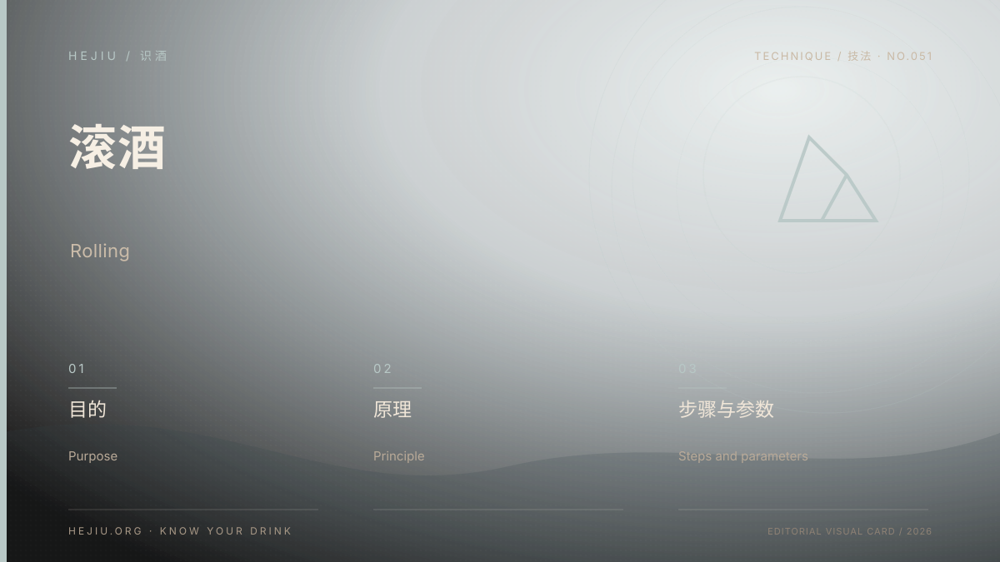

# Rolling

Rolling is a mixing technique in which a drink is poured back and forth between two vessels. It is neither shaking nor stirring: gravity carries the liquid through a transfer that mixes it, exposes it to air and cools it moderately. Rolling is not the most common technique at the bar, but when a recipe calls for it, the method usually corresponds to a specific texture goal.

Figure: thematic illustration for Rolling. Image: AI-assisted illustration generated with Doubao Seedream 5.0 (project-owned); not a photograph of the subject.

## Purpose

The first purpose is gentle mixing. Liquid flowing between vessels creates moderate turbulence, enough to bring ingredients of different density together without the violence of shaking.

The second is controlling aeration. Rolling sends the drink through a thin stream that meets the air, adding a little aeration without the thick foam that shaking can produce. For recipes that want a slightly softer texture without a heavy foam cap, this is a middle option.

The third is chilling and diluting when ice is present. If the recipe uses ice, the ice meets the liquid during the transfers and brings cooling and dilution, though usually more slowly than shaking. Whether ice is used, and how much, directly changes the finished drink.

The fourth is presentation. Pouring the drink back into the glass from a height has a sense of movement, but rolling is primarily a mixing technique and should not be used only for show.

## Principle

The mixing power of rolling comes from gravity and flow. As liquid falls from one vessel into the other it forms a stream and an impact that create shear and disturbance; repeated transfers gradually even out the mixture. Compared with shaking, rolling exerts less shear, introduces fewer bubbles and barely changes the pressure inside the vessel.

Compared with stirring, rolling aerates more. Stirring mainly moves liquid around the ice and the bar spoon, with limited contact with air; rolling exposes a thin stream to air repeatedly and therefore adds a slight aerated feel. Both are gentle, but the results differ.

Dilution depends on ice. With ice, every transfer brings the liquid into contact with melting ice; more transfers and smaller ice mean faster dilution. Without ice, rolling mainly mixes and aerates and brings no significant cooling.

## Steps and parameters

First, prepare two clean, stable vessels. A common pairing is one end of a shaker and the other, or a shaker and a mixing glass; pouring directly between two glass glasses is not recommended, because impact and temperature change can break the glass.

Second, put the ingredients into one vessel as the recipe directs. If ice is called for, add it now; if not, use only liquid.

Third, bring the vessels close, keep a steady height difference and pour slowly and continuously into the other vessel. Too high a pour splashes and adds too much air; too low a pour mixes poorly.

Fourth, pour back into the first vessel and repeat. The number of transfers should follow the recipe or the target texture; there is no universal count, and if a recipe gives a number or a description, follow it.

Fifth, finish with the drink in its final vessel, strain if needed, then garnish and serve as the recipe directs.

Sixth, wash both vessels immediately. Residue from sugar, cream or juice dries on and affects the next use.

There are no general values for height, flow rate or number of transfers. They depend on vessel shape, viscosity, whether ice is used and the goal of the recipe; treating one set of numbers as standard is likely to produce a drink that does not match the recipe.

## Where it applies and alternatives

Rolling suits drinks whose recipes specifically call for it, and situations that need gentle mixing, light aeration and no thick foam. Some recipes focused on aroma or a fine texture use it so that the drink integrates without being violently agitated.

It does not suit recipes that need fast chilling and noticeable dilution; shaking is more efficient on both counts. Nor does it suit ingredients with a lot of pulp or fat that need emulsifying, because the shear of rolling is not enough to break them up.

Alternatives include [stirring](ref:stirring) when less aeration is wanted, [shaking](ref:shaking) when faster chilling, more dilution or foam is wanted, and gentle stirring with a bar spoon when mixing is all that matters and a little gas is acceptable. The choice depends on the texture the recipe wants, not on which technique looks more advanced.

It is important to distinguish rolling a drink from rolling citrus. Rolling a whole citrus fruit on the counter and pressing it lightly softens the peel and flesh before juicing; that is a preparation action, not this technique. The words may overlap in casual use, but the object and the purpose are different.

## Common failure points

First, pouring between two glass glasses. Impact, temperature difference and stress can break them, so use a metal shaker or a dedicated vessel.

Second, pouring too high. The drink splashes, the surface gets dirty and too much air enters.

Third, pouring too slowly. Liquid runs down the wall, mixing is poor, and many transfers still leave the drink uneven.

Fourth, unstable vessels. A slip or a wobbling table spills the drink and can knock over the ice.

Fifth, using hot liquid. Hot liquid creates steam and pressure in a sealed or partly sealed vessel, and transfer can cause burns.

Sixth, too many transfers. With ice, the drink becomes over-diluted and aroma is dispersed by excess aeration.

Seventh, dirty vessels. Leftover juice and sugar bring off-flavours and can clog a strainer.

Eighth, treating rolling as a substitute for shaking. The two differ clearly in chilling speed, dilution and foam and cannot be swapped at will.

## Practice

Start with water. Pour from one metal shaker into another at a steady height, watch whether the stream is continuous and whether it splashes, then pour back and build a fixed rhythm.

Next add ice to the water and watch how the cubes move and how the clarity changes. Practise controlling height and speed so that the ice travels inside the vessel rather than flying out.

Finally, practise with a real recipe and compare rolling against shaking and stirring. Record aroma, foam, temperature and dilution to build your own judgement. Work over a sink or a tray to make cleaning easier.

## Common misconceptions

First, "rolling is just shaking". There is no hard shake, so pressure and foam are lower and chilling is slower.

Second, "rolling needs no ice". Whether ice is used is decided by the recipe; only with ice is there noticeable chilling and dilution.

Third, "any two glasses can be used". Pouring between glass glasses carries a risk of breakage; choose stable, impact-resistant vessels.

Fourth, "the longer you roll the better". Over-rolling over-dilutes recipes with ice and disperses aroma.

Fifth, "rolling replaces stirring". Both are gentle, but aeration and method differ, and the recipe should decide.

Sixth, "rolling is only for show". It genuinely changes mixing and aeration and is not merely a performance move.

## See also

- [Stirring](ref:stirring): a gentler method with less aeration.
- [Shaking](ref:shaking): a faster method with more chilling, dilution and foam.
- [Cocktail shaker](ref:shaker): one of the vessels commonly used for rolling.
- [Mixing glass](ref:mixing): another usable vessel and stirring context.
- [Cocktail basics](ref:basics): where mixing methods sit in the overall process.
