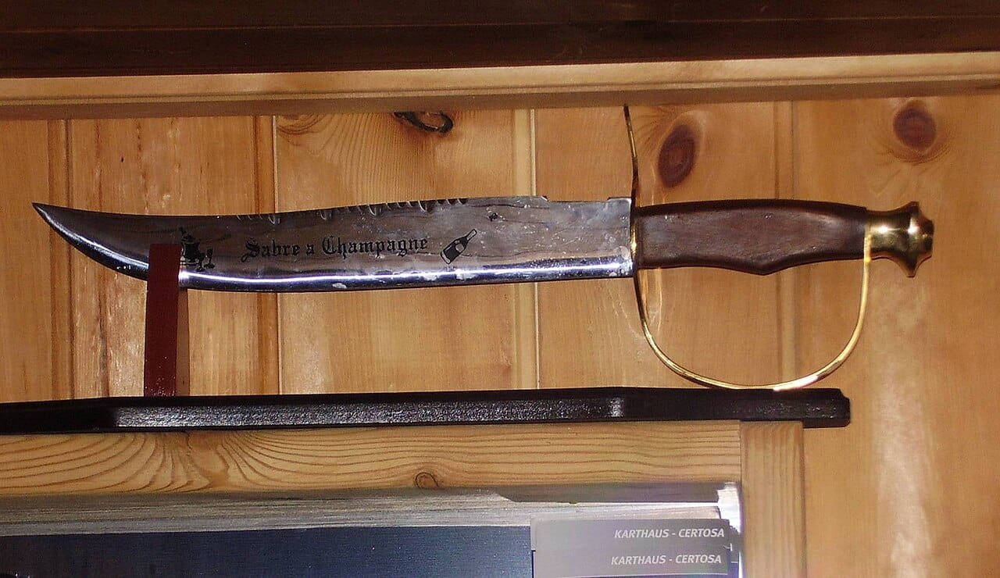

# Sabrage

Sabrage opens a Champagne bottle with a sabre or a purpose-made Champagne blade, sliding it along the bottle's seam so the neck ring and cork fly off under the bottle's own pressure. It is not a chop but a slide: the back of the blade travels fast along the seam and strikes the rim, the glass ring cracks and the pressure pushes the cork out.

The move is theatrical and risky. Bottle pressure is high and the neck leaves fast; a poor strike can send glass, cork and wine into the room. It suits trained hands that can control the bottle and the direction, not a crowded room or an unprotected attempt.

Figure: A Champagne sabre. Image: Slartibartfass, CC BY 3.0, via Wikimedia Commons ([source page](https://commons.wikimedia.org/wiki/File:Champagners%C3%A4bel_Bellavista.jpg)).

## Pressure and the seam

Champagne pressure is several times atmospheric, and the cork is held by wire and the bottle's neck structure. The sabre passes along the seam and strikes the rim, cracking the glass ring; the crack runs, the ring breaks and the cork and ring leave under pressure.

The seam is one of the weakest lines in the bottle. At the join between ring and body the glass thickness changes and stress concentrates; a strike along the seam lets the crack follow the structure instead of shattering the bottle. The back of the blade is safer than the edge because it does not cut, only transfers impact.

Temperature changes pressure. The warmer the bottle, the higher the pressure and the more violent the opening; the colder, the lower the pressure and the safer the move. Sabrage calls for a well-chilled bottle, for safety and for steadier bubbles.

## History and legend

There are several origin stories, the best known being a Napoleonic cavalry tale of opening bottles with a sabre from the saddle to celebrate a victory. The story is hard to verify, but it made sabrage a sign of celebration and ritual.

In the nineteenth century, as Champagne spread through banquets and festivities, sabrage moved from military tale to party performance. Today Champagne bodies and producers stress safety and method: chilling, a steady hold, direction and distance, not "the harder the better".

Legend aside, the move is physics. Understanding pressure, the seam and temperature matters more than the story; without those conditions, sabrage is only a dangerous performance.

## Where it suits

Sabrage suits celebrations, weddings, launches and outdoor events, and trained sommeliers performing. It needs space, light and a safety distance; it does not suit a crowded room, a low ceiling or a table close to guests.

It only suits Champagne and some sparkling bottles. The Champagne bottle's glass thickness and shape are designed for internal pressure; ordinary sparkling bottles may not be, especially thin-walled ones. Never sabre a still wine bottle. For sparkling wine, see [sparkling wine](ref:bubbly); for temperature, see [ice and temperature](ref:ice).

It is not a replacement for normal opening. For everyday drinking, thumb control and a slow bottle turn are safer and quieter; sabrage is theatre, not necessity. For the standard method, see [opening sparkling wine](ref:opening).

## The move and safety

First, chill. The bottle should be well cooled in a bucket, low pressure; not straight from the fridge and never shaken.

Second, dry it. Wipe off water and ice so the hand does not slip; the rim and seam should be clean of capsule residue.

Third, find the seam. Most bottles have a vertical seam where it meets the neck ring; the back of the blade travels along that line toward the rim.

Fourth, hold steady. Grip the base, tilt the bottle about 30 to 45 degrees and point the neck at open space, away from people, lights and windows; never at a face, a lamp or a window.

Fifth, slide. Run the back of the blade fast and decisively along the seam into the rim; do not hesitate and do not chop. When the ring leaves, steady the bottle at once so the wine does not spray.

## Risk and protection

Glass is the main risk. When the ring breaks, small fragments can fly; the operator and onlookers should wear eye protection and stand at least an arm's length away.

Cork and ring leave fast and the direction is not fully controllable; point the neck at open space, away from people, pets and fragile objects. Indoors, check ceiling height and clearance.

Spraying wine can also cause slips and mess. Wipe the rim with a cloth before pouring; do not aim at a glass at once, since pressure can still spray.

## Common mistakes

First, using the edge. The edge cuts glass and makes more fragments; sabrage uses the back of the blade and impact, not cutting.

Second, a bottle that is not cold enough. Higher temperature means higher pressure, a more violent opening and fragments that travel farther; chill it properly.

Third, pointing at people. The direction of the flying neck is not fully controllable; aim at open space and have onlookers wear eye protection.

Fourth, treating it as everyday opening. Sabrage is theatre with risk; for daily drinking use thumb control and a slow bottle turn. For Champagne, see [Champagne](ref:champagne); for the flute, see [Champagne flute](ref:flute).

For Sabrage, begin with the timing and temperature, then the equipment, and finish with the scale it is practised at; that order keeps the account grounded.

Setting [Opening sparkling wine](ref:opening)'s object beside [Champagne flute](ref:flute)'s key action makes the boundary between them visible.

**At a glance:** Opening a Champagne bottle by sliding a sabre along the bottle's seam so the neck ring and cork fly off under pressure. It needs a cold bottle, a steady hold and a safe direction. 

The entry on Sabrage draws on Oxford University Press, Encyclopaedia Britannica, Comité Interprofessionnel du vin de Champagne, Corning Museum of Glass.

The sabre should slide along the seam, not strike the neck; a cold bottle and a safe direction matter more than force, and the neck ring can fly several metres.

Practice with an empty bottle first, and never point the neck at anyone.

**Key facts.**

| Item | Detail |
| --- | --- |
| In one line | Opening a Champagne bottle by sliding a sabre along the bottle's seam so the neck ring and cork fly off under pressure. It needs a cold bottle, a steady hold and a safe direction. |
| Applies to | Sparkling wine、Champagne flute、Champagne |

**Sources and limits.** The key claims about Sabrage are checked against the following sources: Oxford University Press (Used to check sabrage history and method), Encyclopaedia Britannica (Used to check Champagne production and bottle pressure), Comité Interprofessionnel du vin de Champagne (Used to check Champagne service and opening advice) and 5 sources in total. Prices, batches and status change; the body is project-written and does not reproduce source text.

For Sabrage, this technique was last checked in 2026; prices, batches and availability change, so confirm them against the sources below.
