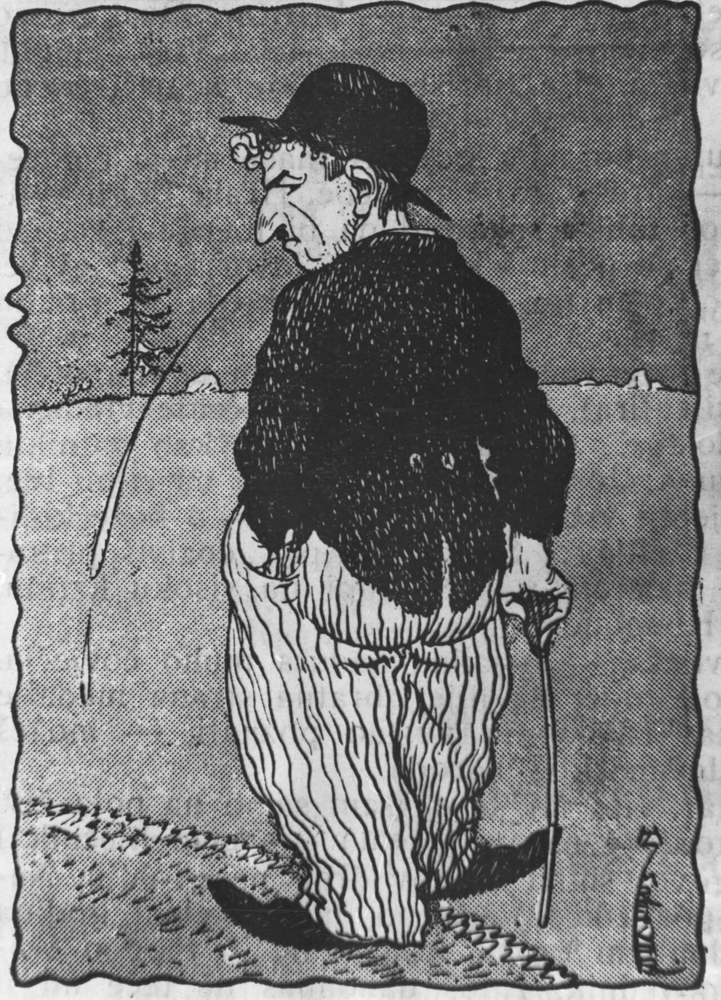

# Spitting

Spitting is a basic professional tasting action: hold the liquid in the mouth, let it contact the tongue and palate, then spit it into a spittoon. The point is not to reject the drink but to complete an assessment without consuming much alcohol. At trade fairs, judging sessions, producer tastings and sommelier exams, spitting is standard practice.

Figure: Spitting. Image: Hinko Smrekar, Public domain, via Wikimedia Commons ([source page](https://commons.wikimedia.org/wiki/File:Hinko_Smrekar_-_Avtoportret_kot_Charlie_Chaplin.jpg)).

## Purpose

The first purpose is staying clear-headed. When tasting fifteen or several dozen wines, even small sips accumulate and affect judgement and safety. The second is protecting the senses. Alcohol dulls taste and smell and dries the mouth; spitting reduces that interference.

The third is controlling intake. Tasting is about gathering information, not drinking. The fourth is courtesy and professionalism. In a professional setting, spitting signals that you are evaluating seriously rather than drinking; it also respects the people around you.

Spitting is not waste. The amount used for tasting is already small, and the spit portion does not change the cost for the producer or host. The real waste to avoid is opening a bottle and leaving it to oxidise.

## Equipment and setting

The essential tool is a spittoon. Common spittoons have a funnel-like opening and a large body, sometimes with a lid or splash guard to reduce spray and smell. Place it within reach and slightly below mouth level so you do not need to bend or tilt your head.

You also need tissues or cloth, water and a way to record. Tissues wipe the glass rim and the corners of the mouth; water rinses between wines, though a large rinse each time is unnecessary and may dilute the next wine. The room should be ventilated and the spittoon emptied regularly so odour does not build up.

At home, a lidded bucket, a wide container or a sink can serve. What matters is that the container is deep, wide, stable and unlikely to splash clothing or the table.

## Procedure

First, take a small sip as in [sipping](ref:sipping), about five to ten millilitres, and let it spread through the mouth for two to three seconds. Do not rush the contact just because you plan to spit; too short a time misses the middle palate.

Second, lower your head slightly, bring the lips near the spittoon and keep the upper body stable. Third, spit with a short, controlled force so the liquid lands in the container rather than sprays. Fourth, wipe the corners of the mouth with a tissue.

Fifth, rinse with a little water if needed and spit that into the spittoon too. Sixth, record immediately. After spitting, the finish still lingers in the mouth and nose, and this is the moment to judge [finish](ref:finish); do not rinse everything away at once.

## Parameters and rhythm

Sip size determines whether contact is sufficient and how easy spitting will be. Too little does not cover the mouth; too much risks choking or splashing. Five to ten millilitres is common, and less for spirits.

Spitting frequency should match the tasting rhythm. For each wine: nose, sip, spit, record, as a fixed loop. Spitting quickly without recording blends the impressions of different wines together.

Estimate alcohol intake rather than relying on feeling. A ten-millilitre sip of a twelve-percent drink contains about 1.2 millilitres of pure alcohol; even when most is spat, the oral mucosa absorbs a small amount. Over many wines, schedule rests, drink water and do not drive. Spitting is not a reason to drive.

## Failure cases

First, spitting only half. Liquid remains at the back of the mouth and is swallowed by reflex, affecting judgement and increasing intake. Second, placing the spittoon too high or too far. Tilting the head or leaning forward to aim can cause choking or splashing.

Third, spitting too hard. Liquid rebounds from the container and may hit clothing, the table or other people. Fourth, spitting into your own glass or water glass. This contaminates equipment and distorts later wines.

Fifth, rinsing heavily right after spitting. Water washes away the finish and you miss judging its length. Sixth, sharing a spittoon without care. The rim should not touch the lips; keep distance and use a guard if needed.

Seventh, treating spitting as a substitute for a breath test. Spitting reduces intake but is not zero intake; after a session, confirm your condition before deciding to drive.

## Practice

First, practise with water. Use water instead of wine to rehearse the path and force from mouth to container, checking that nothing splashes and you do not choke. Second, practise in front of a mirror and watch head, shoulders and hands for stability.

Third, practise rhythm. Prepare three to five different drinks and complete one round in the fixed order of nose, sip, spit, record, noting the finish time for each. Fourth, practise placement. Put the spittoon at different heights and distances to find the position where you are most stable and least likely to splash.

The aim is muscle memory, so spitting becomes automatic and attention stays on the senses.

## Relationship to other steps

Spitting follows [sipping](ref:sipping) but does not end the tasting. After spitting, aroma and finish continue in the nose and mouth, so record immediately. Treating the spit as the end of the process misses the finish.

Spitting also shapes how a tasting is organised. For many wines or high-alcohol drinks, provide enough spittoons, tissues and water, and arrange seating and movement so people do not interfere with each other. A host who treats spitting as rude often pushes guests into excessive intake and lowers the quality of the tasting.

## Common misconceptions

First, spitting means disrespecting the drink. In professional tasting it is standard and unrelated to liking the wine.

Second, spitting means you have not really tasted it. Aroma, texture and finish are all registered before the spit, so most sensory assessment is unaffected.

Third, spitting means no alcohol intake. The oral mucosa still absorbs some, so do not drive immediately after a session.

Fourth, you can spit anywhere. Container, position and hygiene all affect safety and experience, so set up in advance.

Fifth, faster spitting is more professional. Rushing misses the middle palate and makes notes coarse.

**In brief:** A professional tasting technique in which liquid is held in the mouth and then spat out; the aim is to stay clear-headed, limit alcohol intake and taste many drinks in sequence, not to express dislike or waste the product.

## Further reading

- [Sipping](ref:sipping): the mouth contact before spitting.
- [Finish](ref:finish): the dimension still judged after spitting.
- [Alcohol by volume](ref:abv): understanding intake and strength.
- [Wine](ref:wine): the basic professional tasting sequence.
- [Baijiu](ref:baijiu): small cups and spitting habits in baijiu tasting.
- [First tasting](ref:tasting): the complete beginner sequence from colour to spit.
