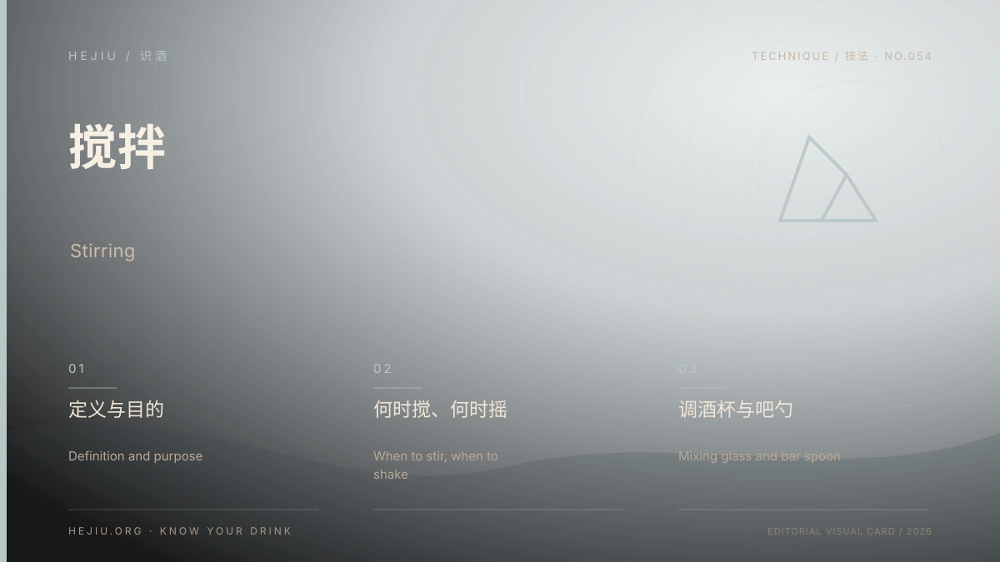

# Stirring

Stirring is the technique of putting ingredients and ice into a mixing glass and moving them steadily with a bar spoon. It does three things: chills, dilutes moderately and mixes. Compared with [shaking](ref:shaking), stirring brings in less air and fewer ice shards, so the drink stays clearer and the aroma finer, which suits short drinks built mainly on spirits.

Figure: thematic illustration for Stirring. Image: AI-assisted illustration generated with Doubao Seedream 5.0 (project-owned); not a photograph of the subject.

## Definition and purpose

The core purpose of stirring is to mix different ingredients evenly at a low temperature while adding only a controlled amount of dilution. Gin, vermouth and bitters are close in density and viscosity, so stirring is enough to bring them together; they do not need the violent agitation that juice or syrup requires.

Stirring is not about "as cold as possible" but about "cold enough, diluted correctly". Colder takes longer and adds more dilution; not cold enough leaves the aroma closed and the entry sharp. The aim is a stable, repeatable balance point, not a fixed number of seconds.

At home, without a mixing glass, use a thick-walled straight glass large enough for both ice and a bar spoon to move. A rim that is too narrow makes stirring awkward, and a wall that is too thin transfers heat and may crack on impact.

## When to stir, when to shake

The test is usually the ingredients and the target texture. Recipes built on spirits, bitters and vermouth are normally stirred; recipes with citrus juice, syrup, egg white, cream or fruit purée normally need shaking. The first aims for clarity and a fine aroma, the second for full mixing and aeration.

Take the [Dry Martini](ref:martini): the public IBA recipe stirs it over ice and strains it into a chilled glass. Shaking would give a similar structure but with more dilution, a looser texture and a more scattered aroma. The [Old Fashioned recipe](ref:old-fashioned) instead stirs in the serving glass and is never strained, which is another way of building a drink. The choice of technique changes the result, and the recipe page should state which one applies.

## Mixing glass and bar spoon

A common mixing glass is a straight glass or metal vessel large enough to hold the ingredients and plenty of ice. Glass lets you watch colour and dilution, while metal chills faster. Either way, chill it first or at least rinse it clean so no stray smell remains.

The [bar spoon](ref:spoon) is the main tool: a long thin handle makes it easy to move along the wall of the glass, and a small bowl makes the motion easy to control. Hold the spoon around the upper middle of the handle and let the bowl travel between the ice cubes rather than sending them flying.

## Basic motion

The basic stance: hold the glass with one hand, hold the bar spoon with the other, put the bowl between the ice cubes and make a steady circular movement along the wall. Keep the motion small; too wide and the ice knocks about and melts faster, too narrow and the mixture does not combine evenly.

Stirring usually takes some ten to twenty-five seconds, depending on the amount and shape of the ice, how cold the glass is and the target dilution. A common signal is that the outside of the glass feels clearly cold and condensation appears. Strain as soon as stirring ends so the drink does not keep sitting in melt water.

## Ice and dilution

Ice is a working part of stirring, not just a cooling medium. It melts as you stir, adding dilution and changing the final [alcohol by volume](ref:abv) and texture. Large, dry ice melts slowly and makes dilution controllable; crushed or wet ice chills fast but dilutes fast too.

If the recipe calls for higher strength, stir for less time or use larger ice; for a softer texture, stir a little longer. Dilution is not a mistake but part of the recipe design, and the key is whether it can be repeated. Ice quality matters too: ice with off-flavours, cloudiness or a tendency to melt fast gives the drink stray tastes. For more on ice shapes, see [ice and temperature](ref:ice).

## Straining and serving

A stirred drink is strained after stirring. The usual approach is a strainer or a fine mesh, straining the liquid into a pre-chilled glass or one already holding ice. Strain quickly so the drink does not linger in the strainer, and keep the strainer and mesh clean so no smell carries over.

Straining into a glass that already holds ice (a rocks glass, for example) keeps chilling the drink but also keeps diluting it; straining into an empty glass (a martini glass, for example) holds the temperature more steadily but warms faster. The two styles suit different paces of drinking, and the recipe should say which one it means.

Without a strainer, a fine mesh or a clean tea strainer will do, but do not press the ice hard or shards will fall into the glass. Rinse the mesh right after use; leftover liquid and sugar attract dust and insects.

## Common failures

First, too little ice. Not enough chilling, uncontrolled dilution and a drink that is too strong with closed aroma. Second, stirring too widely. Hard agitation only melts the ice faster and makes dilution unpredictable. Third, stirring too briefly. The glass is not cold enough and the entry feels sharp.

Fourth, not straining promptly. The ice keeps melting and the body thins. Fifth, a dirty mixing glass. Leftover juice or detergent contaminates the drink. Sixth, stirring everything. Recipes with juice, syrup or egg white do not mix fully by stirring.

## Cleaning and hygiene

Rinse the mixing glass and bar spoon immediately after use so syrup and juice do not dry and set. With glass, watch the residue where the base meets the wall; with metal, watch scratches on the inner surface. Leave them to dry so no smell remains.

Bar hygiene directly affects drink safety. Wash the bar spoon, strainer and mixing glass separately; tools that have touched raw egg or cream need thorough cleaning. Technique is part of flavour, hygiene is the floor, and neither replaces the other.

Stirring is best approached through the timing and temperature, then the equipment, and then the scale it is practised at. One check alone will not settle it.

**In brief:** A bartending technique in which ingredients and ice go into a mixing glass and are stirred steadily with a bar spoon, chilling, lightly diluting and mixing the drink; compared with shaking, stirring adds less air and keeps the drink clearer. 

## Further reading

- [Bar spoon](ref:spoon): spoon shapes, grip and points of use.
- [Dry Martini](ref:martini): an example of a stirred classic cocktail.
- [Dry Martini recipe](ref:recipe): executable quantities, steps and equipment.
- [Old Fashioned recipe](ref:old-fashioned): building and stirring in the glass as another approach.
- [Alcohol by volume](ref:abv): understanding dilution from stirring and the strength of the finished drink.
