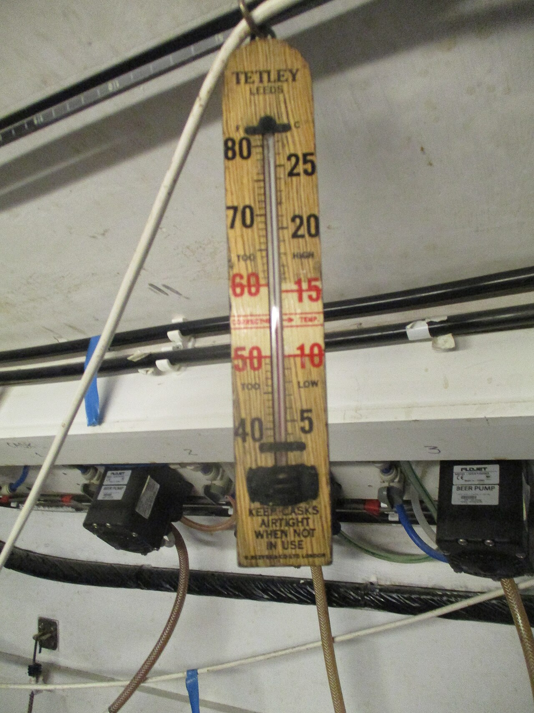

# Temperature Control

Temperature control uses refrigeration, ice buckets, room warming and storage management to bring a drink to its serving temperature. It is not "as cold as possible" or "room temperature", but the temperature the drink needs, held as steady as possible.

Temperature shapes aroma, bubbles, texture and fermentation. Too cold and aroma is muted; too warm and alcohol rises and the body goes loose; large swings make the bottle expand and contract and stress both cork and wine.

Figure: A cellar thermometer. Image: Mtaylor848, CC BY-SA 4.0, via Wikimedia Commons ([source page](https://commons.wikimedia.org/wiki/File:Tetley%27s_thermometer,_cellar,_New_Inn,_Wetherby_(4th_December_2022).jpg)).

## Principle and variables

The core is heat transfer. Air conducts slowly, water quickly and metal faster still; a bucket beats a fridge and a metal cup beats glass. Choose the medium before choosing the time.

Room, bottle and liquid temperature are not the same. The wall follows the room, the liquid follows the wall and time; an infrared reading of the bottle is a guide, while a probe is needed for the liquid.

The rate of change matters too. A sudden chill stresses glass, a sudden warmth raises bottle pressure; control should be slow and steady, not extreme. For measurement, see [thermometer](ref:thermometer).

## Serving ranges

Sparkling wine is usually 6 to 8 degrees Celsius, where the cold holds the bubbles and keeps acidity fresh; white wine 8 to 12, lighter whites lower and fuller whites higher; rosé 8 to 12.

Red wine is usually 14 to 18 degrees Celsius, lighter reds lower and fuller reds higher; sweet wine 6 to 10, where the cold balances sweetness; spirits are usually room temperature or slightly below, depending on style.

These are ranges, not verdicts. The same wine at a different age, glass or occasion may want a different temperature; start with the range and adjust by taste. For ice, see [ice and temperature](ref:ice).

## Cooling

An ice bucket is the fastest method. An ice-water mix, with water covering the wine, brings a bottle to range in 15 to 30 minutes; it suits sparkling, white and red that needs a quick cool. For the bucket, see [ice bucket](ref:bucket).

A fridge suits long storage and slow chilling. It is stable but slow; a white wine may take 1 to 2 hours to come down from room temperature. Do not keep wine on the door, where the temperature swings.

A freezer is not for quick chilling. It stresses glass and can freeze the cork and expand the liquid; use it only in an emergency. Cooling should be gradual, not extreme.

## Warming

Room warming is the safest. Take the bottle out of the fridge and leave it 20 to 40 minutes to return to range; a red from a cool cellar often needs the same.

Cupping the glass in the hand is a fast warm. Hand heat passes through the wall and softens the wine; it also concentrates aroma, which suits tasting rather than volume service. Never run hot water over the bottle, which can crack the glass.

A warm-water bath speeds warming. Stand the bottle in water no hotter than 30 degrees Celsius and let the heat pass slowly; the water must not be so deep that the cork soaks. Never use a microwave or a kettle.

## Storage temperature

Storage should be stable. A cellar or wine fridge usually sits at 12 to 14 degrees Celsius and 60% to 70% humidity; swings damage wine more than a single number. Warm storage ages wine faster, cool storage slower.

Swings make the cork expand and contract, letting air in and oxidising the wine; low humidity dries the cork, high humidity moulds the label. Store away from light, vibration and odour.

Long and short storage differ. Use a fridge or cellar for the long term; a domestic fridge is fine for a few days; an open bottle should be chilled and finished quickly. For aroma, see [aroma](ref:aroma).

Temperature matters because it changes molecular motion. Warmer liquid releases aroma faster and alcohol rises more sharply; colder liquid slows the molecules, locks the aroma and tightens the palate. Not every aroma peaks at the same temperature, which is why serving temperature is wine-specific. The same principle explains why a cold glass warms slowly at first and then quickly as the room takes over.

Temperature also shifts sweetness and acidity. Cold makes sweetness less obvious and acidity fresher; warmth makes sweetness more obvious and acidity softer. Sweet wine is served cold to balance sugar, white wine cold to keep acidity fresh, red wine warmer to open tannin and aroma.

Bubbles respond too. Carbon dioxide dissolves better when cold, so the bubbles are finer and last longer; warmth lets gas escape and the drink goes flat. That is why sparkling wine is chilled rather than served at room temperature.

## Common mistakes

First, chilling every wine. A long chill mutes red aroma, and white is not better the colder it gets.

Second, using the freezer for a quick chill. Sudden cold stresses glass and can freeze the cork; cool slowly.

Third, ignoring temperature swings. Repeated change damages wine more than a steady number; storage must be stable.

Fourth, judging by hand. Touch is imprecise and inconsistent; a thermometer is more reliable than "it feels cold". For fermentation temperature, see [fermentation](ref:fermentation); for wine, see [wine](ref:wine).

**At a glance:** Using refrigeration, ice buckets, room warming and storage management to bring a drink to its serving temperature. Temperature shapes aroma, bubbles, texture and fermentation, and stability matters more than a single number. 

Begin with the timing and temperature, move on to the equipment, and finish with the scale it is practised at. That order keeps the reading of Temperature Control practical.

A common mistake is to treat Temperature Control as a tool. Start with what it is, then check what the label says. If they conflict, trust the more specific source.

Sources for Temperature Control include Oxford University Press, Encyclopaedia Britannica, Comité Interprofessionnel du vin de Champagne, National Institute of Standards and Technology.

A probe thermometer beats guessing; sparkling wine is best at 6–8 °C, light whites at 8–10 °C, and reds at 16–18 °C.

A thermometer in the fridge and a quick ice-water bath are more reliable than a fixed timer.

**Key facts.**

| Item | Detail |
| --- | --- |
| In one line | Using refrigeration, ice buckets, room warming and storage management to bring a drink to its serving temperature. Temperature shapes aroma, bubbles, texture and fermentation, and stability matters more than a single num… |
| Applies to | Wine |

**Sources and limits.** The key claims about Temperature Control are checked against the following sources: Oxford University Press (Used to check drinks temperature and service background), Encyclopaedia Britannica (Used to check wine temperature and fermentation background), Comité Interprofessionnel du vin de Champagne (Used to check sparkling wine service temperature and advice) and 5 sources in total. Prices, batches and status change; the body is project-written and does not reproduce source text.

For Temperature Control, this page was last checked in 2026; prices, batches and availability change, so confirm them against the sources below.
