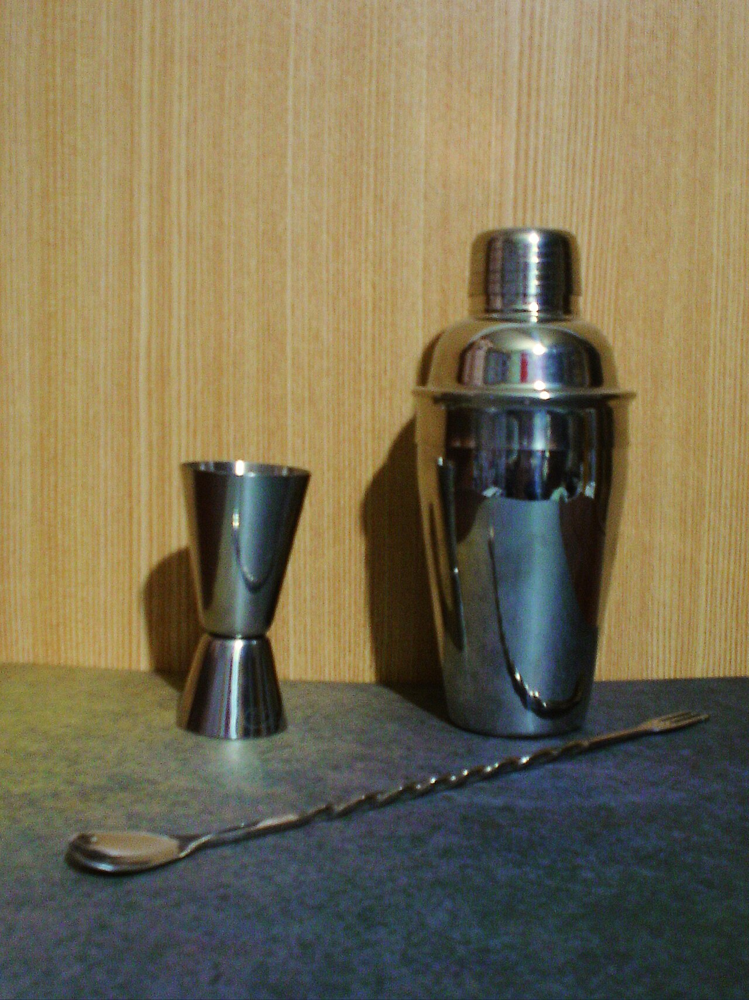

# Bar spoon

A bar spoon is a long-handled spoon used in bartending: the bowl end measures small volumes, the shaft stirs, and the spiral section helps the fingers control the spoon and guide a pour. It looks simple but is a basic tool for stirred cocktails; length, weight and bowl capacity affect both efficiency and the finished texture.

Figure: Bar spoon. Image: Wikimedia Commons contributor, CC BY-SA 3.0, via Wikimedia Commons ([source page](https://commons.wikimedia.org/wiki/File:Cocktail_shaker_set.JPG)).

## Definition and form

Bar spoons are usually made of stainless steel and range from 25 cm to 40 cm in length. Bowl capacity is commonly about 5 ml, with smaller and larger versions also available. The middle of the shaft often has a spiral that adds grip and lets the fingers slide along it while stirring.

There are also versions with a fork end or a spring end for picking up garnishes or straining. Different forms serve different actions, but the core functions remain stirring and guiding. Selection should start with whether the length suits the common glass and mixing vessel, not appearance alone.

## Size and capacity

Length determines whether the spoon can reach the bottom of a tall glass or mixing glass and affects hand position while stirring. Too short and it cannot reach the bottom of a tall glass, so stirring is incomplete; too long and it is hard to control in a shallow glass and may knock the rim. A working bar keeps different lengths for different glassware.

Bowl capacity affects measuring accuracy. When measuring by spoon, confirm the actual capacity rather than estimating "one spoon". Small amounts of syrup, bitters or lemon juice can be measured more consistently with a spoon, but professional service still favours a jigger or scale.

## Stirring motion

The purpose of stirring is to chill, dilute and mix evenly while keeping the drink as clear as possible. The basic motion is to insert the spoon into a mixing glass with ice, keep the back of the spoon near the wall, and turn gently with the fingers along the spiral so the ice and liquid move slowly. The motion should be steady and continuous, not vigorous.

Stirring time depends on ice size, liquid temperature and target dilution. Frost on the glass and a clearly cold hand are common signals. After stirring, strain through a strainer into a chilled glass so the ice does not keep melting. Motion and timing decide the drink more than the tool does. For consistency, record the number of turns or the time and compare under the same ice conditions.

## Contrast with shaking

Stirring and [shaking](ref:shaking) are different techniques. Shaking adds more aeration and dilution through vigorous movement and suits recipes with juice, egg white or cream; stirring is gentler and suits recipes based on spirits, bitters and vermouth, keeping the drink clear with delicate aroma.

The IBA recipe for [Negroni](ref:negroni) stirs with ice and strains into a rocks glass over ice. Using a shaker instead would give more dilution and a looser body. The bar spoon and the [cocktail shaker](ref:shaker) are not substitutes but tools for different recipe goals.

## Other uses

A bar spoon can also guide a pour. Holding the back of the spoon near the glass wall lets liquid flow down the spoon, reducing impact and mixing, which is common for layered cocktails or drinks that need a slow pour. The bowl can also measure small volumes, pick up small garnishes or adjust the ice in the glass.

In layered drinks the guiding role is especially clear: liquid flows slowly down the spoon and differences in density are preserved, creating visible layers. This takes patience and steadiness; the tool only assists, and the motion is the key. If the spoon is too far from the wall, the liquid drops straight in and breaks the layers; if it is pressed too tightly, the flow becomes too slow, so the angle must be adjusted to the glass.

## Material and care

Stainless steel bar spoons are durable and easy to clean and are the most common choice. Rinse immediately after use so syrup and juice do not remain in the bowl and spiral; dry after washing to avoid water marks and oxidation. The spiral can trap residue, so a soft brush may be needed.

Do not use a bar spoon to hit ice or lever hard objects, which can bend it. Over time the joint between bowl and shaft may loosen, and it should then be replaced. A well-cared-for spoon lasts a long time, but it is ultimately a consumable tool, and an obviously deformed spoon should not be used for service. If the coating flakes or rust appears, it should also be kept away from drinks.

## Common misconceptions

First, the longer the bar spoon, the better. Length should match the glass, and too long or too short both hinder control.

Second, one spoon means a fixed volume. Bowl capacities differ, and recipes should state actual millilitres.

Third, the harder the stir, the better. Vigorous stirring adds too much air and melts the ice too quickly.

Fourth, a bar spoon is only for stirring. It also guides pours, measures small volumes and picks up garnishes.

Fifth, a bar spoon can replace a strainer. Ice must still be filtered after stirring, which a spoon cannot do.

## Buying advice

First check whether the length matches the common glassware, then check bowl capacity and whether the shaft is straight. The spiral should be even and free of burrs, and the bowl should be firmly joined to the shaft. Home users can choose a medium length with a stated bowl capacity; a high-volume bar should keep several lengths for different glasses.

Stainless steel is the main material, and surface finish affects feel and cleaning difficulty. After purchase, test with water to confirm the bowl does not scrape the glass and the shaft does not slip, then use it for service. The value of a tool lies in consistent reproduction, not appearance.

For Bar spoon, begin with the material and scale. Then look at the task it is designed for, and finally ask what it distorts outside that task. The answers point to different choices, not to a single score.

Setting [Shaking](ref:shaking)'s material beside [Cocktail shaker](ref:shaker)'s purpose makes the boundary between them visible.

**Short definition:** A long-handled bar tool for stirring cocktails, guiding pours and measuring small volumes; length, bowl capacity and spiral shaft affect stirring efficiency and handling.

## Further reading

- [Shaking](ref:shaking): the motion, ice and dilution control.
- [Negroni](ref:negroni): an example of a stirred classic cocktail.
- [Cocktail shaker](ref:shaker): types and selection of shaking tools.
- [Negroni recipe](ref:recipe): executable quantities, steps and equipment.
