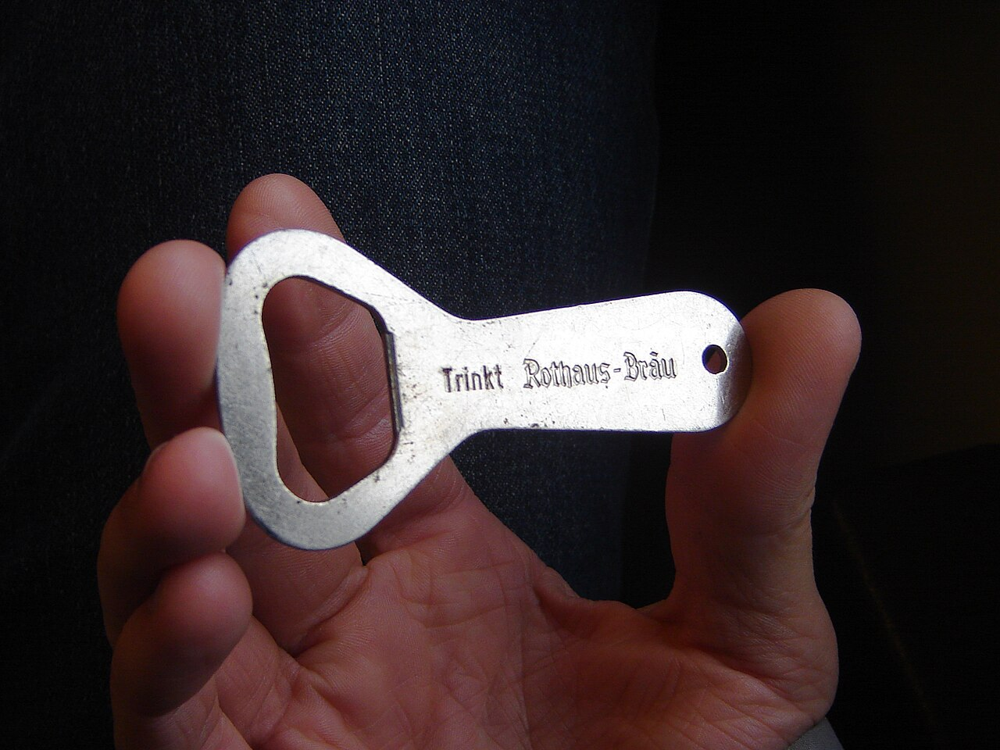

# Bottle Opener

A bottle opener opens crown-cap beer bottles. It is simpler than a corkscrew: no helix and no long lever, just a notch that grips the lower edge of the cap and a pivot to lift it.

The crown cap is the common closure on glass beer bottles: a metal cap with a crimped, serrated skirt pressed onto the bottle's lip. The opener's notch catches the skirt and lifts; the crimps release and the cap comes off. Steady pressure beats force.

Figure: A simple metal bottle opener. Image: Ich, Public Domain, via Wikimedia Commons ([source page](https://commons.wikimedia.org/wiki/File:Bottle_Opener.jpg)).

## Structure and types

The most common type is the bar blade: a flat stainless plate with a notch at one end and a grip at the other. It is thin, fast and made for high-volume bar use, and is often used to open bottles one-handed.

The key-shaped opener is one of the oldest: a ring or handle with a notch at the front. It is cheap, light and suited to home and outdoor use. A wall-mounted opener is fixed to a wall or counter and uses a lever, suiting bars and restaurants.

There are also double-ended openers: one end for crown caps, the other for screw caps or cans. They are versatile, but the notch may not fit closely and can slip. Choose by use and bottle type.

## How a crown cap releases

The crown cap has several crimps pressed onto the bottle's lip. The opener's notch catches the lower edge and lifts; the crimps open and, because the metal has some spring, do not close again, so the cap comes free.

Angle matters. The opener should sit square to the rim with the notch fully under the skirt; at an angle it grips only part of the cap, slips, and bends the metal.

Pressure should be steady, not violent. A hard jerk loads the rim, shakes the bottle and can spray foam; a steady lift releases the crimps one by one and leaves the cap whole. For beer service, see [beer](ref:beer).

## What bottles it suits

The bottle opener suits crown-cap beer and some glass-bottled drinks such as soda, juice and kombucha. The notch must match the cap; too small and it will not grip, too large and it slips.

It does not suit screw caps. A screw cap is opened by turning; levering it damages the rim and distorts the cap. Use a hand or a screw-cap function instead.

It does not suit cork. Cork needs a helix and a lever, which a bottle opener lacks; levering a cork crumbles it and drops fragments into the wine. For cork, see [corkscrew](ref:corkscrew).

## Steps

First, hold the bottle. Grip the lower body with one hand and the opener with the other; keep the bottle steady.

Second, seat the notch. Place the notch under the cap's skirt, square to the rim; try gently to confirm it is seated.

Third, lift. Pivot the opener upward with steady pressure, not a jerk; the cap releases with a click.

Fourth, check the rim. Look for metal fragments or glass chips; if present, do not drink. Wipe the opener as well.

## Cleaning and care

Wipe the opener after use. Metal dust and drink collect in the notch; rinse in warm water and dry with a cloth, without a long soak that rusts it.

Stainless can be wiped with a soft cloth, not steel wool, which scratches; plastic should be kept away from heat, which warps it. Check the screws on a wall-mounted opener so it does not work loose.

Store dry. Do not leave it by the sink or in a damp drawer; water collects in the notch and rust follows. For long storage, dry it and keep it separate.

## Common mistakes

First, a slanted angle. The notch grips only part of the cap and slips; keep the opener square to the rim.

Second, too much force. A hard jerk loads the rim and sprays foam; use steady pressure.

Third, using a bottle opener on cork. Without a helix and lever it crumbles the cork; use a corkscrew.

Fourth, skipping the rim check. Look for metal or glass chips after opening; if present, do not drink. For beer glasses, see [beer mug](ref:mug); for pouring, see [pouring](ref:pouring); for choosing glasses, see [how to choose a glass](ref:glass).

The opening also shapes the foam. Pressure releases when the cap comes off, and carbon dioxide escapes quickly; a shaken bottle or a violent opening sprays foam. Open steadily and slowly so the pressure falls gently and the foam is finer. Let the bottle stand for a few seconds before pouring; the bubbles settle and the foam is more even.

Beer temperature matters too. Colder beer holds more dissolved carbon dioxide and opens with finer foam; warmer beer loses gas faster and the foam is coarser. Check the temperature before deciding whether to chill; do not shake the bottle to judge carbonation, which only makes the foam harder to control. For temperature, see [ice and temperature](ref:ice). If the foam is heavy, wait a few seconds and pour slowly down the glass wall.

**At a glance:** A simple tool for crown-cap beer bottles, common as a bar blade, wall-mounted opener or key shape. It grips the cap's lower edge and lifts steadily.

For Bottle Opener, begin with the material and scale. Then look at the task it is designed for, and finally ask what it distorts outside that task. The answers point to different choices, not to a single score.

The comparison with [Beer](ref:beer) and [Pouring](ref:pouring) runs through material and purpose. Each answers a different question.

Treating Bottle Opener as a vessel mixes two different questions: identity and use. Separate them before comparing.

Oxford University Press, Encyclopaedia Britannica, British Beer and Pub Association, Brewers Association are the main sources behind this entry on Bottle Opener. Each is cited where it bears on a specific claim; none is asked to carry the conclusion alone.

“Structure and types” and “How a crown cap releases” answer different questions — material and purpose. Taken alone, either one can make Bottle Opener look like a vessel.

**Key facts.**

| Item | Detail |
| --- | --- |
| In one line | A simple tool for crown-cap beer bottles, common as a bar blade, wall-mounted opener or key shape. It grips the cap's lower edge and lifts steadily. |
| Material | Stainless steel、Plastic |
| Purpose | Opening crown-cap beer and some glass-bottled drinks |

**Sources and limits.** The key claims about Bottle Opener are checked against the following sources: Oxford University Press (Used to check beer service and opening tool background), Encyclopaedia Britannica (Used to check crown caps, foam and serving), British Beer and Pub Association (Used to check pub beer service and opening methods) and 4 sources in total. Prices, batches and status change; the body is project-written and does not reproduce source text.

For Bottle Opener, this page was last checked in 2026; prices, batches and availability change, so confirm them against the sources below.
