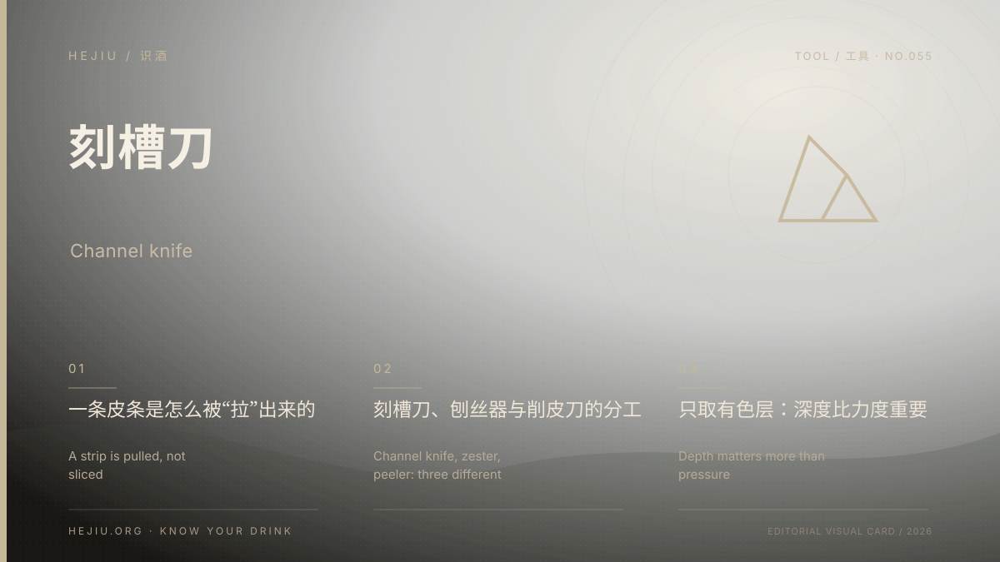

# Channel knife

A channel knife is a small bar tool with a single narrow V- or U-shaped notch at the tip instead of a full cutting edge. Drawn along a citrus peel, the notch lifts a long, even ribbon — the twist that hangs from the rim of a Martini or coils over the surface of an Old Fashioned.

Figure: thematic illustration for Channel knife. Image: AI-assisted illustration generated with Doubao Seedream 5.0 (project-owned); not a photograph of the subject.

> **Quick verdict**
> **In one line:** This tool helps you decide whether Channel knife is worth buying, and whether a substitute works.
>
> - **Best for:** Anyone who wants the purpose, substitutes and limits of Channel knife.
> - **Not for:** If you want want a gear list without the use case.
> - **Check first:**
>   - Width controls two things at once: how much oil can be expressed and whether the garnish will hold its shape.
>   - The geometry explains the motion.

## A strip is pulled, not sliced

The geometry explains the motion. Two short edges cut into the coloured peel while the channel between them arches the strip upward, so the result is a continuous band rather than a pile of fragments. The notch usually sits at the front of a short handle, sometimes angled downward and sometimes nearly at a right angle, so that it can follow the curve of the fruit.

Grip the front of the handle between thumb and forefinger with the notch facing you, and hold the fruit in the other hand. Set the notch near the stem end, press just enough for it to bite, then draw it steadily toward the blossom end at a constant angle. The fruit can rotate slowly under the blade, but changing the angle mid-stroke makes the strip waver and eventually break.

Length is limited by the circumference of the fruit. A medium lemon yields a strip of roughly 10 cm; an orange gives more, a lime less. Joining two strips is possible, but the overlap lifts, and a [Y-peeler](ref:peeler) is a better answer when a longer garnish is needed.

## Channel knife, zester, peeler: three different outputs

All three tools remove citrus peel; none replaces the others.

A channel knife produces a continuous strip about 3–5 mm wide. A zester cuts fine shreds of 1–2 mm, with a large surface area that releases oil quickly and suits scattering over a drink or working into sugar, but it cannot make a garnish that stands. A peeler removes a ribbon 2–3 cm wide, which covers the mouth of a large glass or wraps around a rim.

The choice follows the finished drink rather than a hierarchy of tools. A visible curl on the rim calls for a channel knife; a veil of aroma on the surface calls for a zester; a broad ribbon for a large glass or a flame calls for a peeler. The channel knife is the only one of the three that produces a continuous strip in a single stroke, which is why it has never been displaced.

## Depth matters more than pressure

Citrus peel has two layers. The coloured outer layer, the flavedo, holds the aromatic oil. Beneath it lies the white albedo, spongy, wet and bitter. The correct cut goes through the coloured layer and stops at the surface of the white.

The test is visual. Turn the strip over: the underside should be coloured, with only a thin pale film. A strip with a broad white back releases little aroma when expressed, tastes bitter, and softens within minutes as it absorbs moisture.

Depth is set by the angle of the notch and the initial pressure, not by drawing faster. Too upright and the notch digs into the pith; too shallow and it skims the surface without lifting a strip. Thick-skinned fruit such as grapefruit, or lemons with a heavy white layer, are less forgiving; make a short trial cut near the stem and inspect the underside before continuing.

## Why strip width changes the drink

Width controls two things at once: how much oil can be expressed and whether the garnish will hold its shape.

A wider strip breaks more oil cells, so folding or twisting it releases a more forceful burst of aroma. It is also heavier, more likely to carry pith, and more inclined to droop over the rim or slide into the glass. A narrow strip of 2–3 mm is stiffer and stands neatly, which suits small glasses and upright garnishes, but it carries less oil and gives a more restrained perfume.

In practice 3–5 mm is the useful middle. For [flaming zest](ref:flame), go slightly wider, because the flame needs a concentrated cloud of oil; for a drink such as a [Dry Martini](ref:martini) where the peel is only a suggestion, a narrower strip keeps the aroma from swamping the gin and vermouth.

The [basics of cocktail service](ref:basics) treat the garnish as part of the recipe rather than decoration, and width is where that idea becomes physical.

## The working sequence

Wash and dry the fruit. Surface water stops the notch from biting and dilutes the drink. When the peel is going into the glass, choose fruit with an intact skin; waxed fruit should be washed in warm water and dried.

Do not squeeze the fruit. A tight grip stretches the peel and makes the notch skid. Let it rest in the palm, use the side of the thumb as a guide against the blade, and let the other hand control only direction and speed.

Draw once, all the way. Sawing back and forth frays the edges, thins the strip and spends the oil on friction. Lift the blade at the end rather than tugging, which snaps the strip and can send the point into a finger.

Use the strip immediately. Within a quarter of an hour the cut surface dries, the strip softens and the aroma fades. For advance prep, hold strips briefly in iced water, but dry them before service or they will dilute the drink.

## When there is no channel knife

The closest substitute is a [Y-peeler](ref:peeler) followed by a small knife: cut a broad ribbon, then trim it to width. The result is less uniform, but it keeps the coloured layer and avoids the pith. If the same drink also needs juice, use a [citrus press](ref:press) for that job rather than cutting fruit and peel with one blade.

A paring knife can do the work, but depth and width depend entirely on hand control; it is an emergency solution, not a production method.

A zester cannot substitute. Its shreds are too short and fragile to hang on a rim. If aroma alone is the goal, it is faster than a channel knife.

Some bar knives combine a small blade with a channel notch on the spine. They save space on a home bar, but the notch is rarely as sharp as a dedicated tool.

## Care: keep the notch off the cutting board

The notch is an inside edge, and a standard sharpening steel cannot reach it. Once dull, it is effectively finished. The first rule is therefore never to test it on a cutting board and never to use it for anything except citrus peel.

Rinse the notch in warm water immediately after use so that pulp and oil do not dry inside it. Dried oil turns sticky and makes the next strip skid. Dry at once, especially inside the channel. Most channel knives are hand-wash only; a dishwasher accelerates handle ageing and can knock the tip against other items.

Replace the tool when strips begin to fray or break. Some models have replaceable heads, which is worth checking before buying. Store point down in a container or with a guard so that it does not collide with other metal tools.

## Common misconceptions

First, that a channel knife and a peeler are interchangeable. The notch and the blade produce widths an order of magnitude apart.

Second, that a deeper cut gives more aroma. Cutting into the pith brings bitterness and a limp strip; the oil is in the coloured layer.

Third, that a wider strip always looks better. Wide strips droop, carry pith and sit less securely.

Fourth, that strips can be cut the night before. They lose water and aroma; cut them to order.

Fifth, that a dull notch can be sharpened at home. The inside edge is difficult to restore, so replacement is the practical answer.

Sixth, that a cutting board is a safe place to practise. That single habit is the most common way to ruin the tool.

## See also

- [Y-peeler](ref:peeler): the wide-ribbon tool that complements the channel knife.
- [Citrus press](ref:press): juice and peel are separate operations.
- [Flaming zest](ref:flame): a technique that needs a slightly wider strip and a good oil cloud.
- [Dry Martini](ref:martini): a classic built around a lemon twist.
- [Cocktail basics](ref:basics): where the garnish sits in the service sequence.

**At a glance:** A bar knife with a small V- or U-shaped notch that pulls long, even strips of citrus peel; notch width, sharpness and cutting depth determine aroma release and whether the garnish holds its shape. 
