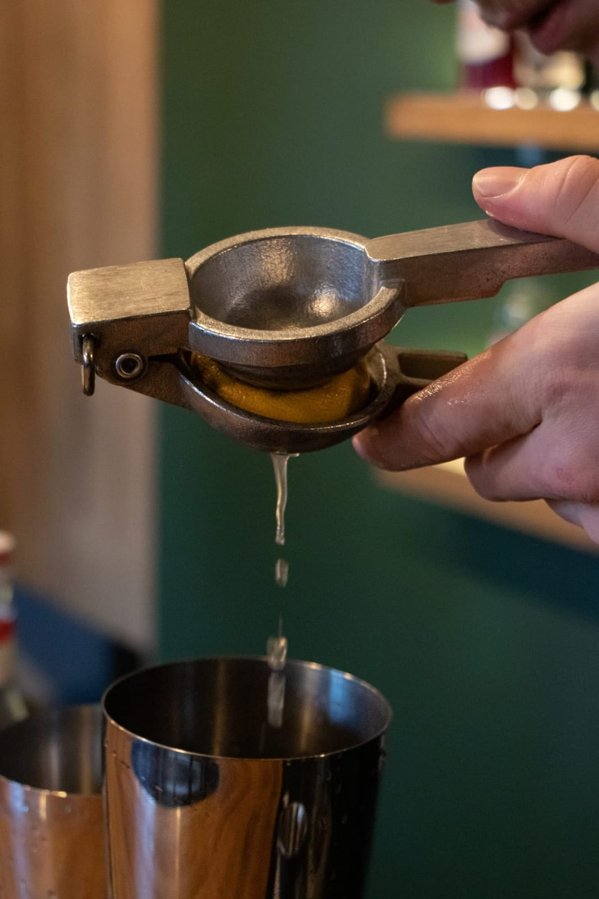

# Citrus press

A citrus press is a manual tool for pressing half a citrus fruit. It multiplies force through a lever or screw so that the user can extract juice with less hand effort, while keeping pulp, seeds and most of the peel out of the glass. For recipes built on fresh lime or lemon juice, it is one of the basic tools that determine yield and consistency.

Figure: A hand uses a metal lever citrus press on a lemon, with juice falling into a shaker below. Image: Guste Cibulskyte, CC0, via [source page](https://wordpress.org/photos/photo/486a216f78/).

## What problem it solves

The first problem it solves is hand strength. Lime and lemon peel are firm, juice is hard to extract by finger pressure alone, and several drinks in a row cause fatigue and inconsistent yield.

The second is separation. The cup-shaped press holds pulp and seeds while juice flows out through the base or side, reducing the chance of seeds falling into the drink or pulp clogging a strainer.

The third is hygiene and speed. Squeezing by hand puts fingers in contact with juice and makes continuous work awkward; a press provides a fixed contact surface that can be cleaned and reused in a bar rhythm.

It cannot solve the problem of juice quality. A press only extracts juice; freshness, variety and ripeness determine flavour. No tool can turn a tired lime into good juice.

## Structure and materials

A common press is lever-operated: a cup or bowl sits on the base, an arm swings up and down above it, and a pressing head shaped to fit the fruit sits at the end of the arm. Put half a citrus in the cup, pull the arm down, and juice is extracted.

Another type is screw-operated: a threaded rod pushes the head down, giving an even force at a slower pace, and usually suited to larger volumes. Screw presses are often bigger and heavier.

Materials commonly include stainless steel, coated cast aluminium and food-grade plastic. Stainless steel resists acid and cleans easily but is heavy; cast aluminium is lighter and cheaper, but if the coating is damaged, acidic juice may reach the metal and cause off-flavours and corrosion; food-grade plastic is light and inexpensive, but can scratch and age over time. Choose based on the condition of the juice-contact surfaces, not the overall look.

The shape and size of the cup matter too. A cup that is too small will not fit a large lemon, while one that is too large gives poor support to a small lime, so the fruit sits crooked. How well the head fits the fruit affects yield and whether the peel is crushed.

## How to choose

First, consider the size of the fruit you use most. A bar built on limes and one built on lemons and grapefruits need different cup sizes. Check before buying that half your usual fruit fits the cup.

Second, consider stability. A wide base with a low centre of gravity does not slide under pressure; a light base requires the other hand to hold it, which is more tiring.

Third, consider lever travel and feel. The arm should travel far enough to flatten half the fruit, and the grip should not dig into the hand; a screw press should turn smoothly.

Fourth, consider the juice-contact material. Acidic juice accelerates corrosion on unprotected metal, and coated cast aluminium with damaged coating deserves particular attention.

Fifth, consider cleaning. A removable cup with no hard-to-reach corners is better for frequent use.

Sixth, check dishwasher instructions. Different materials and coatings tolerate different conditions, so follow the product guidance.

Do not judge only by how dry the peel looks afterwards. Yield depends on fruit condition, cutting, pressing force and the tool together; the tool is only one factor.

## Correct use

First, wash the fruit. Citrus skin can carry dust and pesticide residue, so wash and dry it before pressing, especially when the peel will be used as a garnish.

Second, cut the fruit across into halves. A crosswise cut aligns the segments with the direction of force in the cup and gives a more even extraction; the cut face should be flat to keep peel fragments out of the juice.

Third, place the half cut-side down in the cup so that the head presses the centre of the flesh rather than the peel.

Fourth, press the lever or turn the screw steadily. Force should be continuous and even, not a sudden push; a hard jolt ruptures the peel, releases bitter oil and can splash juice.

Fifth, stop when juice clearly stops flowing. Pressing further into the white pith and peel adds bitterness and oil.

Sixth, pour the juice into a measure and use it as the recipe directs. When clear juice is needed, pass it through a fine strainer or use [double straining](ref:double) to remove fibre. Clear pulp and seeds from the cup promptly so that it does not clog.

Seventh, rinse immediately after use. Citrus acid and sugar corrode metal, dry in seams and affect the next drink.

## Alternatives

Without a press, a hand reamer can be used: push the cone into the flesh and twist, which suits small quantities but tires the hand more. Hand squeezing and clamp-style juicers are also options; clamp juicers suit oranges and grapefruits but take more space.

For large volumes, an electric juicer is faster but harder to clean and may introduce more pulp fibre and air through high-speed rotation. Bottled juice saves time, but its flavour and freshness differ from fresh juice; if a recipe insists on fresh juice, it should not be replaced.

If only a little peel oil is needed, there is no need to press at all: cut a strip of peel and express it. Tools should follow whether the recipe needs juice or peel.

## Care and safety

After every use, rinse the cup, head and base with warm water to remove pulp, seeds and peel fragments. The longer acidic juice stays, the more visible the corrosion. Dry or air-dry afterwards to prevent water marks and oxidation.

Check the coating and the pressing head regularly. When the coating flakes, rust appears or plastic cracks, stop using the tool for juice contact. Do not scrub with steel wool or strong alkaline cleaners, which damage the surface.

For safety, keep fingers away from the lever and hinge, and place the base on a stable surface so that it does not tip under pressure. Do not press a whole fruit, and do not reach into the cup to clear pulp while the arm is being pressed. Clean the work surface and hands afterwards, following food-safety practice for fresh juice.

## Common misconceptions

First, "the harder you press the more juice you get". Excessive force ruptures the peel, brings in bitter oil and splashes juice.

Second, "one press fits all citrus". Limes, lemons, oranges and grapefruits differ in size and need a matching cup.

Third, "peel-side down extracts better". The cut face should go down; peel-side down presses oil and bitterness into the juice.

Fourth, "seeds in the juice do not matter". Seeds and pulp clog strainers and add bitterness.

Fifth, "bottled juice is a full substitute". Fresh juice differs in aroma and acidity; if freshness is the point, use fresh juice.

Sixth, "the press does not need washing every time". Acidic residue corrodes metal and affects flavour, so clean it promptly.

## See also

- [Mojito](ref:mojito): a built recipe based on fresh lime juice.
- [Whiskey Sour](ref:sour): a classic sour balanced with lemon juice and sugar.
- [Fine strainer](ref:fine): the next step for removing pulp and fibre.
- [Cocktail basics](ref:basics): where citrus juice sits in a recipe.
- [Double straining](ref:double): how to handle juice or a finished drink that needs clarity.
