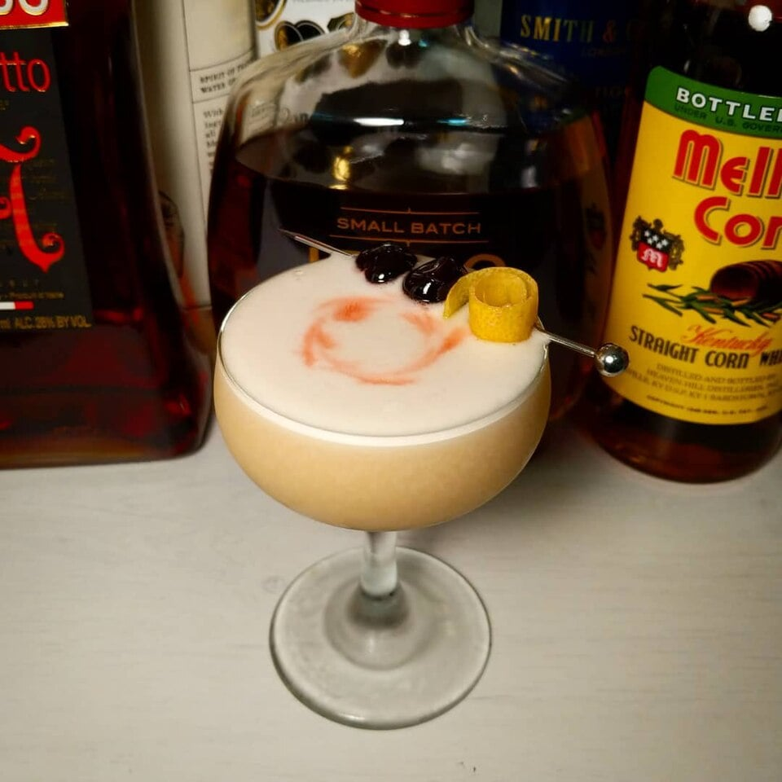

# Cocktail pick

A cocktail pick is a thin pin that fixes an olive, cherry, citrus peel or pearl onion above the surface of a drink or against the rim. It looks like the least important object on the bar, yet its length, gauge, point and material decide whether the garnish stays put, whether the guest can eat it comfortably, and what impression the drink makes in the first seconds on the table.

Figure: A whiskey sour with two maraschino cherries on a metal cocktail pick, alongside a twist of lemon peel. Image: Ilikefood, CC BY-SA 4.0, via [source page](https://commons.wikimedia.org/wiki/File:Whiskey_sour_in_coupe_glass_with_garnishes.jpg).

> **Quick verdict**
> **In one line:** This tool helps you decide whether Cocktail pick is worth buying, and whether a substitute works.
>
> - **Best for:** Anyone who wants the purpose, substitutes and limits of Cocktail pick.
> - **Not for:** If you want want a gear list without the use case.
> - **Check first:**
>   - Olives sit in brine, cherries and citrus carry acid, and both accelerate corrosion.
>   - A pick changes the space at the rim.

## Three jobs on one thin stick

The first job is to hold. Olives and cherries are smooth and heavy, and they sink if left loose. A pick supports them at the rim or above the liquid so that the garnish stays visible and the drink is recognisable at a glance.

The second is to allow eating. With a pick, the guest grips the handle and lifts the garnish out instead of reaching into the glass.

The third is to direct attention. The angle of the pick, its length and the position of the garnish determine what the nose meets first and where the first sip lands. None of this belongs to the recipe, but all of it belongs to service.

## Bamboo, plastic, metal

Bamboo is cheap, light and slightly textured, which gives friction so that an olive does not spin. It also absorbs liquid, softens, stains and can grow mould if reused; it is essentially a single-use item, and splinters are a real risk once the surface frays.

Plastic comes in colours, survives water and can be reused, but it bends under load and cheap grades discolour or degrade in alcohol and acid. It is useful when colour is used to mark different drinks, less useful when the garnish has weight.

Metal is the strongest and the cleanest-looking option. Stainless steel resists corrosion and can be washed indefinitely, but it conducts cold quickly, which makes a chilled pick uncomfortable to hold, and its smooth surface lets an olive rotate. Plated or low-grade metal picks pit and discolour in brine and acid, and can leave a metallic taste.

## Where 10–15 cm comes from

Cocktail picks commonly run from 10–15 cm. The range is not arbitrary: it answers to the height of the glass, the diameter of the garnish, and the clearance needed between the fingers and the rim.

Below 10 cm, a pick laid across the rim leaves too little overhang, so the garnish slips into the drink and fingers approach the liquid. Above 15 cm, the centre of gravity rises; a pick carrying an olive wobbles, is easy to knock over and looks clumsy.

Within that range, match the glass. A Martini glass is wide and shallow, so 10–12 cm is enough. A highball is taller and the garnish often sits above the rim, where 12–15 cm is more stable. Treat the figures as a guide and compare the pick with your own glassware before buying.

## Single, double and the cocktail fork

A single pick has one point and is the default for one olive, one cherry or one piece of citrus peel.

A double pick has two parallel prongs and holds two items, such as an olive and an onion or two cherries. It keeps them from rotating into each other and makes the arrangement look deliberate. The drawback is that both holes must line up at once, and soft garnishes tear easily.

A cocktail fork has two or three short tines and behaves more like a small fork. It suits soft items such as brandied cherries or chunks of fruit, which it lifts without piercing through, but it grips weakly and is poor at holding a garnish on a rim.

The garnish, not the ambition of the presentation, decides the choice. One olive looks cleanest on a single pick; two different items justify a double.

## Which way should the point face

This is the most overlooked safety detail at the bar. The usual practice is to put the point down inside the glass and leave the blunt handle up. A guest leaning in to drink then faces no sharp tip, and if the glass tips over, the point aims at the base rather than outward.

When the garnish has to stand above the rim, part of the pick is outside the glass; in that case bury the point in the garnish and leave the blunt end facing out. In neither arrangement should a sharp tip hover over the rim pointing at a guest's face.

Bamboo splits into fine splinters, and plastic can form a sharp break when bent or heated. A pick that is bent, cracked or frayed should be discarded rather than kept in service.

## Metal picks, acid and brine

Olives sit in brine, cherries and citrus carry acid, and both accelerate corrosion. Stainless steel is relatively stable, but not all stainless steel is equal; prolonged contact with salt and acid can still pit lower grades.

Plating is a decorative layer that wears away with repeated piercing and washing. Once the base metal is exposed, corrosion speeds up and the drink may pick up a metallic note. Spots, darkening, flaking, or an olive that tastes wrong the next day are reasons to stop using the pick.

Metal should not stay in the drink for long. Insert it for service and remove it when the guest has taken the garnish; do not leave a metal pick in the glass as a stirrer. A [bar spoon](ref:spoon) is the right tool for stirring.

## How a garnish changes the way you drink

A pick changes the space at the rim. Laid across the glass, it blocks part of the lip, so the guest has to turn the head or use a straw. Standing upright in the drink, it may meet the nose.

Position matters too. An olive at the bottom of the glass lets the first sip be spirit; an olive at the rim puts salt and brine into the nose before the liquid arrives. A [Dry Martini](ref:martini) often uses the second arrangement so that the savoury note precedes the gin. The same logic applies to the cherry in a [Manhattan](ref:manhattan), where the sweet aroma reaches the nose first.

When citrus peel is pinned, the outer face should point toward the guest so that ruptured oil cells release aroma outward. A peel pierced all over loses its oil early. A strip cut with a [channel knife](ref:channel) can hang one end over the rim and be held with a pick at the other, which is more secure than piercing it through the middle.

## Alternatives: toothpicks, bar spoons, skewers

A toothpick is the usual stand-in, but it is normally only 6–7 cm long, too short to bridge most rims and too weak to hold an olive without snapping. It works for a small glass or a quick fix, not for professional service.

A bar spoon can lift a garnish from the glass; its long handle reaches the bottom and the bowl can cradle a cherry. It cannot pierce, and it cannot pin a garnish to the rim. It is a retrieval tool, not a display tool.

Long bamboo skewers can be cut down, but the cut end is rough and needs sanding. Small metal forks or dessert forks can work in an emergency, though their size rarely matches the glass.

## Cleaning and storage

Rinse metal picks in warm water immediately after use to remove brine and fruit residue, then dry them. Do not leave them soaking overnight and do not scour them with steel wool, which scratches the surface and speeds corrosion. Follow the maker's guidance on dishwasher use.

Bamboo and wooden picks are single-use. Washing makes the wood swell, then crack as it dries, and the splinter risk rises. Plastic picks can be reused for a while, but should be discarded when bent, cloudy or cracked.

Store picks dry in a jar or a divided tray, points down, away from knives. A practical bar keeps single picks, double picks and forks in separate compartments so that service does not require searching. Garnish choice and placement, alongside glassware and ice, are part of the service standard described in the [basics of cocktail making](ref:basics).

## Common misconceptions

First, that a toothpick is a cocktail pick. It is too short and too weak; olives slide off and the wood snaps.

Second, that metal is always more hygienic and can stay in the drink. Salt and acid corrode metal and change the taste.

Third, that a sharper point is better. An over-sharp pick tears the garnish, catches fingers and leaves a hazard at the rim.

Fourth, that the garnish is only decorative. Its position changes the order in which aroma reaches the nose and shapes the first sip.

Fifth, that a bamboo pick can be washed and reused. Wood swells, cracks and can grow mould.

Sixth, that a double pick is always more premium. The number and texture of the garnishes should decide, and a single olive looks fussier on a double.

## See also

- [Bar spoon](ref:spoon): for lifting garnishes and stirring, a different job from pinning.
- [Dry Martini](ref:martini): a classic served with an olive or a lemon peel.
- [Manhattan](ref:manhattan): often finished with a brandied cherry on a pick.
- [Channel knife](ref:channel): the tool behind a long citrus-peel garnish.
- [Cocktail basics](ref:basics): where the garnish sits in the service sequence.

[Bar spoon](ref:spoon) and [Manhattan](ref:manhattan) are the nearest useful comparisons: one clarifies material, the other tests purpose.
