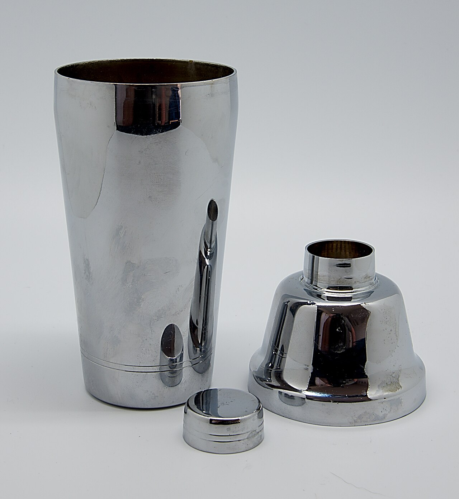

# Cocktail shaker

A cocktail shaker is a bar tool for shaking cocktails. It encloses ingredients and ice and chills, dilutes and mixes them through hard shaking. Its structure, material and capacity directly affect working efficiency and the finished texture, so it is not an optional accessory but a core piece of equipment in the cocktail process.

Figure: Cocktail shaker. Image: Clément Bucco-Lechat, CC BY-SA 3.0, via Wikimedia Commons ([source page](https://commons.wikimedia.org/wiki/File:Shaker_-_2.jpg)).

## Definition and types

Common types are the three-piece and two-piece shaker. A three-piece shaker consists of a body, a lid and a built-in strainer; it seals well and suits recipes with egg white, cream or juice. A two-piece shaker usually consists of a body and a lid, holds more, needs a separate strainer, and works faster but demands a better seal.

There is also the French shaker, shaped like a lidded metal can with a larger capacity, often used for thinner recipes. No type is absolutely better; the key is whether it matches the recipe, the ice and the working habits.

## Materials and structure

Bodies are mostly stainless steel, with glass and copper versions also available. Stainless steel is durable, conducts heat quickly and is easy to clean, making it the most common bar choice; glass lets you watch the mixture but breaks easily and does not suit heavy shaking; copper bodies look distinctive but are heavy and demand more care.

Structurally, the lid seal, body thickness and rim angle all affect use. An ageing seal causes leaks, and an overly wide rim makes straining harder to control. Checking these details tells you more about a shaker than appearance alone.

## Capacity and selection

Capacity determines whether the shaker can hold the ingredients plus enough ice. Too small and there is not enough ice, making chilling and dilution hard to control; too large and the ice has too much room, collides less and mixes less efficiently. A working bar usually keeps several capacities for single and multiple servings.

Selection also depends on hand size and workspace. A body that is too wide is hard to grip, and too heavy a shaker tires the arm during long shaking. Home users can choose a moderate-capacity three-piece with a reliable seal; high-volume bars care more about durability and cleaning efficiency.

## Sealing and straining

Sealing is one of the most critical properties. Pressure rises inside during shaking, and if the lid or seal is loose, liquid seeps out, wasting ingredients and compromising hygiene. Before use, check that the lid is fully seated and press it down with the palm while shaking.

Straining affects the finished drink. A three-piece shaker has a built-in strainer that catches ice as you pour; a two-piece shaker needs a separate strainer or mesh, adding steps. Incomplete straining lets ice keep melting and diluting the drink, so strainer choice and speed matter too.

## Cleaning and care

Empty and rinse immediately after use to prevent juice, syrup and cream from drying inside. Recipes with egg white or cream require taking apart the lid and strainer and cleaning the seal and crevices thoroughly. Dry afterwards to avoid water marks and odours.

Stainless bodies can be wiped dry with a soft cloth; avoid steel wool that scratches the surface. Glass bodies should avoid sudden temperature changes that cause cracking. Seals are consumables and should be replaced when aged, deformed or odorous. A well-cared-for shaker lasts a long time; poor care brings hygiene and safety problems.

## Relationship to technique

The shaker is the vehicle for the [shaking](ref:shaking) technique, but the tool cannot replace the motion. Grip, motion width, timing and ice condition all change the result. Even a good shaker gives a poor drink if the motion is too wide and leaks, or if the shake is too short and mixing is incomplete.

Take [Negroni](ref:negroni): the IBA recipe stirs rather than shakes. Using a shaker instead would add dilution and aeration and change the style. This shows that tool, technique and recipe must be considered together; "use a shaker" is not a standard method for every cocktail.

## Common misconceptions

First, the more expensive the shaker, the better. Price and brand do not equal suitability; seal, capacity and feel are the key points.

Second, every cocktail uses a shaker. Recipes built around aroma and clarity usually suit stirring, while shaking adds extra dilution and aeration.

Third, any lid will do as long as it is on. An ageing seal or a lid not properly seated will leak, so check before use.

Fourth, a shaken drink can wait. Ice keeps melting and dilutes the drink, so it should be strained and served promptly.

Fifth, washing only the body is enough. The lid and strainer most often retain juice and cream and must be taken apart and cleaned.

## Buying advice

First decide the use: home mixing can use a moderate-capacity three-piece with a reliable seal; frequent multiple servings favour a larger two-piece with a proper strainer. Then check whether the seal fits, whether the lid opens and closes easily, and whether the weight suits long gripping.

For material, stainless steel is the safe choice; glass suits low-frequency use and display; copper suits settings where appearance matters, at the cost of more care. After purchase, test with water first to confirm there are no leaks, then use it with alcohol and juice. For home use, consider storage space and cleaning convenience so that a large shaker does not sit unused.

**Short definition:** A bar tool for shaking cocktails, commonly in three-piece and two-piece forms; body, seal and straining method affect chilling, dilution and working efficiency.

Start with the material and scale. From there, consider the task it is designed for, then what it distorts outside that task. That is how a practical judgment about Cocktail shaker is built.

Read [Shaking](ref:shaking) for the material side of Cocktail shaker, and [Negroni recipe (IBA version)](ref:recipe) for the purpose side. Together they locate it.

**Key facts.**

| Item | Detail |
| --- | --- |
| In one line | A bar tool for shaking cocktails, commonly in three-piece and two-piece forms; body, seal and straining method affect chilling, dilution and working efficiency. |
| Material | stainless steel、glass |
| Purpose | Shake cocktails to chill, dilute and mix the ingredients evenly |

**Sources and limits.** The key claims about Cocktail shaker are checked against the following sources: International Bartenders Association (Used to check the method for shaken cocktails), Oxford University Press (Consulted for entries on shakers, bar tools and cocktail technique; Migrated from the former reference list at the end of the article; access date not re-verified), Cocktail Kingdom. Prices, batches and status change; the body is project-written and does not reproduce source text.

## Further reading

- [Shaking](ref:shaking): the motion, ice and dilution control.
- [Negroni](ref:negroni): an example of a stirred classic cocktail.
- [Negroni recipe](ref:recipe): executable quantities, steps and equipment.
- [Rocks glass](ref:vessel): how glass shape and ice affect the finished drink.
