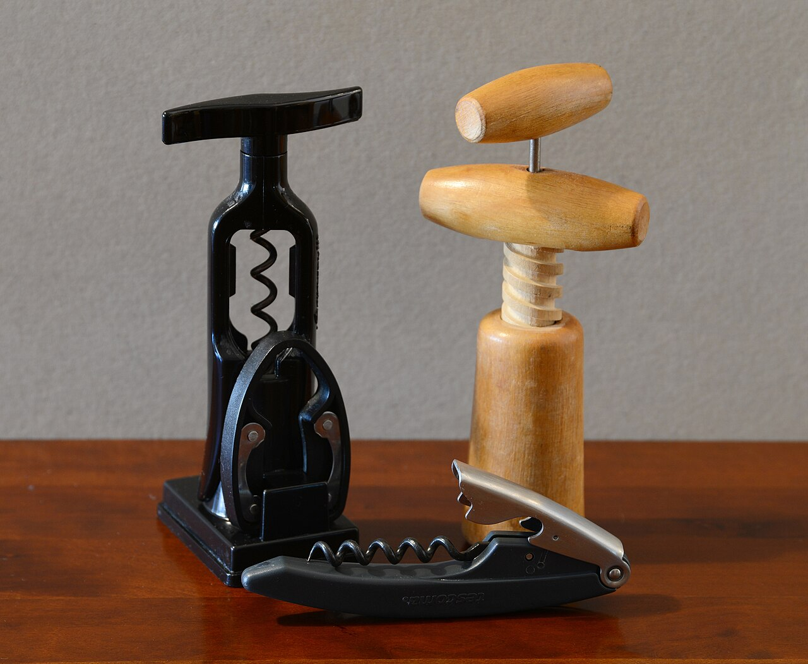

# Corkscrew

A corkscrew pulls a cork with a helix and a lever. Its core is not drilling but converting rotation into upward pull: the helix enters the cork, the lever multiplies the lifting force and the cork comes out slowly and vertically. It mainly serves [wine](ref:wine) opening and service.

There are many kinds: the sommelier knife, the winged opener, the lever model and the table model. Their structures differ, but the logic is the same: centre the screw, pull vertically, go slowly. The better the tool, the rarer the broken cork. A left-handed user can rotate the tool rather than the bottle, keeping the same vertical pull.

Figure: Several corkscrews of different designs. Image: Alvesgaspar, CC BY-SA 4.0, via Wikimedia Commons ([source page](https://commons.wikimedia.org/wiki/File:Corkscrews_December_2014-1.jpg)).

## Structure and types

The sommelier knife is the most common. It folds a helix, a lever and a blade into a pocket knife; the blade cuts the capsule, the helix enters the cork and the lever lifts in stages. It is portable but needs technique.

The winged opener has two arms. The helix enters the cork, the arms rise and are pressed down to lever the cork out; it is easy on the hands but bulky to carry.

The lever model has a long handle and a stop against the bottle rim. It multiplies force and suits old or fragile corks; the table model is fixed to a counter for high-volume bars. Choose by setting, not by price.

## Screw and lever

The helix turns rotation into linear motion. Pitch, diameter and taper decide how easily it enters; too thick and it splits the cork, too thin and it slips. A good helix has a sharp tip and a moderate pitch.

The lever multiplies force. The closer the stop to the rim and the longer the arm, the greater the pull, but too long an arm can snap the cork. A sommelier knife levers in stages, raising the cork a little at each notch, which is safer than one hard pull.

Vertical matters. The helix should follow the bottle axis; if it is off, the cork takes uneven force and breaks. Pull straight up, not side to side; twisting against the rim adds friction and raises the risk.

## What bottles it suits

The corkscrew suits natural cork and some synthetic stoppers. Natural cork is elastic and easy to enter; synthetic is harder and needs a slower entry and a steadier pull. It does not suit screw caps, nor sparkling wine where pressure must be controlled.

Sparkling wine is under pressure, and the cork can fly out; driving a corkscrew into it can release the cork suddenly and dangerously. Sparkling wine should be opened with thumb control and a slow bottle turn, or by sabrage. For sparkling service, see [opening sparkling wine](ref:sparkling).

Old corks are fragile. Age softens and dries them, and a helix can crumble them; old bottles are better opened with a lever model or a two-prong tool. A broken cork is not a small matter: fragments fall into the wine and affect taste and safety.

## Steps

First, remove the capsule. Cut just below the rim with the blade, taking care with the fingers; remove it whole so the cork is exposed.

Second, clean the rim. Wipe the rim and cork with a clean cloth to remove dust and mould; if the cork surface is mouldy, clean it before judging contamination.

Third, centre the screw. Point the tip at the centre of the cork and turn along the bottle axis; do not enter at an angle from the edge, and do not pierce through the cork.

Fourth, lever up. Set the stop on the rim and lift the lever in stages, moving the stop as the cork rises, until most of it is out.

Fifth, pull slowly. Finish by hand, without force; at the moment of release there may be an off odour, so smell first to judge contamination. For the full routine, see [opening a cork](ref:opening).

## Cleaning and care

Wipe the tool after use. Cork dust and wine remain on the helix; rinse in warm water and dry with a cloth, without a long soak that rusts the hinge.

The sommelier knife hinge needs care. A drop of food-grade lubricant now and then keeps the lever smooth; cooking oil goes rancid and sticky. Keep the blade sharp, since a blunt blade tears the capsule and the hand.

Store dry. Do not keep the tool by the sink or in a damp drawer; the helix and blade rust and the hinge seizes. For long storage, dry it and keep it separate.

## Common mistakes

First, an off-centre screw. Entering at an angle gives uneven force and breaks the cork; centre it and follow the axis.

Second, pulling too fast. One hard pull snaps the cork; lever in stages and pull slowly.

Third, using a corkscrew on sparkling wine. Pressure can send the cork flying; use thumb control or sabrage.

Fourth, ignoring a broken cork. Fragments fall into the wine and affect taste and safety; switch tools, remove the rest and filter if needed. For cork contamination, see [cork taint](ref:taint); for decanting, see [decanting](ref:decanting) and [decanter](ref:decanter).

Read Corkscrew through the material and scale, then the task it is designed for, and finally what it distorts outside that task. The sequence matters.

[Opening a cork-sealed bottle](ref:opening) explains material; [Wine](ref:wine) adds purpose. Put Corkscrew between them before deciding what it is.

**Short definition:** A tool that uses a helix and a lever to pull a cork. The screw must be centred, the pull vertical and slow, and a broken cork needs care.

Do not reduce Corkscrew to a vessel. 

Sources for Corkscrew include Oxford University Press, Encyclopaedia Britannica, Corning Museum of Glass, USPTO.

A waiter's friend with a two-step lever is the most common; a winged corkscrew suits home use but can tear older corks, and a broken cork needs a filter.

Clean the helix and wax the tip lightly; a dusty screw can crumble an old cork.

**Key facts.**

| Item | Detail |
| --- | --- |
| In one line | A tool that uses a helix and a lever to pull a cork. The screw must be centred, the pull vertical and slow, and a broken cork needs care. |
| Material | Stainless steel、Plastic、Wood |
| Purpose | Pulling natural cork and some synthetic stoppers |

**Sources and limits.** The key claims about Corkscrew are checked against the following sources: Oxford University Press (Used to check opening tools and wine service background), Encyclopaedia Britannica (Used to check cork and wine bottle history), Corning Museum of Glass (Used to check bottle and glass craft background) and 4 sources in total. Prices, batches and status change; the body is project-written and does not reproduce source text.

For Corkscrew, this page was last checked in 2026; prices, batches and availability change, so confirm them against the sources below.
