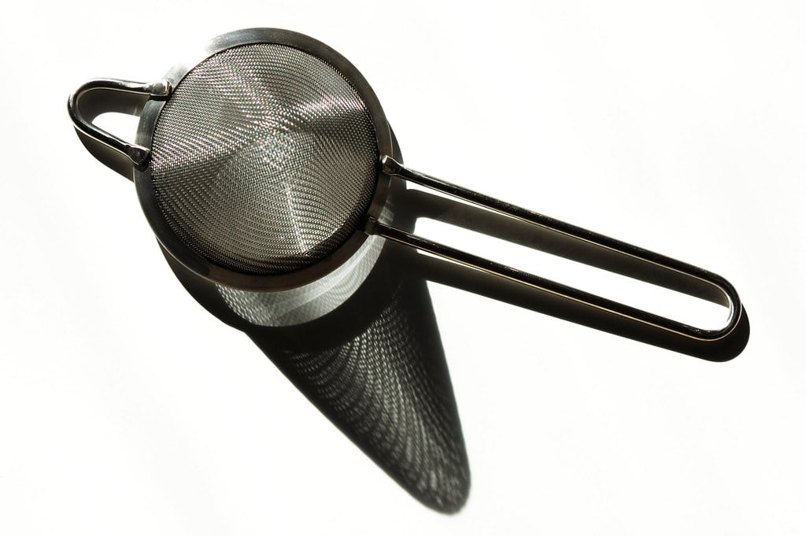

# Fine strainer

A fine strainer is the second strainer in double straining. It usually consists of a fine mesh and a metal frame, placed below the primary strainer or over the rim of the glass to catch fruit fibre, herb fragments, ice shards and small pieces of egg white. It does not hold back ice and does not mix anything; it only gives already-strained liquid a finer pass.

Figure: A conical fine-mesh strainer with a metal mesh and twin-wire handle. Image: theilr, CC BY-SA 2.0, via [source page](https://www.flickr.com/photos/90863480@N00/4172725365).

## What problem it solves

A fine strainer deals with the particles that a primary strainer cannot stop. After shaking, the strainer holds back ice and larger solids, but fruit fibre, herb fragments and ice shards still pass through the openings and stay suspended in the drink.

These particles cause several problems. They feel gritty, settle at the bottom of the glass and spoil the appearance; herb fragments keep oxidising and bring grassy notes; ice shards keep diluting the drink in the glass. A fine mesh addresses these issues together.

It also helps control foam. Some egg-white recipes do not want a thick foam, and a fine mesh breaks up part of it; more often, egg-white recipes deliberately avoid a fine mesh to preserve the foam. The choice depends on whether the recipe wants clarity or foam.

## Structure and materials

The basic structure is mesh, frame and handle. The mesh intercepts, the frame supports and keeps the shape, and the handle makes it easy to hold and tap.

Mesh materials are commonly stainless steel and nylon. Stainless steel is durable, easy to clean and tolerant of cold and heat, but can show rust if it stays in contact with acidic juice and is not cleaned promptly; nylon is light and inexpensive but does not tolerate high heat, and scratches can harbour residue. Frames are usually metal, and some models have hooks or a base that sits steadily on the rim.

Common shapes are conical and round. A conical strainer has a lower centre of gravity and more capacity, which suits sitting on a glass; a round one is flatter and sits directly on a container. Sizes vary widely, so check that it covers your usual rim without wobbling.

Mesh density is usually given by the manufacturer, often described as "fine" or "super-fine", but labels are not consistent between makers. Do not compare products by a single mesh number alone; actual interception also depends on how flat the mesh is, how it is woven and how fast the liquid flows.

## How to choose

First, consider the use. For shaken short drinks, choose a fine, stable mesh; for juice with a lot of pulp, an extremely fine mesh clogs quickly and is worse than a slightly coarser one.

Second, consider size and stability. The strainer should sit steadily on your usual glass or mixing vessel and not slide during pouring. Models with hooks or a wide rim are usually more stable.

Third, consider material and acid resistance. A bar that works with lemon and lime should choose an acid-resistant, easy-to-clean mesh and rinse it promptly.

Fourth, consider cleaning. The seam between mesh and frame is a common place for residue; choose a product with a smooth seam and no hard-to-reach corners.

Fifth, check that the mesh is flat. Dented, lifted or loose mesh lets particles through the gaps and catches pulp.

Sixth, consider the handle and storage. The handle should be comfortable and of moderate length; an overly long strainer is awkward to store and clean.

## Correct use

First, check that the strainer is clean and the mesh is intact. A mesh with holes or loose threads cannot be used for fine filtration.

Second, place the fine strainer on the target glass or container and confirm that it is stable. Pre-chilling the glass and strainer reduces aroma loss and warming if possible.

Third, place the primary strainer above the fine strainer. The primary strainer holds back ice and large solids, and the fine strainer handles the remaining particles; the order cannot be reversed.

Fourth, pour slowly and let the liquid flow naturally. Do not aim at one spot, which can push particles into the mesh or knock the strainer off balance.

Fifth, tap the frame after straining so that clinging drops fall. Do not press the solids with the back of a spoon and do not scrape the residue into the glass.

Sixth, wash immediately. Rinse with warm water, brush the mesh gently, dry it and check for dents or rust.

A fine strainer cannot replace a primary strainer, nor should it be used to filter a whole batch of pulpy juice. It is designed for a small amount of fine particles, not for taking all the solids.

## Alternatives

Without a fine strainer, a small tea strainer or a kitchen sieve can be used temporarily, though precision and stability are usually lower. Cheesecloth and a coffee filter give more thorough clarification, but flow is very slow and more aroma and bubbles are lost.

If only larger herb fragments need removing, a single strain is enough; if foam should be kept, egg-white recipes should skip the fine strainer. When a completely clear result is needed, consider settling, decanting or a more specialised clarification method rather than chasing a finer and finer mesh.

## Care and safety

Rinse immediately after every use. Sugar, pulp and egg white dry in the openings, making the next filtration slower and creating a hygiene risk. Brush gently along the mesh with a soft brush and do not bend the screen.

Check the mesh and frame regularly. Stop using it if rust, holes, loose threads or separation between mesh and frame appear. Nylon mesh does not tolerate high heat, so do not use it for very hot liquid; metal mesh should also avoid sudden temperature shocks.

Store it dry and do not crush it against sharp tools. A fine strainer is thin and hard to flatten once deformed, and filtration quality drops noticeably. After handling fresh juice or egg white, clean the strainer, surface and hands according to food-safety requirements.

## Common misconceptions

First, "the finer the mesh the better". Too fine a mesh clogs, slows service and strips aroma and bubbles.

Second, "a fine strainer can replace the primary strainer". Using only the fine mesh lets solids pile up, making filtration slow and uneven.

Third, "double straining is always better". It suits recipes that need clarity, not drinks where foam or fruit texture is the point.

Fourth, "straining can fix a recipe". Straining only removes particles; it cannot change acid, sugar or alcohol balance.

Fifth, "the mesh does not need washing every time". Residue dries, clogs and brings off-flavours.

Sixth, "you can press down while straining". Pressing forces particles through the openings and deforms the mesh.

## See also

- [Double straining](ref:double): the full technique that uses this tool.
- [Strainer](ref:strainer): the primary tool for the first strain.
- [Shaking](ref:shaking): the most common step before fine straining.
- [Cosmopolitan](ref:cosmo): a shaken short drink that needs a clear appearance.
- [Cocktail basics](ref:basics): where straining sits in the overall process.

**Short definition:** The second strainer in double straining, used to catch fruit fibre, herb fragments and ice shards; mesh fineness, frame stability and cleaning affect clarity and speed. 
