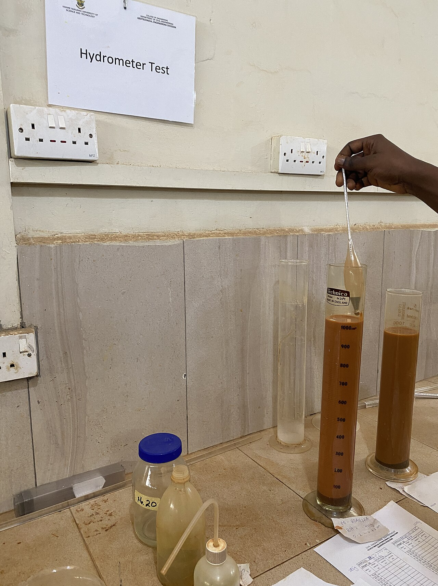

# Hydrometer

A hydrometer looks simple but rewards care: a weighted bulb at the bottom, a narrow stem at the top, and a scale that meets the liquid surface when the instrument floats upright. It measures density or specific gravity, not “alcohol” or “sugar” directly. Figures for alcohol by volume, sugar content or proof are obtained by reading density first, then applying temperature, solution composition and conversion tables. Treating a hydrometer as an “alcohol meter” is the most common conceptual error in using one.

Figure: A hydrometer test in a laboratory; a glass hydrometer reading in a cylinder, not an alcoholometer or saccharometer. Image: Maame1Yaa, CC0, via Wikimedia Commons ([source page](https://commons.wikimedia.org/wiki/File:Laboratory_Hydrometer_test.jpg)).

## Definition and principle

A hydrometer works by Archimedes' principle: an object immersed in a liquid receives an upward buoyant force equal to the weight of the liquid it displaces. The instrument's weight is fixed, so a denser liquid means a smaller displaced volume, and the hydrometer floats higher; a less dense liquid means it sinks deeper and the reading is lower. The scale can therefore be marked from top to bottom or bottom to top in density, specific gravity or the percentage of a particular solution.

The same glass instrument can be made into different “meters”: a density hydrometer reads g/mL or kg/m³; a specific gravity hydrometer reads the ratio to water (specific gravity); an alcoholometer reads ethanol volume percentage or proof; a saccharometer reads sucrose mass fraction (°Brix). Different names do not mean different principles; they mean different scales and intended solutions. Using a saccharometer on spirits, or an alcoholometer on a sugary fermentation liquid, produces readings distorted by dissolved solids and cannot be taken as the target value.

## Common scale types

A density hydrometer is marked in g/mL or kg/m³ for work that needs absolute density. A specific gravity hydrometer uses water at a specified temperature as 1, with readings such as 1.050 or 0.995; brewers use it to describe wort, juice or fermenting liquid. An alcoholometer is marked in ethanol-water volume percentage or proof; the TTB Gauging Manual defines a scale of 0 (water), 100 (proof spirits) and 200 (absolute alcohol), read at 60°F. A saccharometer is marked in sucrose mass fraction, commonly 0–30 °Brix, for grape ripeness, juice and fermentation monitoring.

There are also Baumé, API and other industrial scales for specific liquids. They are not a universal “concentration” and cannot be converted directly to alcohol. Choose by the liquid and the answer you need: specific gravity or Brix for fermentation progress, an alcoholometer for proof, a density hydrometer for general density.

## How to read it

First, prepare the sample: the liquid must be uniform, bubble-free and at a stable temperature. Pour it into a clean, transparent cylinder deep enough for the hydrometer to float freely without touching the walls. If there is foam, let it settle or stir gently to release bubbles; carbonated samples must be degassed, because bubbles attached to the instrument make the reading low.

Second, insert the hydrometer: hold the top of the stem, immerse it slowly a little beyond its natural floating point, then release it and let it float freely. Do not let it hit the bottom, and do not warm the liquid with your hand. Wait until it is still and no bubbles are attached. To read, place the eye slightly below the liquid surface and raise the line of sight slowly until the surface changes from an ellipse to a straight line; the point where this line crosses the scale is the reading. Keep the line of sight perpendicular to the stem to avoid parallax, and read the thermometer at the same time because temperature changes density.

Third, correct: hydrometers are usually calibrated at 20°C or 60°F. If the sample is at another temperature, convert the reading with the correction table. The TTB Gauging Manual notes that below 60°F the hydrometer reads lower than true proof, and above 60°F it reads higher, so table correction is required. Brewing also uses 20°C correction tables; different industries use different standard temperatures, and they cannot be mixed.

## Temperature and calibration

Temperature is the most easily ignored variable. Liquid density changes with temperature, and the glass itself expands; if the sample is not at the calibration temperature, the reading is not the density at standard conditions. Bring the sample, cylinder and hydrometer to a similar temperature, using a water bath if necessary. Record the temperature immediately after reading, then apply the table or calculation. A density reading without a temperature is half the data.

Calibration matters too. NIST's hydrometer calibration service measures at about 10%, 50% and 90% of the scale and reports a correction equation; everyday users can check one point with a known liquid such as pure water, but a single point does not cover the whole range. TTB requires producers to test hydrometers and thermometers frequently and to stop using an instrument whose error exceeds one subdivision. Glass hydrometers break easily; a bent stem, a cracked bulb or a loose scale all affect the reading. Replace a damaged instrument rather than gluing it back together.

## Uses in brewing and spirits

In beer and wine making, a hydrometer tracks fermentation: read the wort or juice before fermentation for original gravity or Brix, then read final gravity at the end; the difference supports an estimate of alcohol production. Brewers also use it to judge whether fermentation is complete and whether temperature or yeast needs adjustment. A hydrometer cannot tell you “alcohol” directly, because the liquid still contains sugar, protein and alcohol; density is the combined result. You need the start and end readings plus an empirical formula or laboratory analysis.

In spirits production and tax gauging, an alcoholometer reads proof. TTB requires precision hydrometers and thermometers, operated under 27 CFR 30.23, with Table 1 correction to 60°F. Modern plants may use density meters or oscillating instruments, but these still need calibration and comparison. For consumers, a hydrometer is not a household necessity; if you only want a bottle's strength, the label and a test report are more reliable than buying an instrument.

## Limits and alternatives

The first limit is that the reading is indirect: it measures density and does not distinguish sugar, alcohol, protein or dissolved salts. In a sugary fermentation liquid, high density does not necessarily mean high alcohol; alcohol lowers density, but sugar raises it. The second limit is temperature: without correction, readings are not comparable. The third is sample size: a cylinder that is too narrow, an instrument that is too large or too little liquid can make it touch the wall or fail to float. The fourth is bubbles and suspended solids: carbon dioxide, protein and fruit pulp all interfere.

Alternatives include a refractometer (refractive index, common for Brix and juice), an oscillating densitometer (high laboratory precision), near-infrared spectroscopy (on-line measurement) and a pycnometer (specific gravity bottle). A refractometer used on an alcoholic solution needs correction and cannot be read as alcohol directly; a densitometer also needs temperature control and calibration. No instrument “reads everything directly”; the key is to know which physical quantity it measures and how to convert the reading into the answer you need.

## Common misreadings

First, a hydrometer is not an “alcohol meter”. It measures density; alcohol is inferred from density, temperature and composition. Second, a deeper reading does not mean “stronger”. In pure water the reading is near 1.000; in ethanol it is below 1.000, because high-strength alcohol is less dense. Third, Brix is not “sugar equals sweetness”. Brix approximates sucrose mass fraction; alcohol, acid and soluble solids affect refraction and density, and actual sweetness also depends on residual sugar and acidity.

Fourth, temperature does not matter is wrong. The same drink reads differently at 15°C and 25°C; only after correction can the values be compared. Fifth, “eyeballing” the reading is wrong. Meniscus, parallax, bubbles and a wet stem all introduce error; under standard practice, read to the smallest division and estimate to half a division when needed. Sixth, a hydrometer is not “more accurate because it costs more”. Range match, valid calibration and good technique matter; a cheap but well-calibrated instrument may serve daily work better than an expensive uncalibrated one.

## Buying and care

First choose the range: beer wort usually needs a 1.000–1.120 hydrometer; wine or high-sugar juice may need 1.000–1.140; spirits proof needs an alcoholometer covering 0–200 proof. Then consider the subdivision: finer divisions read more precisely but are harder to see. Check that the stem is straight, the scale is clear and the bulb has no cracks; plastic hydrometers resist impact but usually offer less precision and long-term stability than glass.

After use, rinse immediately with water so sugar or tartar does not dry on the stem; dry with a soft cloth and store in the original plastic tube or foam box, away from hard objects. Do not rinse with hot water, which can crack the glass, and do not use an ultrasonic cleaner unless the maker permits it. For long storage, keep it dry, dark and away from high heat. Check the zero point periodically with pure water or a standard solution; if it has drifted, send it for calibration or replace it.

## Writing and teaching

In writing, the accurate wording is “the fermentation liquid measured 1.050 and fell to 1.010 on the hydrometer, and the alcohol estimate combines that drop with temperature and a formula”, not “the hydrometer measured 5% alcohol”. When introducing the tool, state the physical quantity first, then the scale type and temperature basis, then the limits of conversion. In teaching, show a density hydrometer, an alcoholometer and a saccharometer side by side so readers can see “one principle, different scales”.

The value of a hydrometer is not that it turns a drink into a single number, but that it puts density, temperature and conversion on the table. If you know the physical quantity behind the reading, it is a reliable, cheap and reproducible tool; if you treat the reading as direct alcohol or sugar, it creates an illusion of precision. The instrument is not wrong; the error is in the basis.

## Further reading and see also

- [Fermentation](ref:fermentation): the process a hydrometer helps track.
- [Original gravity](ref:gravity): starting gravity and soluble solids.
- [Alcohol by volume](ref:abv): one target value inferred from density change and temperature.
- [Standard strength and proof](ref:proof): alcoholometer scales and conversion.
- [Brix](ref:brix): saccharometer scales and their limits.
