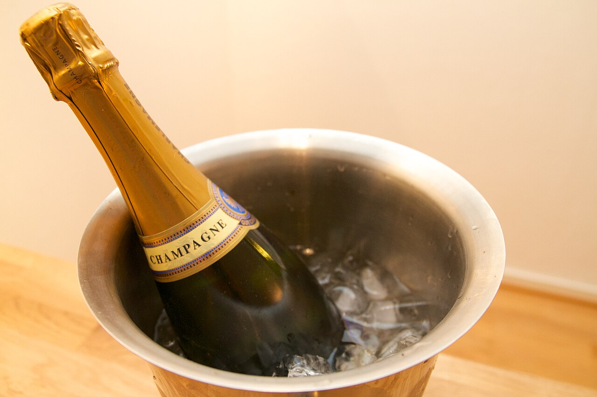

# Ice Bucket

An ice bucket is a bucket-shaped vessel for chilling bottles, usually in stainless steel, copper or glass. Its job is not to bury the bottle in ice but to stand it in ice water: an ice-water mix conducts heat far better than ice alone and chills faster and more evenly.

The shape is usually tall and narrow so a bottle stands upright and the water covers the wine; the rim is wide enough to add ice and lift the bottle; the base is heavy enough to stay steady. It is a tool and a table centrepiece at once.

Figure: A Champagne cooler. Image: Kjetil Ree, CC BY-SA 3.0, via Wikimedia Commons ([source page](https://commons.wikimedia.org/wiki/File:Champagne_cooler_-_2013-12-26_at_19-32-24.jpg)).

## Shape and material

The core is a bucket that is deep enough, watertight and stable. The body must hold a bottle upright and let water reach the wine; the base must not tip. Metal conducts heat quickly and chills faster; glass looks better but conducts slowly and chills slowly.

Stainless steel is the most common: durable, easy to clean and moderate in price. Copper conducts better and costs more, suiting formal service; glass suits display but dislikes sudden temperature change, which can crack it.

Capacity must match the bottle. Champagne and wine bottles differ in diameter; too narrow and the bottle will not fit, too shallow and the water cannot cover the wine. Measure the bottles you use before buying, rather than choosing by looks alone.

## Ice water beats ice alone

Ice alone leaves air gaps, and air is a poor conductor, so chilling is slow. An ice-water mix fills the gaps; water conducts heat well and carries heat away from the glass quickly. Water matters as much as ice.

The target is to cover the wine. The wine sits in the lower and middle body, so water should reach at least the shoulder; if only the base is buried, the upper bottle stays warm and chilling is uneven. Stir briefly after adding ice to mix water and ice.

Salt lowers the freezing point and speeds melting, but it also frosts the bucket and can soak the label. Unless fast chilling is essential, salt is not recommended. For ice and temperature, see [ice and temperature](ref:ice).

## What it suits

The ice bucket suits sparkling wine, sweet wine and white wine that needs low temperature. Sparkling wine is usually served around 6 to 8 degrees Celsius; a bucket chills it quickly and holds it at the table. Sweet and some white wines also need the cold.

It can also cool a red wine down. If a red is too warm, for example at a 28-degree summer room, 5 to 10 minutes in the bucket brings it back to range; do not chill it for long, which mutes the aroma.

It is not for storage. The bucket is a service tool, not a wine cabinet; a long soak peels labels and wets the cork. For sparkling service, see [opening sparkling wine](ref:sparkling) and [Champagne flute](ref:flute).

The bucket and the fridge also divide the work. A fridge suits long storage with a stable temperature but chills slowly; a bucket suits fast chilling and table service, quick but warming over time. Use the bucket to bring a bottle to range quickly, and the fridge to hold it there; the two work as a pair.

## Use and timing

First, ice then water. Fill the bucket about two-thirds with ice, then add water until the bottle is covered; ice first lets it settle and avoids overflow.

Second, place the bottle. Lower it gently, avoiding a knock against the wall; keep it upright with the label outward for identification. Do not shake a sparkling bottle as it goes in.

Third, time it. White wine usually takes 15 to 20 minutes, sparkling 20 to 30, red 5 to 10; the time depends on starting temperature, wine type and bucket material, not a single rule.

Fourth, dry the bottle. Wipe it with a clean cloth when lifting it out, so water does not reach the table or the glass; wipe the rim again before opening. For pouring, see [pouring](ref:pouring).

## Cleaning and care

Empty the bucket after use, rinse with warm water and dry with a cloth. Do not use steel wool on metal, which scratches; use a soft sponge on glass.

Metal takes water marks. Dry it again with a soft cloth to keep the shine; do not seal a lid on a damp bucket. Copper darkens with oxidation and can be cleaned with a copper polish, without over-polishing.

Glass dislikes sudden temperature change. Do not rinse a cold bucket with hot water, which can crack it; let it return to room temperature first. Do not stack buckets, which knocks them together.

## Common mistakes

First, ice without water. Air insulates and chilling is slow; the ice-water mix is the correct method.

Second, too little water. Only the base is chilled and the upper bottle stays warm; cover the wine.

Third, chilling every wine. A long chill mutes red wine aroma; a short cool-down is enough.

Fourth, using the bucket as storage. A long soak peels labels and wets corks; it is a service tool, not a cabinet. For sparkling wine, see [sparkling wine](ref:bubbly); for temperature, see [ice and temperature](ref:ice).

Start with the material and scale. From there, consider the task it is designed for, then what it distorts outside that task. That is how a practical judgment about Ice Bucket is built.

Start with [Ice is a choice, not a test](ref:ice) for material, then read [Sparkling wine](ref:bubbly) for purpose. Seeing both keeps Ice Bucket from being confused with a neighbouring idea.

**At a glance:** A bucket-shaped vessel for chilling bottles, usually metal or glass. An ice-water mix chills faster than ice alone, the water should cover the wine and the time depends on the drink.

Do not reduce Ice Bucket to a vessel.

A 50/50 ice-water mix chills a bottle faster than ice alone; allow 15–20 minutes for a 750 mL bottle and top up the ice.

Salt speeds the melt and the chill, but it also corrodes metal if left in the bucket.

**Key facts.**

| Item | Detail |
| --- | --- |
| In one line | A bucket-shaped vessel for chilling bottles, usually metal or glass. An ice-water mix chills faster than ice alone, the water should cover the wine and the time depends on the drink. |
| Material | Stainless steel、Copper、Glass |
| Purpose | Chilling wine, sparkling wine and beer bottles |

**Sources and limits.** The key claims about Ice Bucket are checked against the following sources: Oxford University Press (Used to check ice buckets and drinks service background), Encyclopaedia Britannica (Used to check wine service temperature and methods), Corning Museum of Glass (Used to check glass and metal vessel craft background) and 4 sources in total. Prices, batches and status change; the body is project-written and does not reproduce source text.

For Ice Bucket, this tool was last checked in 2026; prices, batches and availability change, so confirm them against the sources below.
