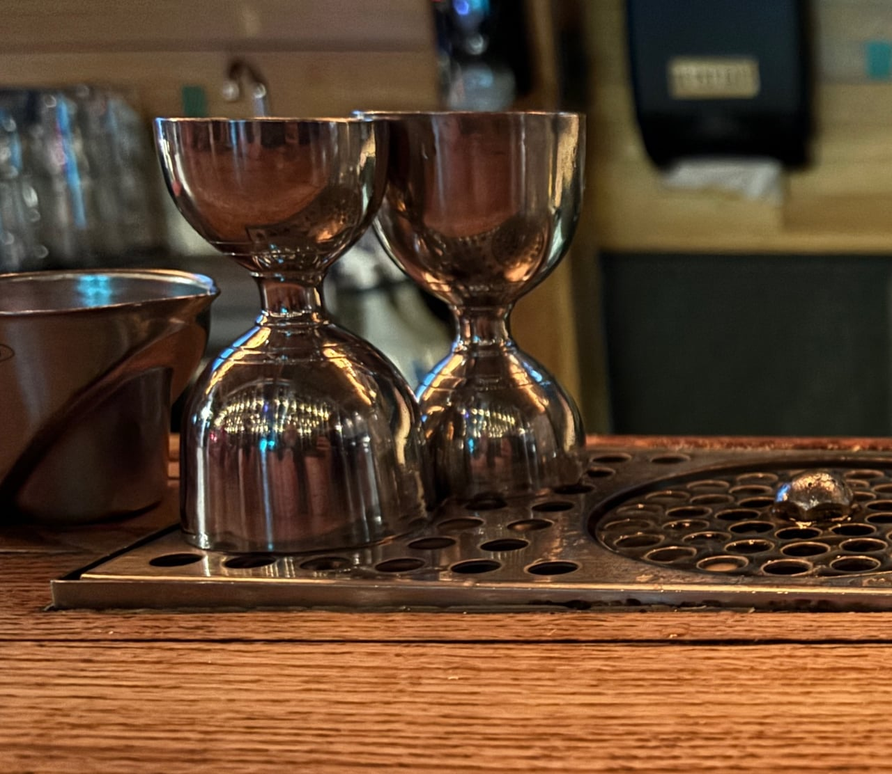

# Jigger

A jigger is the small measure used in bartending for spirits, syrups and juice. It is usually a double-ended cone, with one larger and one smaller cup, so a fixed volume can be poured quickly. Whether a recipe can be reproduced consistently depends heavily on accurate measuring rather than on "just pouring a bit".

Figure: Two metal double-ended jiggers on a bar drip tray, with a small measuring cup at left. Image: Topher, CC0, via [source page](https://wordpress.org/photos/photo/93268b5b84/).

## Definition and form

A common jigger is a stainless-steel double cone with a capacity at each end, such as thirty and forty-five millilitres, or twenty-five and fifty millilitres. There are also single-ended models with markings and glass jiggers. The double-ended design is fast: the two usual measures are immediately to hand, with no need to find a measuring cup.

Form also affects the pour. A narrower conical lip is easier to control; a wider mouth flows faster but measures less precisely. Models with internal markings suit recipes needing finer divisions, but markings wear with use and should be checked periodically.

## Capacity and accuracy

Whether a jigger's nominal capacity means "filled to the brim" or "filled to a mark" varies between products. Confirm the convention before use and check it once against a graduated measure. A common double jigger has about thirty millilitres at one end and forty-five at the other; home users may choose smaller sizes for low-alcohol recipes.

Accuracy depends on pouring angle, viscosity and what remains on the wall. Syrup is viscous and clingy, so the delivered volume may be less than nominal; high-alcohol liquids flow well but spill easily. When millilitre precision matters, a scale or a graduated measure is more reliable than a jigger.

## Procedure

First, confirm that the recipe's unit matches the jigger's capacity. If the recipe says "thirty millilitres", use the matching end rather than estimating with the other. Second, place the jigger on a stable surface and fill to the nominal level, avoiding a high pour that creates bubbles.

Third, check that the surface is level with the rim or the mark. Fourth, bring the jigger close to the target vessel and pour slowly to reduce splashing and cling. Fifth, wait a moment after pouring so clinging liquid falls, then move the jigger away. Sixth, rinse or wipe immediately so syrup residue does not affect the next measure.

## Parameters and judgement

Capacity, viscosity, pouring angle and residue together determine the delivered amount. "One part" or "one ounce" can mean different millilitre values across sources, so follow the unit the recipe actually gives. When converting, check first whether the source uses US or imperial units.

Speed and accuracy need balancing. A busy bar prioritises speed and measures quickly with a jigger; experimental or low-sugar recipes that need exact reproduction suit a scale. The two are not opposed but are tools for different situations.

## Failure cases

First, using the wrong end. Treating forty-five millilitres as thirty changes both strength and balance. Second, "filling by feel". A jigger not used to its nominal level is not measuring at all.

Third, ignoring what clings to the wall. Viscous liquid remains behind, so less is delivered and the drink tastes less sweet. Fourth, worn markings. After long use the marks blur, so check against a standard measure periodically.

Fifth, pouring too hard. Liquid hits the target vessel, creates bubbles and splashes, and affects later shaking or stirring. Sixth, not washing between uses. Juice or syrup residue contaminates the next drink and may clog a strainer.

## Relationship to other tools

The jigger measures, the [shaker](ref:shaker) and mixing glass mix, and the [bar spoon](ref:spoon) stirs and guides. The division is clear: if measuring is inaccurate, no amount of good technique can reproduce the recipe.

In [cocktail basics](ref:cocktail-basics), recipes are usually given in millilitres or ounces. Match the recipe unit to the jigger capacity; if unsure, verify once with a scale or graduated cup before everyday service.

## Material and care

Stainless-steel jiggers are durable and easy to clean and are the common choice; glass jiggers make the level easy to see but break easily. Rinse immediately with warm water so syrup and juice do not dry on; dry afterwards to prevent stains and oxidation.

Do not heat a jigger directly or fill it with strong acid or alkali. Stop using it for precise measuring when markings wear, the rim deforms or rust appears inside. Do not stir or strike with a jigger, because deformation changes its capacity.

## Common misconceptions

First, a jigger's capacity is fixed. Naming conventions and capacities differ between products, so check before use.

Second, pouring by feel is faster. Speed can be trained, but accuracy cannot be replaced by feeling.

Third, any liquid can be measured in a jigger. Viscous or pulpy ingredients cling or clog; use a scale or another method.

Fourth, markings are always accurate. They wear with use; check periodically against a standard measure.

Fifth, a jigger replaces a scale. When gram or millilitre precision matters, a scale is more reliable.

## Buying advice

Check the capacity range of your usual recipes, then choose a matching double jigger. For home use, a thirty and forty-five millilitre pair covers most needs; if recipes range widely, add a smaller or larger size.

Before use, verify both ends against a graduated measure, then practise the pouring angle and stopping point. A tool earns its place through repeatability, not looks.

**Short definition:** A small bar measure for fast, repeated doses of liquid; dual-ended capacity, clear markings and a controlled lip affect consistency and speed in service.

Start with the material and scale. From there, consider the task it is designed for, then what it distorts outside that task. That is how a practical judgment about Jigger is built.

Common jiggers measure 30 and 60 mL, or 1 and 2 oz.

**Key facts.**

| Item | Detail |
| --- | --- |
| In one line | A small bar measure for fast, repeated doses of liquid; dual-ended capacity, clear markings and a controlled lip affect consistency and speed in service. |
| Material | Stainless steel、Glass |
| Purpose | To measure spirits, syrups and other ingredients quickly and repeatably |

**Sources and limits.** The key claims about Jigger are checked against the following sources: International Bartenders Association (Used to check classic cocktail measures), Oxford University Press (Consulted for entries on jiggers and bar measures; Migrated from the former reference list at the end of the article; access date not re-verified), Difford's Guide (Used to check public guidance on bar tools and recipe measures). Prices, batches and status change; the body is project-written and does not reproduce source text.

## Further reading

- [Cocktail basics](ref:cocktail-basics): recipe units, ratios and method.
- [Cocktail shaker](ref:shaker): the mixing tool after measuring.
- [Bar spoon](ref:spoon): stirring and guided pouring.
- [Negroni](ref:negroni): a classic recipe with clear proportions.
