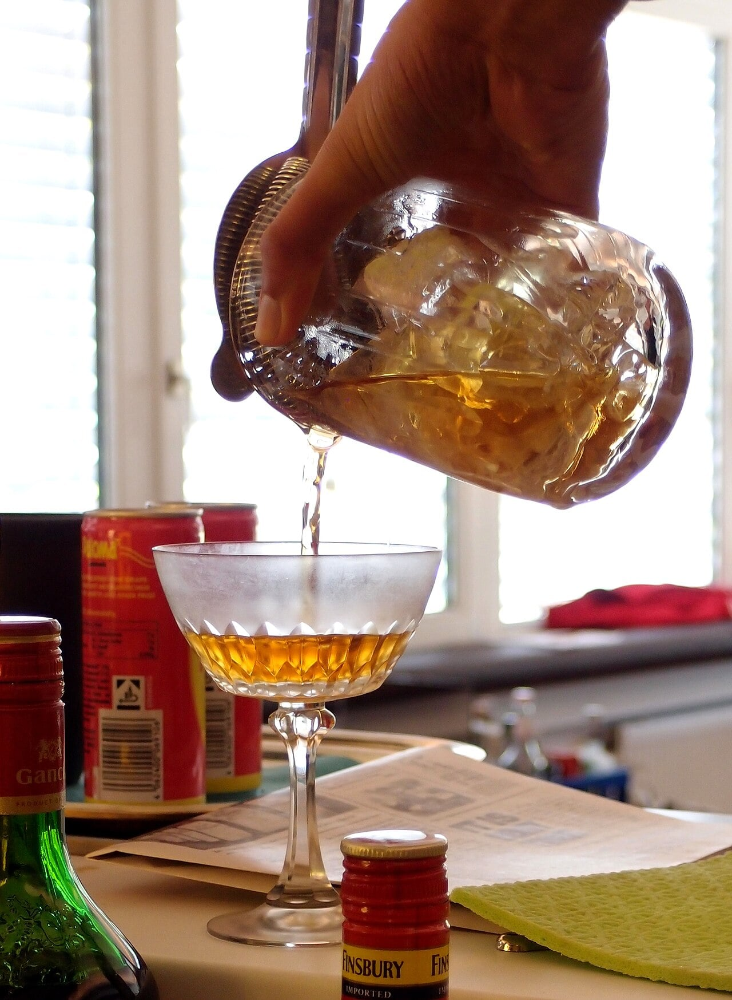

# Mixing glass

A mixing glass is the working vessel for stirred cocktails. Liquid, ice and a bar spoon go in; steady stirring brings about chilling, dilution and mixing; the drink is then strained into a chilled glass. It never reaches the guest, yet it is one of the tools that decides the final temperature and dilution.

Figure: An etched glass mixing glass pours an amber cocktail through a strainer into a coupe, with ice still in the glass. Image: SKopp, CC BY 4.0, via [source page](https://commons.wikimedia.org/wiki/File:Pouring_from_a_mixing_glass.jpg).

## Definition and form

A mixing glass is usually a tall glass with a slightly tapered body and a wide rim, so a bar spoon can reach in and turn. Common shapes are straight-sided and wider at the top than the base; some carry markings for direct measuring. Unlike a shaker, it has no seal and holds no pressure, so it is only for stirring, never shaking.

Capacity is commonly between three hundred and five hundred millilitres. Too small and the ice and liquid crowd together, so stirring is uneven; too large and the surface area is excessive, so the drink warms faster and dilution is harder to control.

## Why glass

Glass does not react with acidic juice, syrup or alcohol and does not retain odours the way some metals can. A clear body lets the bartender see ice size, the stirring path and the degree of dilution while working. Crystal glass feels and conducts heat slightly differently from ordinary glass, but for home use a thick, temperature-tolerant, easy-to-clean glass matters more than "premium" material.

Metal mixing tins chill faster but hide the contents and are unsuitable when colour needs watching. The weakness of glass is breakage, so washing and storage need more care.

## Procedure

First, chill. Put the mixing glass in the fridge, or stir it with ice for a moment and discard the melt water, so the wall is cold. Second, measure the liquid according to the recipe and add it to the glass. Third, add enough ice, usually to about two thirds of capacity, leaving room for the spoon.

Fourth, insert the [bar spoon](ref:spoon), keep its back near the wall and turn steadily with the fingers along the twisted stem. Fifth, stir until the outside frosts, the glass feels clearly cold, or the recipe's time is reached. Sixth, strain through a strainer into a chilled glass so ice and melt water stay out of the drink.

## Parameters and judgement

Capacity sets the ratio of ice to liquid and whether a steady whirlpool can form. Thicker walls warm more slowly after chilling; a wider rim lets aroma escape and temperature rise faster. Stirring time, ice size and starting temperature together decide final dilution; the vessel is only one part.

Three signals show that stirring is done: frost on the outside, a clearly cold hand on the glass, and liquid flowing smoothly around the spoon. Different recipes want different dilution, so "how many turns" should not be followed mechanically.

## Failure cases

First, substituting a shaker. Shaking adds air and produces a cloudy, foamy drink, which does not suit recipes built on spirits, bitters and vermouth. Second, not chilling the glass. Ice melts quickly against a warm wall, so the drink is over-diluted and not cold enough.

Third, packing in too much ice. With no room to move, the spoon cannot turn and chilling is uneven. Fourth, stirring too long. Dilution passes the target, aroma fades and the drink tastes watery.

Fifth, incomplete straining. Crushed ice and melt water enter the glass and keep diluting the drink. Sixth, using a cracked glass or one not made for temperature shocks. Rapid chilling can break it, which is a safety issue.

## Difference from a shaker

A [shaker](ref:shaker) uses vigorous shaking for rapid chilling, aeration and emulsification, and suits recipes with juice, egg white, cream or syrup. A mixing glass uses gentle stirring for chilling and dilution, and suits recipes built on spirits, bitters and vermouth. The IBA recipe for the [Negroni](ref:negroni) is stirred with ice and strained into a rocks glass; the result should be clear, not foamy.

The two are not substitutes but tools for different goals. Shaking a recipe meant to be stirred over-aerates it; stirring a recipe meant to be shaken struggles to emulsify and chill.

## Material and care

Rinse a glass mixing glass with warm water immediately after use so syrup and juice do not dry on. Avoid steel wool, which scratches; do not soak a marked glass for long, or the markings may lift. Dry it upside down to prevent water stains.

Do not use a mixing glass for hot drinks or leave it in a freezer for a long, hard freeze. Large temperature shocks can crack it. Stop using a glass with a crack, chip or deep scratch, because it may fail while stirring.

## Common misconceptions

First, a mixing glass can be shaken. Without a seal, shaking spills and creates no pressure.

Second, bigger is always better. Too much capacity lets the drink warm quickly and makes dilution harder to control.

Third, chilling can be skipped. Pre-chilling directly affects temperature and dilution and cannot be replaced by adding more ice.

Fourth, a mixing glass is only for cocktails. It can gently mix other drinks, but check material and cleanliness first.

Fifth, glass is always better than metal. Each material has trade-offs; match it to the recipe and the method.

## Buying advice

Check capacity against your usual recipes, then look for even walls and a rim that lets the spoon work. For home use, a 350–450 ml glass with thicker walls and markings is practical; a busy bar can keep several and rotate them through the fridge.

Before buying, hold an empty glass to check stability and a smooth rim, then practise stirring with water and ice. A tool earns its place through repeatability, not looks.

Begin with the material and scale, move on to the task it is designed for, and finish with what it distorts outside that task. That order keeps the reading of Mixing glass practical.

[Stirring](ref:stirring) explains material; [Cocktail shaker](ref:shaker) adds purpose. Put Mixing glass between them before deciding what it is.

**At a glance:** A vessel used with a bar spoon for stirred cocktails; wall thickness, capacity and rim shape affect stirring efficiency, dilution and the final temperature.

**Key facts.**

| Item | Detail |
| --- | --- |
| In one line | A vessel used with a bar spoon for stirred cocktails; wall thickness, capacity and rim shape affect stirring efficiency, dilution and the final temperature. |
| Material | Glass、Crystal glass |
| Purpose | To stir cocktails with a bar spoon so the drink is chilled, lightly diluted and evenly mixed |

**Sources and limits.** The key claims about Mixing glass are checked against the following sources: International Bartenders Association (Used to check methods for stirred and shaken cocktails), Oxford University Press (Consulted for entries on mixing glasses, bar spoons and stirring; Migrated from the former reference list at the end of the article; access date not re-verified), Difford's Guide (Used to check public guidance on bar tools and stirring). Prices, batches and status change; the body is project-written and does not reproduce source text.

## Further reading

- [Stirring](ref:stirring): the motion, timing and dilution of stirred drinks.
- [Bar spoon](ref:spoon): the companion tool for a mixing glass.
- [Cocktail shaker](ref:shaker): shaking tools and suitable recipes.
- [Negroni](ref:negroni): a classic example of a stirred cocktail.
