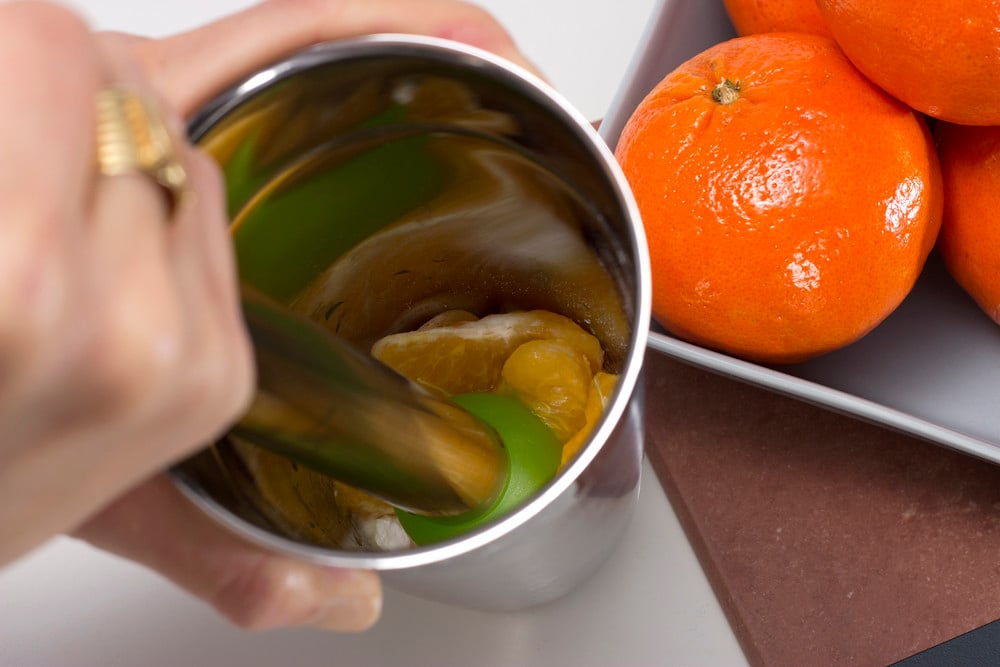

# Muddler

A muddler is the rod-shaped bar tool used to gently press herbs, fruit and sugar in a glass. It looks like a short wooden stick, but length, head shape, weight and material all affect force control, cleaning difficulty and glass safety. With the right tool, muddling becomes controllable; with the wrong one, the same mint can turn from fresh to grassy.

Figure: A hand presses a lime with a wooden muddler in a metal cup, with citrus fruit alongside. Image: Didriks, CC BY 2.0, via [source page](https://www.flickr.com/photos/49889671@N03/6353559445).

## What problem it solves

A muddler solves the problem of getting aroma out of fresh ingredients inside the glass. When mint, basil, lime wedges and sugar sit at the bottom of a glass without a suitable tool, the only options are the back of a bar spoon or fingers, which give uneven pressure and cannot easily reach the bottom.

It lets the user apply downward pressure without breaking the glass. A moderate head spreads the force over the ingredient rather than concentrating it into a point that can crack the wall; a long enough shaft lets the hand stay above the rim instead of reaching into the liquid.

It also separates pressing from stirring. A bar spoon is made for stirring, but crushing herbs with it easily turns into grinding; the shape of a muddler naturally encourages short, controlled, vertical presses and reminds the user to limit force.

## Structure and materials

A muddler usually has two parts: the head and the shaft. The head contacts the ingredients and may be flat, rounded or lightly textured; the shaft is the grip and its length and thickness affect feel and leverage.

There are three common materials. Wood feels warm and costs less, but absorbs odour and moisture and needs careful cleaning and drying. Food-grade plastic is durable and easy to clean, and lighter in weight. Stainless steel is strong, hygienic and easy to clean, but heavier, and needs better control in a thin glass.

Surface condition matters too. Wood with cracks or wear can harbour bacteria; a scratched plastic head can retain colour and odour; a rough stainless surface has more friction and can tear leaves instead of pressing them. Choose for food-contact safety and surface integrity, not looks alone.

## How to choose

First, check that the length matches your usual glasses. The muddler should reach the bottom of the glass while the hand stays above the rim; too short puts fingers in the drink, too long makes control harder.

Second, check the head size against the rim. A head that is too large will not fit a narrow glass; one that is too small concentrates the force.

Third, consider weight and balance. A very heavy muddler is hard to stop in a thin glass, while a very light one needs more effort and is less stable. The centre of gravity should feel close to the hand.

Fourth, consider material and cleaning. A bar that handles mint, citrus and syrup often should choose something easy to clean and resistant to odour; wood needs hand washing and thorough drying.

Fifth, check the surface. Cracks, chips and missing coating are not suitable for continued food contact.

Do not buy an over-heavy or over-long model for a "professional" look. A muddler is a hand tool, and fit matters more than force.

## Correct use

First, confirm that the glass can take the pressure. Thin-walled, narrow or already cracked glasses are unsuitable; use a thicker mixing glass if needed.

Second, put the ingredients at the bottom. In recipes with sugar, add the sugar and a little acid juice first to create an abrasive layer.

Third, hold the glass steady and grip the upper part of the muddler with the other hand, keeping it close to vertical.

Fourth, press down with a short, controlled motion, twist slightly on contact and lift. The aim is to open the plant structure, not to pound the leaves into fragments.

Fifth, watch the leaves and the aroma. Stop when they have darkened and their edges have softened; fragments and dark cuts mean too much force.

Sixth, remove the muddler, wipe or rinse it, and move on. Do not leave it in the glass as a stirring stick.

## Alternatives

Without a muddler, the back of a bar spoon can press lightly, but the contact area is small and control is harder. The handle of a wooden spoon can also work, provided it is smooth, clean and will not scratch the glass. The key for any substitute is a moderate contact area, an intact surface and enough reach.

If the goal is to release herb aroma, shaking can replace muddling: shake the herbs with the liquid and strain out the fragments. The aroma is more dispersed, but the concentrated effect of muddling is lost.

If the goal is juice, a muddler is the wrong tool; use a citrus press or a juicer. A muddler opens structure, it does not extract every drop.

## Care and safety

Wash immediately after every use. Sugar and citrus residue dries on the head and shaft, harbours microbes and affects the next drink. Wood should be hand washed, wiped dry and left to air; do not soak it for long periods, and check the product instructions before putting it in a dishwasher.

Check the head regularly for cracks, chips and odour. Wood that has taken on a strong smell is hard to restore and should be replaced. Stainless steel and plastic should also be checked for rough surfaces and hard-to-clean seams.

For safety, do not press hard in thin-walled glasses or narrow-neck bottles, where breakage and cuts are possible. Do not strike the rim or the table with a muddler, and do not stir ice with it, which wears the head and stresses the glass. After handling fresh ingredients, clean the tool and the work surface according to food-safety requirements.

## Common misconceptions

First, "heavier is better". Extra weight makes control harder and is more dangerous in a thin glass.

Second, "any wooden stick will do". Food-contact safety, surface integrity and cleaning all need to be considered.

Third, "wood does not need washing". Wood absorbs odour and water and must be cleaned and dried thoroughly.

Fourth, "muddling is grinding". A muddler is meant to open aroma structure; grinding brings bitterness.

Fifth, "a muddler replaces shaking". Muddling only treats the ingredients; chilling, dilution and overall mixing still need later steps.

Sixth, "the muddler can stay in the glass". It interferes with drinking and lets the leaves keep oxidising.

## See also

- [Muddling](ref:muddling): the matching technique and force control.
- [Mojito](ref:mojito): the most typical setting for a muddler.
- [Cocktail basics](ref:basics): where tools sit in the overall process.
- [Shaking](ref:shaking): an alternative when no muddler is available.
- [Aroma](ref:aroma): how herb and citrus aroma is released.

**In brief:** A rod-shaped bar tool for gently pressing herbs, fruit and sugar in the glass; length, head shape and material affect force control, cleaning and glass safety.
