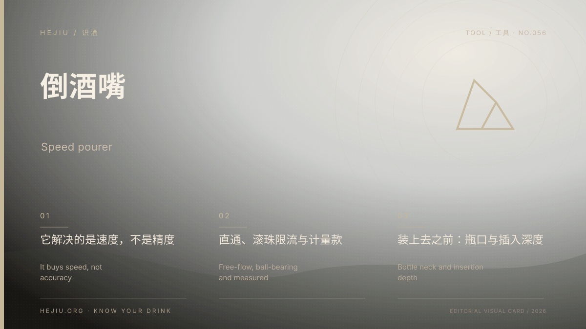

# Speed pourer

A speed pourer is a small spout pushed into the neck of a spirit bottle. It narrows the wide mouth into a fine outlet, so that liquid leaves at a steadier rate and the last drop does not run down the bottle. For a bar working continuously, it is close to standard equipment; describing it as a measuring device is where the confusion starts.

Figure: thematic illustration for Speed pourer. Image: AI-assisted illustration generated with Doubao Seedream 5.0 (project-owned); not a photograph of the subject.

> **Quick verdict**
> **In one line:** This tool helps you decide whether Speed pourer is worth buying, and whether a substitute works.
>
> - **Best for:** Anyone who wants the purpose, substitutes and limits of Speed pourer.
> - **Not for:** If you want want a gear list without the use case.
> - **Check first:**
>   - The core benefit is that one hand can pour in a controlled way.
>   - The most common type is free-flow: no restrictor inside, just a narrowed outlet.

## It buys speed, not accuracy

The core benefit is that one hand can pour in a controlled way. Without a spout, a wide bottle mouth releases a surge as the bottle tips, then drips when it comes back upright. With a narrow outlet, flow is constrained to a narrower range of speeds and the motion becomes faster and more continuous.

The consistency it offers is consistency of action: the same angle held for the same time delivers roughly the same volume. A commonly cited order of magnitude is about 30 ml (1 oz) per second, though the real rate changes with the level in the bottle, the viscosity of the liquid and the angle of the pour. That is enough for an experienced bartender to count seconds, but it is not precision.

An accurate recipe still needs a [jigger](ref:jigger). A jigger delivers a defined volume; a pourer delivers a repeatable motion. The two do not conflict: many bars pour quickly from the spout and check with a jigger, or fit pourers only to the high-volume base spirits.

## Free-flow, ball-bearing and measured

The most common type is free-flow: no restrictor inside, just a narrowed outlet. It is fast and suits spirits used constantly.

A ball-bearing or restrictor model places a small ball or insert in the path, so liquid has to pass around it. Flow is slower and more even. It is often sold as a measuring pourer, but it does not measure; the volume still depends on how long the bottle is tipped.

A true measured pourer contains a chamber that releases a fixed dose, for example 30 ml, and then stops. It is closer to a measuring instrument, but it is more complex, harder to clean and more expensive, and is usually reserved for operations that need strict cost control.

A flip-cap pourer closes when the bottle is set down. It reduces fruit flies and dust, and slows evaporation, which matters on a patio or in a busy room.

## Bottle neck and insertion depth

A pourer is held by a tapered tail pushed into the bottle mouth, relying on friction. Bottle mouths differ in internal diameter, wall thickness and lip shape, so a universal fit is rarely universal.

Wipe the mouth before fitting. Residue makes the pourer slip and collects dust. Push it in vertically until the tail seats against the mouth and the exposed section is stable. Do not force it: too shallow and it leaks, too deep and it may reach the neck, restricting flow or becoming impossible to remove.

Cork-finished bottles and screw-cap bottles have different internal diameters. Choose by measurement or by the maker's stated bottle fit. A common bar practice is to give each base spirit its own pourer and transfer it when the bottle is replaced, rather than pulling and refitting constantly.

## When flow changes, the recipe rhythm changes

With a pourer fitted, spirit enters the shaker or mixing glass faster. That changes the rhythm of the work and the arithmetic behind counting seconds. Pouring is the first step in the [basics of making a cocktail](ref:basics); ice, dilution and garnish follow.

For a [shaken](ref:shaking) recipe such as a [Daiquiri](ref:daiquiri), the ratio of spirit, syrup and lime juice has to be exact. The pourer only gets the spirit into the [shaker](ref:shaker) quickly; the ratio still comes from a jigger or a scale. Fast flow is not permission to pour short, and a bar that counts seconds without checking is the one most likely to drift when it gets busy.

For a stirred recipe, flow affects the time taken, not the recipe itself. Stirring is about ice, time and temperature; pouring faster does not improve the drink, but it keeps service moving.

Viscous liqueurs, syrups and anything with pulp should not carry a pourer. They clog the narrow outlet, flow erratically and are difficult to clean. The tool belongs on clear, free-flowing spirits.

## Cleaning, residue and fruit flies

The inside of a pourer is a warm, damp space with sugar and alcohol in it, which is exactly what fruit flies look for. Residue dries into a sticky film, attracts flies and taints the next pour.

A busy bar should rinse pourers daily, running warm water through both the outlet and the tail, and use a small brush if needed. Once a week, soak them, dry fully and refit. Do not put them in a dishwasher; heat deforms plastic and ages rubber seals.

Wipe the bottle as well. Liquid that escapes around the pourer runs down the glass, collects dust and attracts insects. Cleaning the mouth and shoulder at each bottle change is easier than dealing with the mess later.

On flip-cap models, check the hinge for build-up. If the cap no longer closes flush, the seal is gone and the pourer should be replaced.

## When to pull it out

First, carbonated bottles. Gas is under pressure, and a pourer restricts venting; opening can spray liquid or launch the spout. Use a dedicated bottle stopper or open the bottle normally.

Second, thick or pulpy liquids. Syrups, purees and liqueurs block the outlet.

Third, situations that demand exact measurement. A high-value single serve or a tightly specified recipe should use a [jigger](ref:jigger) or a scale, not a counted pour.

Fourth, bottles that are part of the presentation. An aged spirit or a limited bottling deserves an intact neck; a pourer spoils the line of the bottle.

Fifth, bottles going into long storage. A pourer is not a seal; it lets alcohol evaporate and oxygen in. Refit the original closure for storage.

If counting seconds is not reliable enough, there are two alternatives: go back to a jigger and measure every pour, or use an electronic measuring pourer that controls the dose by button, weight or flow meter. The electronic version suits a fixed menu and steady volume, but needs power or batteries and is more troublesome to clean than a plain spout.

## What to look for when buying

First, material. Stainless steel lasts and cleans well; plastic is light and cheap but ages and stains. Anything touching the liquid should tolerate alcohol and acid.

Second, the seal. The tail should have a suitable taper and enough flexibility to sit without leaking; worn rubber seals should be replaced.

Third, venting. Most pourers have a small air hole that lets air in so liquid flows smoothly. A blocked vent makes the flow surge and gulp.

Fourth, whether it has a cap. A flip cap keeps insects and dust out but is harder to clean; an open spout is simple but needs a separate stopper.

Fifth, whether it comes apart. A two-piece design is much easier to clean thoroughly.

Sixth, bottle fit. Measure the internal diameter of your usual bottles, or rely on the maker's stated compatibility.

## Safety: never on a carbonated bottle

A carbonated bottle holds pressure, and the narrow outlet and vent of a pourer change how that pressure escapes. At opening, gas can drive liquid and the spout outward, causing sprays and flying parts.

Never fit a standard pourer to a carbonated bottle, and never use one as a stopper. A dedicated sparkling-wine or soda stopper is the right tool for keeping bubbles.

There is a smaller risk with still spirits: tip the bottle too far and liquid can escape through the vent. Pour at a measured angle, keep the bottle clear of the glass, and watch the target rather than turning to talk.

## Common misconceptions

First, that a pourer measures automatically. It controls flow, not volume; accurate recipes still need a jigger.

Second, that one pourer fits every bottle. Internal diameters differ, and a universal fit is not universal.

Third, that pourers do not need cleaning. Residue attracts fruit flies and taints flavour, so they need regular washing.

Fourth, that faster flow is always better. It splashes, increases error and makes the pour harder to control.

Fifth, that a pourer can go on a cola bottle. Pressure causes spray and can launch the spout.

Sixth, that a pourer works as a long-term stopper. It is not a seal; spirits oxidise and evaporate.

## See also

- [Jigger](ref:jigger): accurate measurement, the clear complement to a pourer.
- [Cocktail shaker](ref:shaker): receives the spirit the pourer delivers.
- [Shaking](ref:shaking): a technique that depends on exact ratios.
- [Daiquiri](ref:daiquiri): a ratio-sensitive drink that shows why measurement matters.
- [Cocktail basics](ref:basics): pouring and measuring in the service flow.

For Speed pourer, begin with the material and scale. Then look at the task it is designed for, and finally ask what it distorts outside that task. The answers point to different choices, not to a single score.