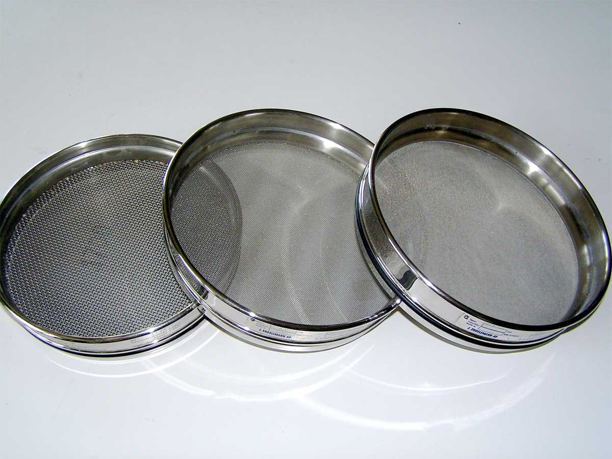

# Strainer

A strainer sits over the rim and holds back ice and solid residue. After stirring or shaking, the drink must be separated from the ice, or it keeps diluting and crushed ice spoils texture and appearance. A strainer looks like "just a sieve", but hole size, fit and technique all change the result.

Figure: Strainer. Image: User:BMK, CC BY-SA 3.0, via Wikimedia Commons ([source page](https://commons.wikimedia.org/wiki/File:Laboratory_sieves_BMK.jpg)).

## Types and form

The two commonest types are the Hawthorne and the julep strainer. A Hawthorne has a spring coil that fits shakers and mixing glasses of different diameters, and its holes are fine enough to catch crushed ice. A julep strainer resembles a perforated spoon and is often used with a mixing glass, relying on the rim size for fit.

There is also a fine-mesh strainer, usually stacked under a Hawthorne for a second pass. It catches finer pulp, herb fragments and ice shards and clarifies the drink, but it also holds back some oils and bubbles and changes texture. Decide first whether the recipe wants clarity or body.

## Size and fit

The strainer diameter must match the rim of the glass or shaker. Too small and it slips inside; too large and it will not sit, so the drink tips over while pouring. A Hawthorne's spring accommodates a range of diameters, but confirm that it is stable on your usual tools.

Hole size decides the filter. Fine holes catch crushed ice and pulp but slow the flow and require a steadier pour; coarse holes flow faster but let crushed ice through. A second pass gives both, at the cost of an extra step and more washing.

## Procedure

First, seat the strainer on the rim or shaker mouth and confirm it is stable. Second, hold the vessel and strainer with one hand and control the pouring angle with the other. Third, pour slowly so liquid passes the holes while ice and residue stay above.

Fourth, tap the strainer edge after pouring so attached liquid falls, but do not slap it, or crushed ice drops into the glass. Fifth, for a second pass, place a fine-mesh strainer under the Hawthorne. Sixth, wash the strainer immediately so syrup and pulp do not dry on.

## Parameters and judgement

Flow rate, hole size and tilt together decide the result. A steep tilt pours fast but lets crushed ice through; a shallow tilt filters more cleanly but takes longer. Recipes with pulp, muddled herbs or egg white usually need finer filtering; stirred recipes built on spirits and bitters only need the ice held back.

Filtering also changes texture. Fine mesh removes some bubbles and particles, making the drink clearer and smoother, but over-filtering can cost body and aroma. Whether to double-strain is a question about the recipe, not a default that "cleaner is better".

## Failure cases

First, a strainer that does not fit. It slides or tips while pouring, spilling the drink or even dropping ice into the glass. Second, pouring too fast. Crushed ice is pushed through the holes and shards appear in the glass.

Third, not chilling the strainer. A warm tool raises the drink's temperature and makes bubbles livelier. Fourth, a dirty strainer. Leftover syrup and pulp contaminate the next drink and can block the holes.

Fifth, using a strainer instead of a fine mesh. When fine particles must be caught, one Hawthorne is not enough; add a mesh strainer. Sixth, slapping the strainer after pouring. Ice and residue are knocked into the glass and the work is undone.

## Relationship to stirring and shaking

After [stirring](ref:stirring), the strainer separates ice from liquid so the drink stays clear; after [shaking](ref:shaking), it must also hold back crushed ice and any pulp or egg-white fragments. Mixing glasses and [shakers](ref:shaker) have different rim sizes, so strainers should match each.

A [mixing glass](ref:mixing-glass) usually pairs with a julep or Hawthorne strainer, while a shaker usually takes a Hawthorne. Matching the tools matters more than buying a "premium" strainer on its own.

## Material and care

Stainless steel strainers are durable and easy to clean and are the common choice. Rinse immediately with warm water to remove syrup, pulp and herb fragments; mesh clogs easily, so brush gently with a soft brush rather than poking it with a sharp tool.

Dry or invert to drain so water stains and oxidation do not form. The spring and mesh are wear points; replace the strainer if they deform, rust or break. Do not use it to crush ice or pry hard objects, which bends it out of shape.

## Common misconceptions

First, a bigger strainer is better. It must match the rim; oversize is unstable.

Second, finer holes are always better. Finer filtering is cleaner but slower and removes some bubbles and texture.

Third, pouring faster is easier. A fast pour pushes crushed ice through and puts shards in the glass.

Fourth, a strainer replaces a fine mesh. One layer cannot catch fine particles; use a second pass when needed.

Fifth, a strainer need not be washed. Residue contaminates the next drink and blocks the holes.

## Buying advice

Check the rim diameters of your usual mixing glass and shaker, then choose a strainer that sits securely. For home use, one Hawthorne and one fine-mesh strainer cover most needs; a busy bar should keep several sizes to match its vessels.

Before buying, seat an empty strainer on the rim to check that it does not slip or scratch, then practise pouring with water and ice. A tool earns its place through repeatability, not looks.

[Stirring](ref:stirring) and [Cocktail shaker](ref:shaker) are the two useful reference points for Strainer. [Stirring](ref:stirring) sets out material; [Cocktail shaker](ref:shaker) brings in purpose. Read them together.

**In brief:** A bar tool that keeps ice, crushed ice and solid residue out of the glass; Hawthorne and julep strainers are the common types, with a fine-mesh strainer used for a second pass. 

For Strainer, begin with the material and scale. Then look at the task it is designed for, and finally ask what it distorts outside that task. The answers point to different choices, not to a single score.

**Key facts.**

| Item | Detail |
| --- | --- |
| In one line | A bar tool that keeps ice, crushed ice and solid residue out of the glass; Hawthorne and julep strainers are the common types, with a fine-mesh strainer used for a second pass. |
| Material | Stainless steel |
| Purpose | To filter out ice, crushed ice and solid residue so texture and clarity stay under control |

**Sources and limits.** The key claims about Strainer are checked against the following sources: International Bartenders Association (Used to check methods and straining for cocktails), Oxford University Press (Consulted for entries on strainers and bar tools; Migrated from the former reference list at the end of the article; access date not re-verified), Difford's Guide (Used to check public guidance on bar tools and straining). Prices, batches and status change; the body is project-written and does not reproduce source text.

## Further reading

- [Stirring](ref:stirring): the straining step after stirring.
- [Shaking](ref:shaking): handling crushed ice and residue after shaking.
- [Cocktail shaker](ref:shaker): the main partner for a strainer.
- [Mixing glass](ref:mixing-glass): the vessel for stirred recipes.
- [Bar spoon](ref:spoon): the companion tool for stirring and guided pouring.
