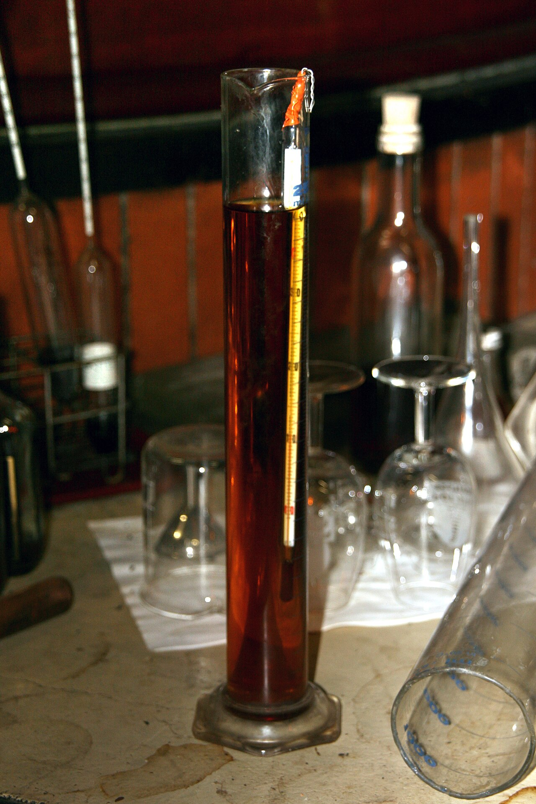

# Thermometer

A thermometer measures temperature. In drinks it has three common jobs: measuring the liquid, the bottle and the storage environment. Temperature shapes aroma, texture, bubbles and fermentation, so a reading is more reliable than a guess. For wine's temperature range, see [wine](ref:wine).

There are many types: probe, infrared, stick-on and glass alcohol. They measure different things with different accuracy; choose the wrong type and the reading drifts or fails altogether.

Figure: A wine thermometer. Image: Sémhur, CC BY-SA 4.0, via Wikimedia Commons ([source page](https://commons.wikimedia.org/wiki/File:Wine_thermometer_-_20091205.jpg)).

## Types and targets

A probe thermometer is best for liquid. The probe enters the drink and the reading reflects the liquid; response is moderate and accuracy good, suiting home and restaurant use. Clean and sanitise the probe before it enters the glass.

An infrared thermometer is best for surfaces. It reads infrared radiation and does not touch the liquid, suiting the bottle, the outside of a decanter and the cellar wall; it cannot read the inside of a clear liquid, nor measure accurately through glass.

A stick-on thermometer is best for the bottle. It attaches outside and shows the wall temperature; wall temperature is not liquid temperature but is a useful guide. A glass alcohol thermometer is cheap and stable but slow, suiting ambient rather than quick readings.

## Temperature and wine

Temperature shapes aroma. Too cold and the aroma is muted and the wine closed; too warm and alcohol rises, the nose turns sharp and the body goes loose. White wine is usually served cooler than red, sparkling cooler still and sweet wine often coldest.

Temperature also shapes bubbles. The colder the sparkling wine, the more carbon dioxide stays dissolved; as it warms, bubbles escape faster and the drink goes flat. The bucket and the fridge bring the wine to range, not as cold as possible.

Temperature shapes fermentation too. During fermentation it governs yeast activity and the flavour compounds produced; too warm and fermentation races with off-flavours, too cool and it stalls. For fermentation, see [fermentation](ref:fermentation).

## Where it helps

The thermometer suits work that needs precise control: restaurant service, cellar management, fermentation monitoring and blind-tasting training. It turns a feeling into a reading and gives temperature judgments a basis; for beginners it also teaches the link between temperature and aroma.

It does not replace experience. A thermometer tells you the degrees, not whether the wine is good now; aroma, texture and personal preference still need tasting. Temperature is a variable, not an answer.

It does not measure every liquid. Infrared cannot read the inside of a clear liquid; a probe is not for boiling liquid; glass is not for fast-changing temperatures. Match the type to the target.

## Use and calibration

First, clean the probe. Wipe with an alcohol swab and rinse with water before it enters the wine, so dust, oil and bacteria do not follow. Let the alcohol dry completely, since a wet probe dilutes the sample and skews the reading.

Second, place it. The probe goes into the middle of the liquid, not against the glass or an ice cube; against the glass it reads the wall, against ice it reads low.

Third, wait for the reading to settle. A thermometer needs time to respond; record after it steadies, not at the first number and not while moving the probe.

Fourth, calibrate regularly. Use an ice-water mix at 0 degrees Celsius and boiling water near 100 (depending on altitude) as references; if the drift is large, adjust or replace. For temperature and service, see [ice and temperature](ref:ice).

## Cleaning and care

Clean the probe after every use. Wash with warm water and a little neutral detergent, then rinse; do not immerse the electronic body, which lets water in.

Protect the infrared lens. A dirty lens skews the reading; wipe with a soft cloth, never a hard object. Stick-on thermometers lose grip if peeled and re-stuck repeatedly.

Store away from heat and damp. Do not keep an electronic thermometer by the stove or in direct sun; keep glass thermometers from knocks and cracks. Check batteries, since low power makes readings unstable.

## Common mistakes

First, using infrared on the inside of a liquid. It reads the surface only, and a clear liquid's interior is unreliable; use a probe for liquid.

Second, letting the probe touch the glass or ice. The reading follows the wall or the ice, not the wine; place it in the middle.

Third, skipping calibration. Thermometers drift, and an unchecked one can be several degrees out; check with ice water and boiling water.

Fourth, treating the number as a verdict. The right temperature does not make a wine good; it is a variable, and aroma and texture still need tasting. For aroma, see [aroma](ref:aroma); for pouring, see [pouring](ref:pouring).

Cellar management also relies on the thermometer. Stability matters more than the absolute number; place the thermometer where it represents the room, away from the door, a radiator or the back of a rack. A daily reading at the same time beats an occasional check, and a long record reveals seasonal shifts and equipment faults. Record humidity alongside temperature, since the two together affect corks and labels.

**At a glance:** A tool for measuring liquid, bottle or cellar temperature, common as a probe, infrared or stick-on model. Readings must settle, calibration must be checked and the probe placed where it represents the whole. 

Thermometer is best approached through the material and scale, then the task it is designed for, and then what it distorts outside that task. One check alone will not settle it.

[Ice is a choice, not a test](ref:ice) and [Fermentation](ref:fermentation) answer different questions about Thermometer: material and purpose. Read them as a pair, not as alternatives.

Infrared models read surface temperature only; a probe is better for liquids and should be calibrated in ice water before use.

Check the probe in ice water at 0 °C and in boiling water at 100 °C before trusting a reading.

A probe should be inserted at least 5 cm into the liquid for a stable reading.

**Key facts.**

| Item | Detail |
| --- | --- |
| In one line | A tool for measuring liquid, bottle or cellar temperature, common as a probe, infrared or stick-on model. Readings must settle, calibration must be checked and the probe placed where it represents the whole. |
| Material | Stainless steel、Glass、Plastic |
| Purpose | Measuring liquid, bottle and storage temperature |

**Sources and limits.** The key claims about Thermometer are checked against the following sources: Oxford University Press (Used to check drinks temperature and service background), Encyclopaedia Britannica (Used to check wine temperature and fermentation background), Corning Museum of Glass (Used to check thermometer and glass object craft background) and 4 sources in total. Prices, batches and status change; the body is project-written and does not reproduce source text.

For Thermometer, this page was last checked in 2026; prices, batches and availability change, so confirm them against the sources below.
