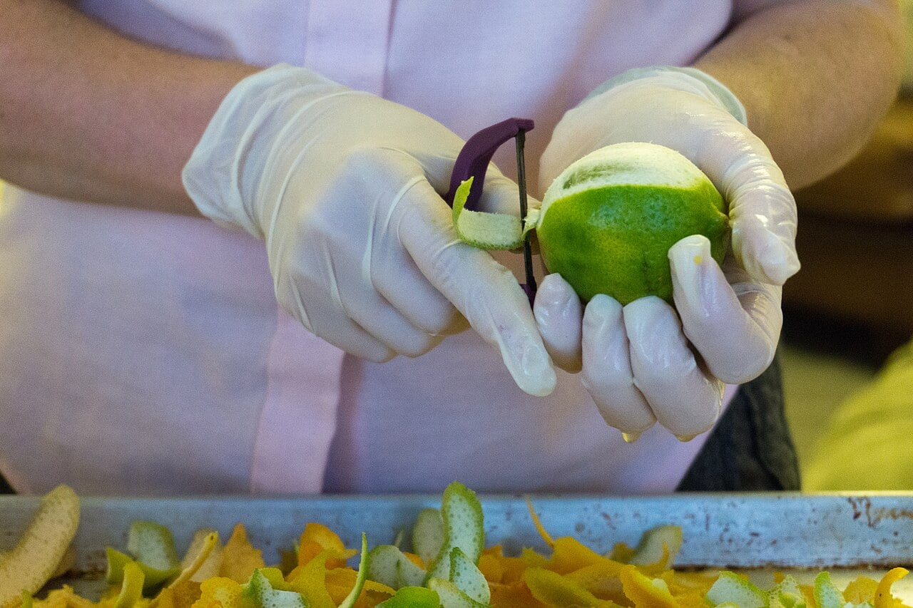

# Y-peeler

A Y-peeler joins its handle to the blade at a right angle, so that the tool looks like a Y or a T from the side. It is used with both hands: one holds the fruit, the other pulls the handle down while the blade runs along the skin and lifts a wide, thin ribbon. In a kitchen it peels potatoes and carrots; at a bar it takes citrus peel and cuts vegetable garnishes.

Figure: A gloved chef uses a purple-handled Y peeler on a lime, with peeled citrus zest on the counter. Image: Jami430, CC BY-SA 4.0, via [source page](https://commons.wikimedia.org/wiki/File:Chef_uses_a_Y_peeler_to_peel_a_lime.jpg).

## Why a Y handle instead of a straight one

A straight peeler, often called an I-shaped or swivel peeler, is held like a pen and pushed or pulled with one hand. The blade swivels to follow a curved surface. It suits long vegetables and feels natural at the wrist, but on a spherical fruit the blade tends to skip across the curve and the width of the peel becomes hard to control.

The Y shape turns the blade sideways and lets both hands apply force from opposite sides, so the wrist does not rotate. The pulling direction stays stable and the ribbon keeps a more even width. A bar wants repeatable, tidy ribbons rather than the fastest possible basket of potatoes, which is why the Y form is more common in cocktail work.

The trade-off is agility. A Y-peeler is awkward on concave surfaces and on very small fruit. A lime is often narrower than the blade itself, so the cut curves and the peel tears. For small limes, a straight peeler gives better control.

## Swivel blade or fixed blade

Y-peelers come with two kinds of head. A swivel blade rocks slightly with the curve of the peel, reducing resistance and suiting uneven surfaces, but on thick skin it can chatter and produce a ribbon of uneven thickness. A fixed blade does not move, so the cut is flatter and more consistent, but the user has to adjust the wrist angle to follow the fruit.

For citrus at a bar, most hands prefer a fixed blade: one stroke gives a steady thickness and a clean edge that can go straight onto the glass. A swivel blade is more at home on irregular vegetables. When buying, cut one lemon with each type and compare the white on the underside; that tells you more than any specification.

## Setting the cutting depth

Depth is the product of three things: the gap between blade and frame, the downward pressure, and the angle of the blade against the skin.

The target is the same as with any peel tool: take the coloured layer and leave the white sponge behind. Press too hard and the blade digs into the pith, making the ribbon thick, bitter and wet; press too lightly and it skids across the surface, producing a ragged strip with little oil.

A practical check is to inspect the first ribbon. If the underside is almost bare, with only a pale film, the depth is right. If it looks like white paper, the blade is too deep. If the ribbon is translucent and its edges are frayed, the blade is too shallow. Adjust from that first cut rather than from feel alone.

Skin thickness varies by fruit. Grapefruit has a deep white layer and little margin for error; lemons and limes are thinner and more forgiving. Waxed fruit makes the blade skid, so wash it in warm water and dry it before peeling.

## Width, oil and the shape of the garnish

A peeler blade is commonly 4–6 cm wide, and the ribbon it produces is usually 2–3 cm across, because the spherical fruit narrows the cut along its curve.

A wider ribbon breaks more of the oil-bearing surface, so folding, twisting or squeezing it releases more aroma. It suits large glasses: a single ribbon can cover half the rim of a rocks glass, as in an [Old Fashioned](ref:oldfashioned), and it makes the perfume more obvious. The drawback is that a wide ribbon is more likely to carry pith, and its weight makes it droop over the rim or slide into the drink.

A narrow ribbon of 1–2 cm is easier to keep shallow and holds its shape, which suits small glasses and upright garnishes, but it carries less oil. For [flaming zest](ref:flame), the ribbon needs enough width and thickness to express a visible cloud; a paper-thin piece has too little oil and the flame dies at once.

Width is not a measure of quality. It should match the glass and the weight of the drink: light spirits take a narrow peel, heavier or sweeter drinks can carry a broader one.

## Beyond citrus: bar prep

A Y-peeler also cuts cucumber, apple and radish garnishes. A thin cucumber ribbon can be rolled into a tube and pressed against the inside of a highball; a radish ribbon can be shaped into a small flower. The logic is the same as with citrus: take only the surface, keep the piece thin and intact.

For citrus, start at the stem end so that the blade bites, then pull through to the blossom end in one motion. Stopping and restarting leaves a step in the ribbon. Turn the fruit and cut the next face; a medium lemon usually gives four to six usable pieces.

If the ribbons are not used at once, keep them between damp paper towels for a short time, but never soak them, because water leaches the oil from the surface. Peel that will be expressed is best cut just before service; a cut surface loses aroma quickly.

## Substitutes and workarounds

Without a peeler, a paring knife is the most direct substitute. Lay the blade flat against the skin and push a thin sheet away from you. A skilled hand can make a clean ribbon, but depth is guesswork, pith is easy to catch and fingers are close to the edge.

A [channel knife](ref:channel) cuts strips of 3–5 mm and cannot replace a wide ribbon; equally, a peeler cannot make the continuous strip a channel knife produces. They are complements, not alternatives.

A zester gives only fine shreds, useful when aroma matters and shape does not. If juice is the goal, go straight to a [citrus press](ref:press) instead of peeling first.

## Hand wash, dry, blade inward

The blade is thin and exposed, and the most common injury comes from dropping the peeler into a sink full of dishes and reaching in. Wash with the blade facing away from the hand and never run a finger along the edge.

Rinse immediately in warm water to clear peel from the gap between blade and frame. Dried citrus oil becomes sticky and drags on the next cut. Dry the tool afterwards, especially around the blade mount, where trapped water rusts the metal or stiffens a swivel.

Many peelers are labelled dishwasher-safe, but heat and detergent age plastic handles and dull the edge. For a tool used daily, hand washing is the better habit. Replace it when the blade skids or tears the skin; these blades are generally not designed to be resharpened.

Store blade inward in a drawer divider or on a hook, away from other metal tools. A model with a guard is easier to carry.

## Common misconceptions

First, that a Y-peeler is inherently better than a straight one. They suit different fruit; limes and concave surfaces often favour the straight form.

Second, that a thicker ribbon gives more aroma. Thick ribbons carry pith, and the bitterness overtakes the perfume.

Third, that a freer swivel is always better. On thick skin a swivelling blade chatters and produces uneven thickness.

Fourth, that a peeler can handle anything. It is poor on very soft or very hard surfaces and cannot replace a small knife for detailed trimming.

Fifth, that a quick rinse is enough. Peel trapped in the frame moulds and taints the next drink.

Sixth, that a dull blade can be sharpened. Most of these heads are not serviceable and should be replaced.

## See also

- [Channel knife](ref:channel): the narrow-strip tool that complements the peeler.
- [Citrus press](ref:press): the next step when juice is needed.
- [Flaming zest](ref:flame): a technique that calls for a wide ribbon and enough oil.
- [Old Fashioned](ref:oldfashioned): a classic that often carries a broad orange peel.
- [Cocktail basics](ref:basics): citrus prep and garnish in the wider service flow.
