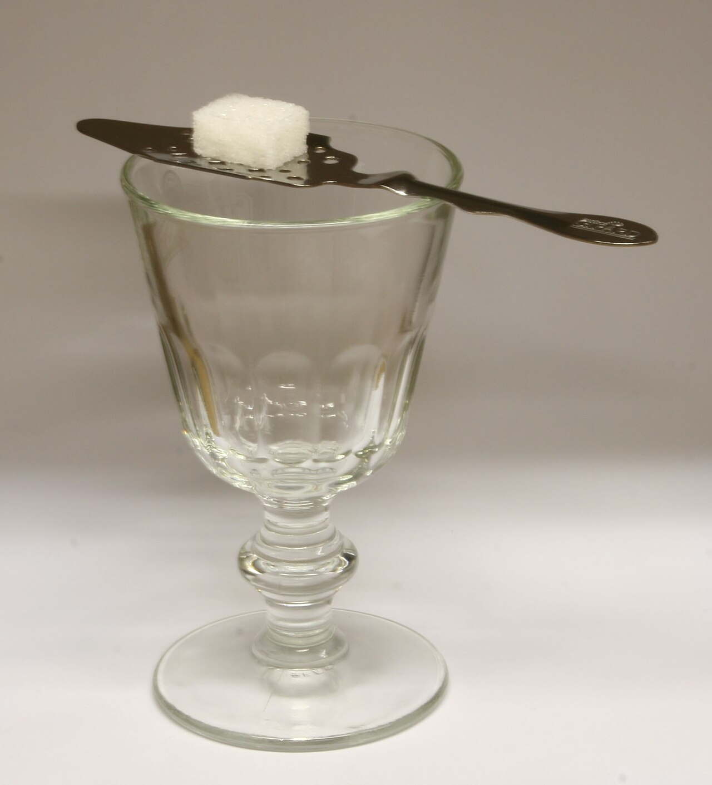

# Absinthe Glass

An absinthe glass is a glass with a wide bowl and a slightly narrowed rim, usually paired with a carved sugar spoon. Its shape is not for looks but for water: a sugar cube sits on the spoon, water drips slowly, the water and spirit mix and the absinthe turns from green to milky white.

The change is called the louche. The anise compounds in absinthe dissolve in high-strength alcohol; as water lowers the strength, the compounds come out of solution and form a fine emulsion. The wider the bowl, the more contact between water and spirit and the more even the louche.

Figure: An absinthe glass, sugar spoon and sugar cube. Image: Cornischong, CC BY-SA 3.0, via Wikimedia Commons ([source page](https://commons.wikimedia.org/wiki/File:Absinthe_glass,_spoon_and_sugar.jpg)).

## Shape and capacity

The classic form is a wide bowl, a narrow rim and a short neck. The wide bowl gives water and spirit enough contact area and makes the louched drink look fuller; the narrow rim gathers aroma and slows the loss of anise and alcohol; the short neck holds the spoon and shows the colour change.

Capacity is usually 200 to 300 millilitres. Too small and the water overflows; too large with too little spirit and the louche is weak. Match the glass to the rough ratio of one part spirit to three to five parts water, not to capacity alone.

The wall is usually thin so the colour and louche show; thin walls also break more easily, so washing and storage need care. The base is thick and low for stability; the narrowed rim keeps the spoon from sliding.

There are several common variants. The Pontarlier has a rounder bowl and a narrower rim for the traditional drip; the Cordon is straighter with a slightly wider rim for modern bars; there is also a "bubble" glass with raised marks on the wall showing the one-dose level. The variants differ, but the logic is the same: wide bowl, narrow rim, a spoon that sits.

It is not the same as an ordinary goblet. A goblet's bowl is too deep and its rim too open, water splashes and the spoon is unstable; the absinthe glass's short neck and narrow rim are designed for dripping. Choose by whether the spoon sits and the water drips steadily, not by resemblance.

## The spoon and the drip

The sugar spoon is part of the set. Its carved bowl spreads the water into even drops; its handle spans the rim and suspends the sugar above the glass. Without a spoon, a small strainer or a dropper can stand in, but less evenly.

The speed of the water shapes the louche. Water should drip slowly so the spirit dilutes gradually; too fast and the louche is uneven and the drink separates. The traditional motion is a drip, not a pour; modern bars use a dropper for the same control.

Sugar is optional. Some drink it with water only, some with syrup; sugar balances absinthe's bitterness and the bite of anise. Taste before adding sugar; do not add it for the ritual alone.

## What it suits

The absinthe glass suits absinthe and other anise spirits that are diluted with water, such as pastis and anisette. It also suits drinks where a colour change matters; the wide bowl and thin wall make the louche visible.

It does not suit short drinks or neat spirits. The glass is too large, the liquid too little and the aroma scatters; the narrow rim is also awkward for a big mouthful. It does not suit hot drinks: the thin wall and wide bowl cool them fast and are hard to hold.

With only one glass, the absinthe glass is not universal. Its use is absinthe and anise; for everyday ice drinks a rocks glass is better, and for sparkling drinks a highball. For the goblet, see [goblet](ref:goblet).

## Use and temperature

Absinthe is usually diluted with iced water; the colder the water, the slower and more even the louche. Warm water speeds the louche but can drive off aroma too fast. Traditionally the water is iced; modern bars sometimes use room-temperature water for a different texture.

Build by pouring one measure of absinthe, setting the spoon across the rim, placing the sugar on it and dripping water slowly. Start around one part spirit to three parts water and adjust to strength and taste; a stronger spirit can take more water.

Do not set it alight. The old "burning sugar" routine destroys aroma and carries a safety risk; modern absinthe culture prefers the cold drip. For the pouring action, see [pouring](ref:pouring).

## Cleaning and care

The wide bowl and narrow rim are easy to knock. Wash by hand with warm water and a little neutral detergent, paying attention to the bowl and base; rinse thoroughly and dry upside down. Do not use a hard brush, which scratches the wall.

Clean the spoon separately. Melted sugar leaves a residue that sets hard; soak it in warm water immediately and dry with a soft cloth. Do not put the carved spoon in a dishwasher, where residue collects in the pattern.

Do not stack thin-walled glasses. Stacking knocks rims and bowls together and can crack them; store separately or on a rack. Keep unused glasses dry to avoid water marks and odour.

## Common mistakes

First, burning the sugar with a flame. It destroys aroma and carries a safety risk; the cold drip is the steadier method.

Second, pouring the water too fast. The louche is uneven and the drink separates; drip slowly so the spirit dilutes gradually.

Third, using a glass that is too small. Water overflows and the louche is weak; match the glass to the ratio.

Fourth, neglecting the spoon. Set sugar is hard to remove and spoils the next use. For the spirit itself, see [absinthe](ref:absinthe); for distillation, see [distillation](ref:distillation); for choosing glasses, see [how to choose a glass](ref:glass).

Start with [Absinthe](ref:absinthe) for material, then read [Goblet](ref:goblet) for capacity. Seeing both keeps Absinthe Glass from being confused with a neighbouring idea.

**At a glance:** A glass with a wide bowl and a narrow rim, usually paired with a carved sugar spoon. It is used for the absinthe water ritual, where the drink turns from green to milky white. 

Start with the material and size. From there, consider the intended use, then how it affects the drink. That is how a practical judgment about Absinthe Glass is built.

**Key facts.**

| Item | Detail |
| --- | --- |
| In one line | A glass with a wide bowl and a narrow rim, usually paired with a carved sugar spoon. It is used for the absinthe water ritual, where the drink turns from green to milky white. |
| Material | Glass |
| Use | Absinthe and anise spirits diluted with water |

**Sources and limits.** The key claims about Absinthe Glass are checked against the following sources: Oxford University Press (Used to check absinthe and dilution ritual history), Encyclopaedia Britannica (Used to check absinthe production and cultural background), Corning Museum of Glass (Used to check glass forms and craft background) and 4 sources in total. Prices, batches and status change; the body is project-written and does not reproduce source text.

For Absinthe Glass, this page was last checked in 2026; prices, batches and availability change, so confirm them against the sources below.
