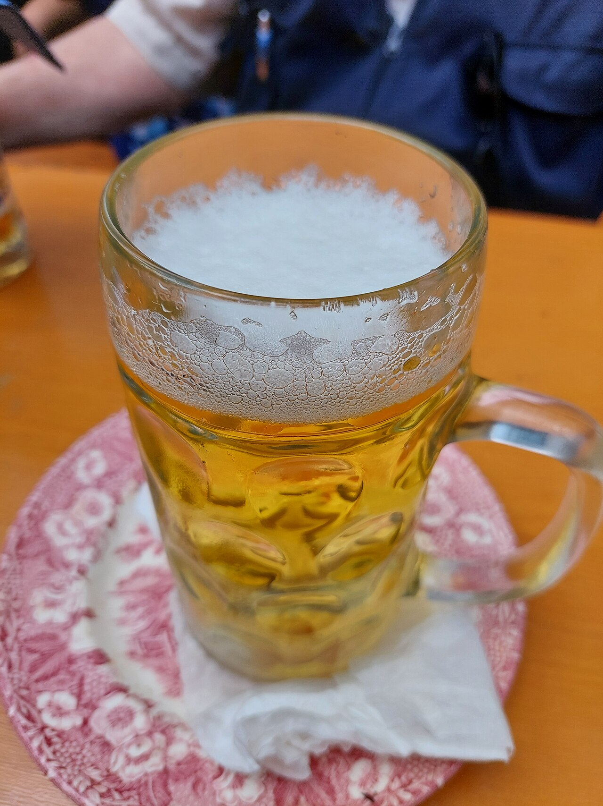

# Beer Mug

A beer mug is a large beer vessel with a handle, thick walls and a wide mouth. It is common in German beer halls, festivals and home tables; the handle keeps the fingers off the wall, the thick wall holds the cold and the wide mouth invites a big draught. For beer itself, see [beer](ref:beer).

The word "mug" may suggest a ceramic coffee cup, but beer mugs range wider: glass, ceramic and pewter all exist. Their common point is not material but the combination of handle, thick wall and large capacity. That combination serves an easy, long drinking session.

Figure: A glass beer mug, full. Image: AxtImHause, CC BY 4.0, via Wikimedia Commons ([source page](https://commons.wikimedia.org/wiki/File:Glass_beer_mug_full.jpg)).

## Shape and capacity

The core features are a handle, thick walls and a straight or slightly tapered body. The handle keeps the hand off the wall and reduces heat transfer; the thick wall adds strength and holds the cold longer; a straight mouth is easy to drink from, a slight taper gathers the foam.

Capacity usually exceeds a pint glass, commonly 300 to 500 millilitres, with larger festival mugs. A large mug suits slow drinking, but the longer the beer sits the warmer it gets and the faster the foam falls. Bigger is not automatically better; the pace matters.

The base is usually thick and low, making the mug stable on the table. A thick base also gives the mug its visual weight, fitting the beer-hall style, but it adds mass and makes long holding tiring. A clean mug matters as much as shape: residual detergent or grease collapses the foam.

## The job of the handle

The handle is not decoration. Beer is served cold, and fingers on the wall warm it quickly; the handle keeps the hand away and holds the cold longer. It also makes the mug steadier when glasses are raised and less likely to slip.

Handle shape affects grip. A thick handle suits large hands, a thin one small hands; the gap between handle and wall must be wide enough that the fingers do not touch the wall. Try the grip before buying, checking that it neither pinches nor slips.

A beer glass without a handle, such as a pint glass, suits fast drinking and stacking; a mug with a handle suits slow drinking and the table. They are tools for different rhythms, not substitutes.

## What it suits

The beer mug suits lager, wheat beer, pilsner and many ales. The thick wall and wide mouth give the foam room and invite a big draught; the handle and wall hold the cold longer. It does not suit delicate spirits or Champagne.

It does not suit every beer. A pint glass suits British ales and shows colour; a tulip suits aromatic Belgian beers; a goblet suits abbey beers. The mug's strength is comfort and capacity, not aroma layering.

With only one beer glass, a thick-walled mug with a handle and moderate capacity is the most practical. It handles most everyday beer and works at festivals and meals, but it is not a tasting glass.

## Use and temperature

Beer is usually served at 4 to 8 degrees Celsius, depending on style. Too cold and the aroma is muted; too warm and carbon dioxide escapes faster and the body feels loose. The thick wall slows warming but cannot replace refrigeration.

Tilt the glass first and let the beer run down the wall, then straighten it so the foam forms a layer. Too fast and the foam spills; too slow and there is too little foam. For the action, see [pouring](ref:pouring).

Do not freeze the mug until it frosts. A sudden chill stresses the glass and frosts the rim; chill the mug, do not freeze it. For the link between foam and aroma, see [aroma](ref:aroma).

## Cleaning and care

The thick wall and handle trap residue. Wash by hand with warm water and a little neutral detergent, paying attention to the inside of the handle and the base; rinse thoroughly and dry upside down. Do not rub the inside with a towel, which leaves fibres and odour.

Glass adsorbs beer's bitterness and aroma. A long-used mug can be soaked in a little bicarbonate solution and rinsed; avoid strongly scented cleaners and damp, mouldy storage.

Ceramic and pewter need different care. Ceramic should avoid sudden heat or cold, which can crack it; pewter should not be scrubbed with steel wool, which scratches it. Whatever the material, dry thoroughly to avoid water marks and odour.

## Common mistakes

First, assuming bigger is better. A large mug warms slowly but an unfinished beer goes warm and flat; match capacity to the number of drinkers and the pace.

Second, freezing the mug. A sudden chill stresses the glass and frost on the rim harms the foam; chill it instead.

Third, using a mug for beer tasting. The thick wall and wide mouth do not gather aroma; use a tulip or a dedicated tasting glass.

Fourth, ignoring the inside of the handle. Foam and oils collect there and spoil the flavour over time. For another beer glass, see [pint glass](ref:pint); for choosing glasses, see [how to choose a glass](ref:glass).

**In brief:** A large beer vessel with a handle and thick walls, common in German beer culture. Thick walls hold the cold, the handle insulates the hand and the wide mouth invites a big draught.

Begin with the material and size, move on to the intended use, and finish with how it affects the drink. That order keeps the reading of Beer Mug practical.

[Beer](ref:beer) and [A different glass, a different view](ref:glass) answer different questions about Beer Mug: material and capacity. Read them as a pair, not as alternatives.

A frequent error is to treat Beer Mug as a drink. Establish what it is, then what the label claims. Neither answer settles the question alone.

The entry on Beer Mug draws on Oxford University Press, Encyclopaedia Britannica, Corning Museum of Glass, British Beer and Pub Association.

A pint mug is the usual British measure; thick walls hold the cold and the handle keeps the hand off the glass.

**Key facts.**

| Item | Detail |
| --- | --- |
| In one line | A large beer vessel with a handle and thick walls, common in German beer culture. Thick walls hold the cold, the handle insulates the hand and the wide mouth invites a big draught. |
| Material | Glass、Ceramic、Pewter |
| Use | Beer, malt drinks and some long drinks |

**Sources and limits.** The key claims about Beer Mug are checked against the following sources: Oxford University Press (Used to check beer vessels and drinking culture), Encyclopaedia Britannica (Used to check beer styles, foam and service), Corning Museum of Glass (Used to check glass forms and craft background) and 5 sources in total. Prices, batches and status change; the body is project-written and does not reproduce source text.

For Beer Mug, this page was last checked in 2026; prices, batches and availability change, so confirm them against the sources below.
