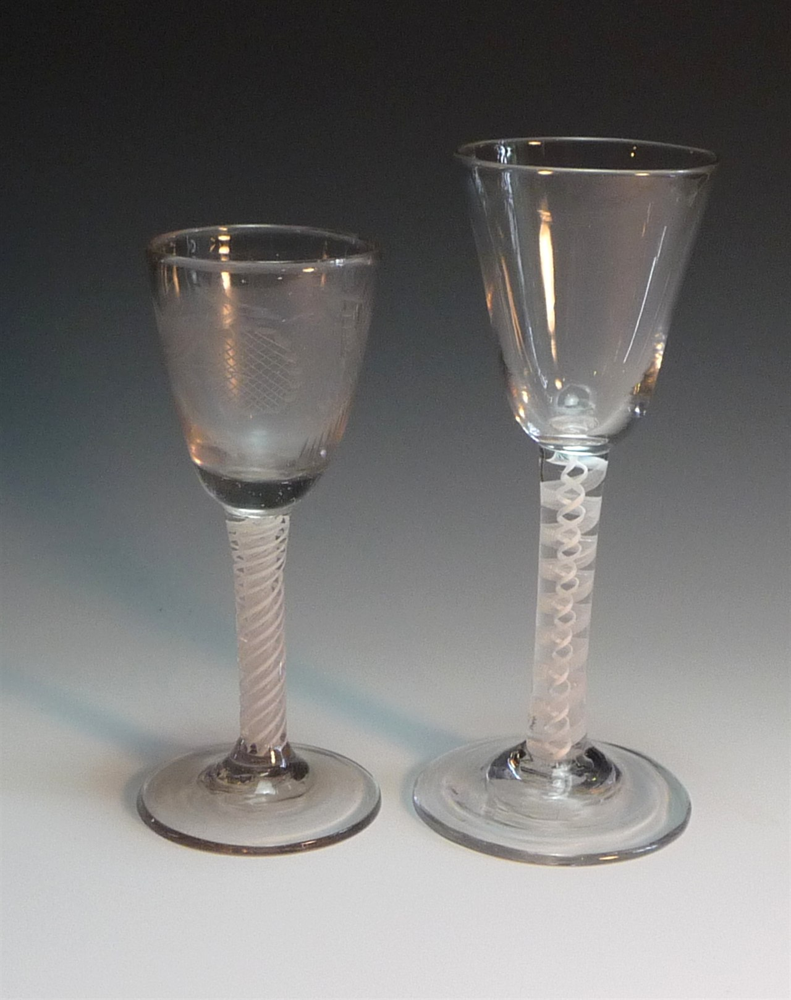

# Copita

The copita is the small stemmed glass most often used for tasting Sherry in Spain. It looks like a shrunken tulip: a gathered bowl, a rim that flares slightly outwards, a fine stem and a modest capacity. Its purpose is specific: to deliver the oxidative aromas of Sherry to the nose using a small pour, a small surface and a controlled temperature, while keeping the wine from warming too quickly. It is also one of the most confused glass names in drinks, because in Mexico a copita means a different small glass used for tequila.

Figure: Copita. Image: User:Theroadislong, CC BY-SA 3.0, via Wikimedia Commons ([source page](https://commons.wikimedia.org/wiki/File:Twisted_stem_glass.JPG)).

> **Quick verdict**
> **In one line:** This glass explains why Copita changes aroma, and which drinks it suits.
>
> - **Best for:** Anyone who wants to understand why Copita changes aroma and texture.
> - **Not for:** If you want want a “buy the most expensive glass” verdict without matching the drink.
> - **Check first:**
>   - A standard wine glass has a larger bowl and a wider rim, designed to give the wine surface and air so that aroma can develop.
>   - The tulip glass has a similar outline and is often used interchangeably.

## The word simply means "little cup"

Copita is the diminutive of the Spanish copa, meaning cup or wine glass, so the literal sense is "little cup". In Spanish bars the word can describe almost any small glass; in the Sherry region it settled into a particular tasting glass: stemmed, small-bowled, gathered at the top, holding roughly one small pour.

That looseness is the source of the confusion. It is both a generic term for a small glass and the name of a specific shape, and the tequila culture of Mexico borrowed the same word for a very different object. When reading a menu or buying glassware, look at the form and the capacity rather than the label. A copita meant for Sherry usually has a fine stem, a bowl smaller than a standard wine glass and a rim that opens slightly.

## The tasting table in the Sherry region

Sherry comes from the area around Jerez de la Frontera, El Puerto de Santa María and Sanlúcar de Barrameda in southern Spain. The local tasting tradition uses a stemmed glass called a catavinos, close in outline to a tulip, for judging colour, aroma and body.

It is worth noting that the region's official tasting material does not argue that smaller is always better. It recommends a generous glass of about 200 ml filled to roughly one third, so that the wine has enough surface to release aroma, and it even warns against very small copitas on the grounds that too little wine and too small a surface leave the aroma nowhere to open. That runs against the market image of the copita as a miniature glass.

The more accurate picture is that the copita is a family of small tasting glasses, with tasting versions commonly holding 100–150 ml, while formal regional tastings may use a larger catavinos. The two are not opposites but different sizes within one tradition: the small glass suits quick judgements and repeated pours, the larger one suits a full nosing.

## Form: a gathered bowl and a flared rim

The outline has three parts. At the bottom, a fine stem and foot keep the fingers away from the bowl. In the middle, the bowl is gathered, widest low down and narrowing towards the top. At the top, the rim turns slightly outwards in the final section.

The gathered bowl works as an aroma funnel. The surface is small, but the aroma is concentrated as it passes up through the narrow neck; the final flare lets it spread a little before it leaves the glass, so it does not hit the nose in one concentrated burst. This "gather, then release" structure differs from a fully closed glass: it concentrates without trapping, and it shapes how aroma reaches the nose during [nosing](ref:nosing).

The flared rim also affects drinking. The wine meets the tip and front of the tongue first, so sweetness and fruit arrive before the alcohol; for stronger Sherries and spirits, that ordering matters.

The stem is functional. Sherry is usually served below room temperature, and a hand wrapped round the bowl heats it quickly; holding the stem keeps the temperature for longer and makes it easy to turn the glass and watch the tears.

## Why oxidative aromas need a small glass

Sherry covers a wide range. Fino and Manzanilla age biologically under a layer of flor, are pale and light, and smell of sea salt, green apple and bread yeast. Amontillado, Oloroso and Palo Cortado age oxidatively, are darker and show walnut, caramel, dried fruit and spice. Pedro Ximénez and Moscatel are sweet, dark and concentrated.

Oxidative aromas are heavy and diffuse. Nut, caramel and dried-fruit molecules escape readily from a large surface and easily merge into a single cloud in a wide glass. A small glass provides a controlled space: the surface is limited, release is slower, and the gathered bowl presses these smells together so they read as one profile rather than a list.

A small glass also limits the air above the wine. Fino and Manzanilla suffer most from excess oxygen and should be finished soon after pouring; a small pour that is replaced rather than a large one left standing is the better habit. For oxidative styles, the small glass keeps the aroma from escaping all at once, so each sip still has something to give.

## Temperature: Sherry should not sit at room temperature

Sherry usually falls between 15% and 22% alcohol, so temperature shapes the aroma more directly than in most wine. Fino and Manzanilla are served well chilled, where the salt and yeast notes stay clear; too warm and alcohol covers the detail. Amontillado and Oloroso suit a temperature a little below room level, where nut and caramel open up; sweet Sherries can be a touch warmer, but still not room temperature.

A small glass cuts both ways on temperature. A small bowl with little wine warms quickly, but a small pour can be finished before it does, and then replaced. The stem reduces hand heat, while the open rim speeds the loss of aroma and alcohol. In practice, chilling the glass and keeping each pour to a few sips does more than simply choosing the smallest glass available. For the wider tasting sequence and temperature, see [a first tasting](ref:tasting).

## How it differs from a standard wine glass

A standard [wine glass](ref:wine) has a larger bowl and a wider rim, designed to give the wine surface and air so that aroma can develop. Using one for Sherry is not wrong, but it creates two problems. The capacity is too large, so a normal tasting pour of 30–50 ml looks lost and the aroma is diluted by a large volume of air. And the wide rim lets oxidative aroma escape quickly, so the delicate notes of a Fino are the first to go.

The copita reverses both. A small bowl lets a small pour form a usable aroma space; a slightly gathered rim slows the loss; a finer stem reduces heat transfer. It does not try to let the wine breathe. It tries to hold the smell still for the short time it is in the glass.

## How it differs from a tulip glass

The [tulip glass](ref:tulip) has a similar outline and is often used interchangeably. The difference is proportion and purpose. A tulip has a larger bowl and a narrower rim, designed to balance aroma and bubbles and used for Champagne, beer and aroma-first short drinks. A copita is smaller, and its rim flares out at the end rather than closing in.

The flare makes the copita more open: you nose it and drink almost at once. The tulip's closed rim concentrates aroma for slower nosing. A tulip works perfectly well for Sherry, especially when you want to stress aromatic layers; a copita is a poor choice for Champagne, because the bowl is too small, the bubbles fade fast and the wine warms quickly.

## Capacity and how much to pour

Typical capacity is about 100–150 ml, though glasses of around 90 ml and close to 190 ml also exist. Capacity depends on the specific product, so check the stated figure. Size is not only a matter of scale: a smaller bowl concentrates aroma but warms faster; a larger bowl is more open but dilutes a small pour in air.

Pour to about one third of the bowl, roughly 30–50 ml. That is enough to cover the base and form a surface without filling the headspace with alcohol. Filling the glass creates two problems: the nose meets a wall of spirit, and by the second half of the glass the wine has already warmed.

For spirit tasting, pour even less, usually 20–30 ml. The empty space is not wasted; it is where aroma and air mix.

## It is not only for Sherry

The copita shape suits any tasting where a small pour, concentrated aroma and temperature control matter. The whisky world has its own nosing copita, often holding around 100–120 ml; some producers sell one glass for both Sherry and [tequila](ref:tequila), with a capacity close to 190 ml; rum, Cognac and aged spirits are also tasted from similar shapes.

What these glasses share is a gathered bowl, a rim that is either slightly closed or slightly flared, a stem and a small capacity. They are not designed for volume but for keeping aroma in the glass a little longer. If you use a Sherry copita for whisky, keep the pour small, or the alcohol will dominate the nose.

## Same word, different object: the Mexican copita

In Mexico, a copita is a different thing: a small, thick-walled glass of roughly 30–60 ml, straight-sided or slightly flared, often served alongside sangrita for tequila or mezcal. It has no fine stem, no gathered bowl and no nosing function. Its job is to deliver a quick shot.

Confusing the two leads to the wrong technique. Drinking Sherry from a tequila copita gives a rim that is too wide and a glass that is too small, so the aroma is gone at once; drinking tequila from a Sherry copita gives a stem and a thin wall that do not suit a quick shot. The two share a word, not a shape.

## Buying, cleaning and storage

Start with capacity and bowl proportion. Capacity depends on the specific product, with 100–150 ml being the common tasting range; the widest point of the bowl should sit clearly below the rim, the rim should open slightly, the stem should be fine without being fragile, and the foot should be steady.

Next, look at the wall and the rim. A thinner rim feels cleaner to drink from but breaks more easily, and uneven walls affect both appearance and aroma. Third, check clarity: tasting depends on colour, so coloured or frosted glass gets in the way.

Hand washing is best: warm water, a little neutral detergent, careful rinsing where the bowl meets the rim, then upside-down drying. Do not wipe the inside repeatedly with a cloth, which leaves fibres and detergent smell; the rim is thin, so avoid knocks. Do not stack the glasses, since the fine stem is the weak point; a single layer or a rack is safer. Make sure the glasses are completely dry before storing them, so they do not pick up damp or cupboard smells.

## Common misconceptions

First, "a copita is a Sherry glass". In Spanish it is simply a little cup, and the Sherry copita is one particular form of it; in Mexico the same word names a tequila glass.

Second, "the smaller the glass the more professional". A bowl that is too small and a pour that is too tiny leave the aroma nowhere to open; regional tasting guidance even warns against very small glasses.

Third, "Sherry can be served at room temperature". Fino and Manzanilla need to be well chilled, and oxidative styles should not be close to room temperature either; the wrong temperature distorts the aroma.

Fourth, "it only holds Sherry". Whisky, rum, tequila and Cognac are also tasted from similar shapes; the point is a small pour and concentrated aroma.

Fifth, "you should fill it to be generous". A full glass puts alcohol ahead of aroma and lets the wine warm before it is finished; one third is a better starting point.

Sixth, "the narrower the rim the more it concentrates". Too narrow a rim makes nosing awkward and cleaning difficult; the copita rim usually opens slightly rather than closing tight.

## See also

- [Wine](ref:wine): the glassware tradition the copita is most often compared with.
- [Tulip glass](ref:tulip): a similar outline with different proportions.
- [Tequila](ref:tequila): the other drink that uses the word copita.
- [A first tasting](ref:tasting): tasting sequence and temperature control.
- [Nosing](ref:nosing): using a small glass to catch aromatic layers.
