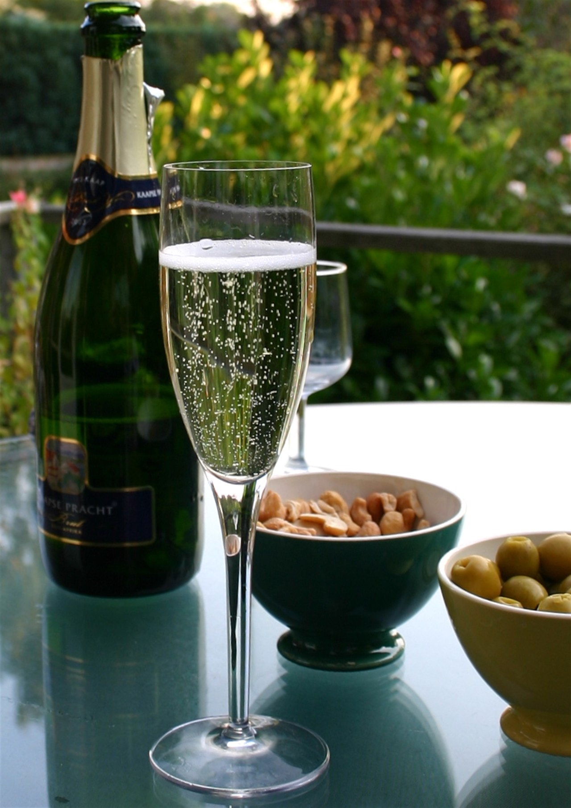

# Coupe glass

A coupe glass is a stemmed, shallow bowl-shaped glass. The body is like an upturned shallow dish, wide at the rim and shallow in depth, with a slender stem and foot below. It is used both for Champagne and sparkling wine and for short cocktails that are strained and served without ice, and it is one of the glass shapes most often given a retro feel at the bar.

Figure: Coupe glass. Image: Taken on September 22, 2005, CC BY 2.0, via Wikimedia Commons ([source page](https://commons.wikimedia.org/wiki/File:Champagne_flute_and_bottle.jpg)).

## What the glass is

The defining feature is shallow and wide. The body rises from the foot into a gentle bowl, usually with a rim diameter clearly greater than the depth. It is not a conical martini glass and not a tall flute; the walls are usually curved rather than straight.

The stem is the other key feature. Holding the stem keeps the fingers off the body and reduces heat transfer, while the foot provides stability and lifts the bowl off the table for easier lifting and viewing.

The coupe is historically linked with Champagne and is often called a Champagne coupe, but it is not reserved for Champagne. Many clear, ice-free short drinks are also served in it. The name comes from the shape and from habit, not from a restriction on use.

## How shape affects aroma and temperature

A wide rim and a shallow bowl first affect how aroma gathers. The wide opening lets aroma spread outward, so a drinker smells a broader band near the rim, but not the concentrated beam a narrowed glass can give. For short drinks built on citrus and florals, this open aroma is an advantage; for drinks that need fine layers, the aroma can feel scattered.

The shallow bowl means a relatively large surface area is in contact with air, so aroma escapes quickly and temperature follows the room more readily. There is no ice in the glass and the drink is already at serving temperature, but the wide surface warms faster, so a short drink should be consumed promptly.

The wide rim also affects bubbles. When Champagne or sparkling wine is poured into a coupe, bubbles have a large free surface to escape from, and carbonation fades faster than in a flute. That is not an advantage for drinks where bubble persistence is the point, though it may not be a drawback where aroma and drinkability matter more.

The stem plays a role in temperature control. Holding it reduces heat from the hand; holding the bowl accelerates warming. Thin walls show temperature change more clearly, so the glass should be handled gently.

## Capacity and suitable drinks

There is no single capacity standard for a coupe, and bowl size, depth and rim diameter vary widely. This page gives no fixed capacity figure; capacity depends on the specific product. First see how much your glass holds, then adjust the recipe quantity and garnish rather than assuming that all coupes are the same.

Drinks that suit a coupe include Champagne and [sparkling wine](ref:sparkling), especially when aroma is meant to open in the glass, and short drinks strained and served without ice, such as the [Cosmopolitan](ref:cosmo) and the [Paper Plane](ref:paper-plane). These drinks usually contain no ice, and the wide rim makes nosing easy while the shallow bowl keeps the liquid close to the rim.

It is less suitable for drinks that need to stay cold for a long time, and for long drinks over ice. A shallow bowl holds little ice and a wide rim does not retain cold; drinks that need plenty of ice and bubbles are better in a straight-sided long-drink glass.

The same drink behaves differently in coupes of different size and shape. A smaller glass brings the liquid closer to the rim and concentrates aroma; a larger glass spreads the surface, opens the aroma and warms faster.

## Material and cleaning

Coupes are commonly made of glass or crystal glass. Ordinary glass is durable and costs less; crystal is thinner and more brilliant, with a clearer ring when tapped, but breaks more easily. Neither tolerates sudden temperature change, so avoid extreme hot-to-cold washing.

The rim is usually thin, so avoid knocks during washing and storage. Hand washing is recommended, with warm water and a little neutral detergent, followed by thorough rinsing and upside-down drying; do not wipe the inside repeatedly with a cloth, which leaves fibres and odour. If the product is dishwasher-safe, use a gentle cycle and make sure the glasses cannot knock together.

Store without stacking, especially thin-rimmed models. Glass can pick up odour from strongly scented items stored inside for a long time; rinse and dry before use. The joint between stem and foot is a weak point, so hold the stem or foot rather than the bowl alone.

## How to choose

First, look at the proportions. A shallow, wide bowl suits short drinks and Champagne; a bowl that is too deep moves towards a conical glass and behaves differently.

Second, look at the rim diameter. Too wide and aroma escapes quickly; too narrow and the open character of a coupe is lost. Match it to the drinks you make.

Third, look at the stem and foot. The stem should be comfortable to hold, and the foot should sit steadily without tipping; a very small foot makes the glass easy to knock over.

Fourth, look at wall thickness and evenness. Very thin walls look elegant but break more easily, and uneven walls affect both appearance and durability.

Fifth, check that the capacity matches your recipes. Capacity depends on the specific product, so confirm that the liquid volume and garnish of your usual drinks will fit.

Sixth, consider washing and storage. Without enough shelf space, large thin-walled glasses are likely to break when stacked.

Do not buy an extremely wide, extremely shallow model for a retro look without considering real use. A glass is a tool, and stability and usability come first.

## Alternative glasses

The closest alternative is the [martini glass](ref:martini): also stemmed and ice-free, but conical with a narrower rim, so aroma is more concentrated and bubbles fade more slowly. When aroma concentration matters, the martini glass is the better choice.

For Champagne and sparkling wine, a [Champagne flute](ref:flute) or a [tulip glass](ref:tulip-glass) can replace the coupe. A flute is tall and narrow, keeps bubbles longer but opens aroma less; a tulip has a wider bowl and a slightly narrowed rim, a compromise between aroma and bubbles.

When ice or a long drink is involved, move to a straight highball or a rocks glass rather than treating the coupe as universal. For general principles of glass selection, see [choosing a glass](ref:glass).

## Common misconceptions

First, "a coupe is only for Champagne". It is also widely used for short cocktails; the shape determines aroma and temperature behaviour, not the identity of the drink.

Second, "the wider the rim the better the aroma". A wide rim opens the aroma but also lets it escape faster, which can weaken fine layers.

Third, "all coupes hold the same volume". Capacities vary widely, and capacity depends on the specific product, so adjust recipe quantities to your glass.

Fourth, "the stem is decorative". The stem reduces hand heat and affects how the glass is held and seen; it is not superfluous.

Fifth, "a coupe suits every cocktail". Long drinks over ice, drinks that need to stay cold and drinks where bubbles should persist are all poor matches.

Sixth, "a coupe keeps bubbles well". The wide rim and shallow bowl let bubbles escape relatively quickly; that is a structural characteristic.

## See also

- [Sparkling wine](ref:sparkling): a common category for the coupe.
- [Champagne](ref:champagne): the region most closely associated with the glass.
- [Cosmopolitan](ref:cosmo): a short drink served without ice.
- [Paper Plane](ref:paper-plane): a modern classic often served up.
- [Martini glass](ref:martini): another stemmed short-drink shape.
- [Choosing a glass](ref:glass): how shape relates to aroma and temperature.
