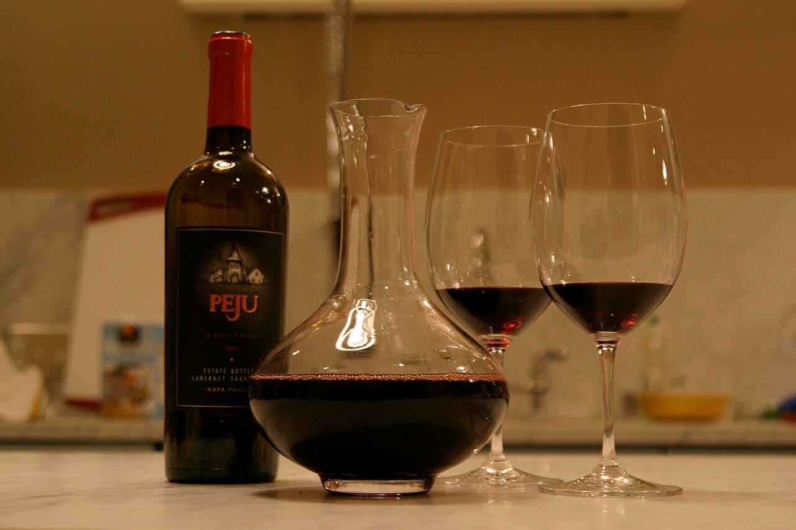

# Decanter

A decanter is a glass vessel for separating sediment and letting wine meet air. Its usual form is a wide base, a long neck and a stopper: the wide base spreads the wine and increases contact with air, the neck steadies the pour, the stopper limits over-oxidation between servings.

It has two jobs that are often confused: removing sediment, leaving the deposit in the bottle, and aerating, letting a younger wine open. The two jobs need different times and often different shapes.

Figure: A decanter and a wine bottle. Image: Daryn Nakhuda, CC BY 2.0, via Wikimedia Commons ([source page](https://commons.wikimedia.org/wiki/File:Decanter_and_wine.jpg)).

## Shape and capacity

The core is a wide base, a long neck and stability. The wide base spreads the wine for contact with air; the neck makes the pour controllable; the base must sit flat. The wider the body, the faster the aeration; the narrower, the slower.

Capacity usually exceeds a bottle, commonly 750 to 1500 millilitres. Too small and the wine reaches the neck with little surface; too large and the wine spreads too thin and the aroma escapes. Match capacity to the bottle, not to size alone.

Materials are ordinary and crystal glass. Crystal is thinner and brighter, but lead crystal is not for long storage; ordinary glass is more durable for daily use. Either way the decanter must be clear, so sediment and colour are visible. Lead crystal is best for serving, not for keeping wine for weeks.

## History and changing forms

The decanter's history is tied to bottles and corks. Early wine was often poured from larger vessels, and the decanter served as both decanting vessel and serving vessel; as glassmaking improved, decanters became thinner and clearer and moved onto the table.

In the eighteenth and nineteenth centuries decanters took elaborate forms: bell, ship, flute and stoppered castle shapes. They were not only for air but for showing colour and taste. Today's shapes are simpler, but the wide base and long neck remain.

Shape also shapes service. A wide decanter suits young wines that need air; a narrow one suits older wines that oxidise easily; a stoppered one suits wine left standing. The shape is not decoration but a control of time and air.

## What it suits

The decanter suits aged reds with sediment and young reds with heavy tannin that need air. It can separate deposit and open aroma; for some wines decanting changes the texture noticeably.

It does not suit every wine. Old or fragile wines need a short decant or none; white wine usually needs no decanting unless there is sediment or a clear reduction; sparkling wine should not be decanted, since the bubbles are lost.

It does not suit spirits. Spirit aroma is gathered by the glass, and a wide decanter lets it escape; if a spirit needs air, it gets it in the glass. For wine, see [wine](ref:wine); for temperature during decanting, see [ice and temperature](ref:ice).

## Use and timing

First, stand the bottle. An aged bottle should stand for hours to a day so sediment falls; the time depends on age and deposit.

Second, use a light. Place a candle or torch under the neck and watch for sediment; stop when it approaches the neck.

Third, pour slowly. Let the wine run down the decanter wall rather than strike it; stop when the sediment reaches the neck and leave the last portion in the bottle.

Fourth, control time. A young, tannic wine may take 1 to 2 hours; an old wine often 15 to 30 minutes or less; taste as it opens. For the full routine, see [decanting](ref:decanting).

## Cleaning and care

Decanters are hard to wash because the neck is narrow and the body wide. Hand wash with warm water and a little neutral detergent, swirl a small amount so it reaches the walls, then rinse repeatedly. Do not use a dishwasher, where heat and water pressure can crack the glass.

Stubborn stains can be soaked with bicarbonate or a dedicated cleaning granule and rinsed; never use steel wool or a hard brush, which scratches. Dry upside down with the neck open to the air.

Crystal dislikes sudden temperature change. Do not rinse a cold decanter with hot water, nor freeze a wet one; the stress can crack the glass. Store it clear of knocks, ideally on a soft mat.

The decanter and the glass divide the work. The decanter separates and aerates; the glass gathers aroma and serves. Decanted wine goes back into a glass, not drunk from the decanter. A wide decanter lets aroma escape, a narrow glass gathers it; the pair does both jobs.

## Common mistakes

First, decanting everything. Old or fragile wines need a short decant or none; over-decanting scatters the aroma.

Second, assuming bigger is better. Too large a decanter spreads the wine thin and the aroma escapes; match it to the volume.

Third, decanting sparkling wine. The bubbles are lost quickly; sparkling wine is not for the decanter.

Fourth, skipping the wash. A narrow neck hides residue that oxidises and spoils the next wine; wash after every use. For cork contamination, see [cork taint](ref:taint); for wine glasses, see [red wine glass](ref:glass).

**Short definition:** A glass vessel for separating sediment and letting wine meet air, usually with a wide base, a long neck and a stopper. Decanting time depends on age, body and aroma.

Decanter is best approached through the material and size, then the intended use, and then how it affects the drink. One check alone will not settle it.

[Decanting](ref:decanting) and [Red Wine Glass](ref:glass) are the nearest useful comparisons: one clarifies material, the other tests capacity.

The usual confusion is to treat Decanter as a drink. Check what it is first, then what the label claims; the two need not agree.

The entry on Decanter draws on Oxford University Press, Encyclopaedia Britannica, Corning Museum of Glass, Riedel. 

The entry separates material from capacity: “Shape and capacity” first, “History and changing forms” second. Without both, Decanter can look like a drink.

A wide-based decanter exposes wine to air; young reds may need an hour, older wines only minutes before sediment appears.

**Key facts.**

| Item | Detail |
| --- | --- |
| In one line | A glass vessel for separating sediment and letting wine meet air, usually with a wide base, a long neck and a stopper. Decanting time depends on age, body and aroma. |
| Material | Glass、Crystal glass |
| Use | Wine, aged bottles and wines that need air |

**Sources and limits.** The key claims about Decanter are checked against the following sources: Oxford University Press (Used to check decanter and wine service background), Encyclopaedia Britannica (Used to check decanting and sediment history), Corning Museum of Glass (Used to check decanter forms and glass craft) and 5 sources in total. Prices, batches and status change; the body is project-written and does not reproduce source text.

For Decanter, this glass was last checked in 2026; prices, batches and availability change, so confirm them against the sources below.
