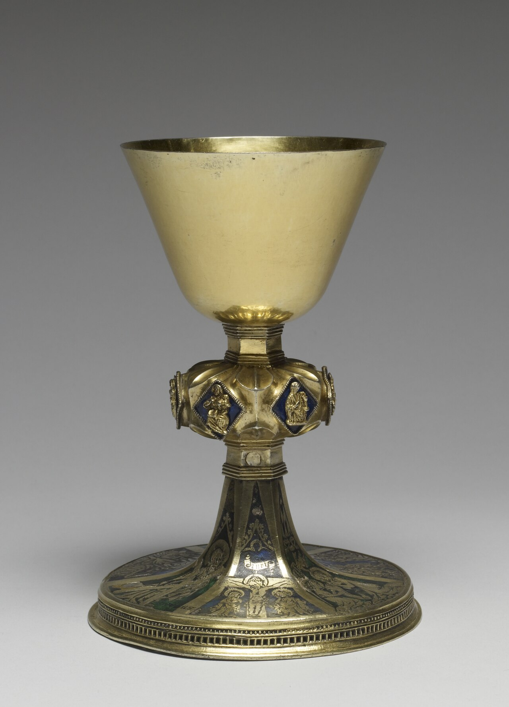

# Goblet

A goblet is a stemmed glass with a wide bowl and an open rim. It looks like a wine glass that has been enlarged and opened out: the bowl gives the drink room to breathe, the rim does not close in, and aroma and foam can rise freely. It is especially common in Belgian beer culture, and it also appears on dinner tables for wine and water. The key to the glass is not a particular brand shape but the combination of a broad bowl and an open mouth.

Figure: Goblet. Image: Anonymous ( Germany ) Unknown author, Public domain, via Wikimedia Commons ([source page](https://commons.wikimedia.org/wiki/File:German_-_Chalice_with_Saints_and_Scenes_from_the_Life_of_Christ_-_Walters_44116.jpg)).

## A wide bowl on a short stem

A goblet has three parts: bowl, stem and foot. The bowl is usually hemispherical or U-shaped, and its widest point sits close to the rim. The rim is wide and, in most versions, not strongly tapered inward. The stem is short, and the foot is roughly as wide as the bowl. The walls tend to be thicker than those of a fine wine glass, and the rim is often rounded.

That proportion defines the job. A wide bowl gives a large liquid surface for aroma to rise from; an open rim lets aroma spread instead of compressing it; a short stem keeps the centre of gravity low and makes the glass stable on a table; thicker walls make it more resistant to knocks. It is not designed to concentrate aroma as tightly as possible. It is designed for a generous balance of aroma, foam, capacity and durability.

For the same reason, a goblet is not a general term for every stemmed glass. Wine glasses, Champagne glasses and spirit glasses may all have stems, but their bowl proportions, rim tapers and wall thicknesses serve different ends. A goblet is a particular set of proportions and uses, not the mere presence of a stem.

## Why Belgian abbey and Trappist ales use it

Belgian abbey beers and the strong ales associated with Trappist breweries are often served in goblet or chalice shapes. Dubbel, tripel and quadrupel styles tend to be aromatic, with notes of banana, plum, raisin, clove and pepper; alcohol levels are substantial and the head is thick and persistent. A wide bowl gives those aromas room to develop, an open rim lets the head expand, and a short stem reduces the direct transfer of hand heat during a slow drink.

Monastery glasses often carry the identity of the house: a logo or abbey mark on the bowl, sometimes an etched nucleation point in the base to steady the foam, and occasionally a slight inward curve just below the rim. That last detail is a gentle gather, not a true aroma trap. A tulip glass narrows much more deliberately; a goblet remains open and expansive.

"Chalice" is often used for the heavier, shallower, more decorated version with a religious or monastic association. "Goblet" is the more general shape name. The two overlap heavily in function, and there is no need to be pedantic when ordering a drink, but when describing glassware it is more accurate to treat a chalice as a subtype of goblet.

## What an open rim does to aroma and foam

Aroma molecules leave the liquid surface and enter the headspace above it. A wider bowl and a larger surface release more aroma per unit of time; a wider rim lets that aroma mix with room air and fall in concentration. The result is a glass that smells generous at first and flattens sooner: the first pour is expressive, but the bouquet loses definition as it sits.

For a strong Belgian ale this is not necessarily a drawback. If a high-alcohol beer is trapped under a narrow rim, ethanol can build up at the opening and sting the nose. An open rim lets ethanol disperse along with the esters, so malt, dried fruit and spice remain easier to read. For a delicate, low-alcohol beer the same openness works against the drink, because the aroma escapes before you can examine it.

Foam behaves in a similar way. A wide mouth gives the head a large surface to spread across, so it looks thick and generous; but gas also escapes more easily from that surface, and carbonation declines faster. A narrow mouth slows the loss of carbon dioxide but forces the foam into a taller column. The goblet chooses a handsome head and an expansive nose over long-lasting carbonation.

The width of the bowl also affects swirling. There is room to turn the beer and increase its contact with air, but a very wide rim makes vigorous swirling risky. Belgian beer rarely needs the sort of hard swirl used for wine; a gentle rotation is enough to lift the aroma again.

## Capacities from 250 to 500 ml

There is no single capacity standard for a goblet. A common range is 250 to 500 ml, depending on the beer, the bottle size and the brand. A 330 ml bottle of Belgian ale often comes with a 250 to 330 ml glass, leaving room for foam; a glass of around 500 ml suits a large bottle to share, a lower-strength beer or a drink that will be enjoyed slowly. Smaller and larger versions exist, and capacity depends on the specific product.

Bigger is not automatically better. If the glass is too large for the pour, the headspace is excessive, the aroma is diluted and the beer warms against a large wall area. If the glass is too small, the foam has nowhere to go and the pour overflows. A useful rule is to stop with the liquid at or just below the widest part of the bowl, leave one or two centimetres for foam, and keep enough headspace for aroma without leaving the glass half empty.

Belgian serving practice often starts by rinsing the inside of the glass with cold water, so the wall carries a thin film that helps an even head. The beer is then poured down the side of a tilted glass, and the glass is straightened at the end to build a thick, fine head. Advice differs by brand, but "do not rush and do not fill to the brim" is universal.

## Goblet versus tulip glass

A [tulip glass](ref:tulip) and a goblet both have a wide bowl and a stem. The difference is the rim. A tulip narrows clearly at the opening, creating a smaller exit where aroma collects; a goblet stays open, letting aroma spread. That single difference decides most of their uses.

Aromatic, highly carbonated or delicate drinks, such as some saisons, sour beers, Champagne and aroma-led short drinks, benefit from the tulip's gather. Heavy, ester-driven, foamy, strong Belgian ales benefit from the goblet's openness. A quadrupel in a tulip can smell hot and crowded; a delicate sour in a goblet can lose its perfume before the first sip.

The same beer will show differently in the two glasses. The glass has not changed the beer; it has changed the path from liquid surface to nose and the rate at which gas leaves the surface. Choose the glass after deciding which part of the drink you want to emphasize.

## Goblet versus pint glass

A [pint glass](ref:pint) is straight-sided, stemless and built around a defined volume; it suits cold, carbonated beer that is meant to be drunk in quantity. A goblet is stemmed, wide-bowled and open; it suits stronger, more aromatic beer that is meant to be sipped. The difference is pace, not rank.

Both have open rims, but the pint has no wide bowl and no stem. The distance from liquid to rim is short, so aroma escapes almost immediately; the hand sits directly on the glass, so the beer warms faster. A goblet gives aroma a buffer of headspace and keeps the hand lower. A Belgian ale in a pint glass feels cramped, and an ice-cold lager in a large goblet warms too quickly and loses its sparkle.

## Where a goblet ends and a wine glass begins

The boundary between a goblet and a wine glass is not whether there is a stem. It is proportion and purpose. A wine glass usually has a longer stem, thinner walls, a more precisely shaped bowl and a rim that tapers slightly, all aimed at directing aroma to the nose and delivering wine to a particular part of the mouth. A goblet has a wider bowl, a more open rim, thicker walls and a shorter stem, aimed at durability, capacity and a relaxed drink.

That does not stop a goblet from holding [wine](ref:wine). In parts of rural Europe the goblet has served as an everyday wine glass: large enough, open enough and easy to wash. It works well for a simple, fruit-forward red. It gives away some definition with a delicate, layered wine.

The reverse is also true. A wine glass can hold a Belgian ale, but the bowl may be wrong for a thick head and the narrower rim may concentrate alcohol. The boundary is use, not etiquette.

## Stem, foot and grip

The stem of a goblet is usually short, so the fingers can easily stray onto the lower bowl. Hold the stem, or pinch the junction of stem and bowl between thumb and forefinger, so the palm does not wrap the bowl. A short stem leaves little room for large hands; holding the foot is an acceptable fallback, provided the glass stays balanced.

The size of the foot matters for stability. A small foot with a high centre of gravity tips easily; a very large foot takes up table space and is awkward to store. A thick foot is stable but heavy; a thin foot is elegant but sensitive to an uneven table. When buying, set the empty glass on a flat surface and rock it gently to see whether the foot sits true.

Thick walls do not mean poor quality. Belgian beer glasses are often deliberately substantial so that they survive toasts, washing and daily use; a thick rim also feels rounder during a large sip. Thin crystal is lighter and more brilliant, but it belongs to a more careful style of drinking, not to a high-turnover beer setting.

## Washing and storage

The wide mouth of a goblet makes washing easier than a narrow tulip: a hand or brush can reach the bottom, and rinsing is quick. It still needs proper care. Detergent residue kills beer foam and leaves odour that carries into the next drink. Wash in warm water with a little neutral detergent and a soft brush, rinse thoroughly, and drain upside down.

The rim is the weak point. A wide mouth has a long circumference, so an impact spreads stress around a larger edge, and stacking puts load directly on the rim. Do not stack goblets, and do not stand them upside down on a hard surface. Store them upright or in a rack with enough space between them.

If the glass has etched nucleation points or gold decoration, avoid strongly alkaline detergents and metal scouring pads. Worn decoration changes both appearance and foam behaviour. Check the product instructions before using a dishwasher; even when it is allowed, use a gentle cycle and make sure the glasses cannot knock together.

## Common misconceptions

First, "a goblet is any stemmed glass". It is not. A goblet is a wide-bowled, open-rimmed, short-stemmed form; wine, Champagne and spirit glasses have their own proportions and jobs.

Second, "a goblet is only for Belgian beer". It is also used for table water, some wines and everyday drinks. The shape does not restrict the liquid.

Third, "the wider the rim the stronger the aroma". A wide rim releases more aroma but also lets it disperse faster; a strong first impression is not the same as clear layers.

Fourth, "a chalice and a goblet are identical". A chalice is usually heavier, shallower and more decorated, often with a monastic or religious association; it can be treated as a subtype of goblet.

Fifth, "a larger capacity is better value". Capacity should match the bottle, the strength and the pace of drinking; an oversized glass warms the beer and dilutes the aroma.

Sixth, "thick glass is cheap glass". Thickness is a trade-off for durability and grip, not a verdict on quality; thin glass is not automatically better for every drink.

## See also

- [Beer](ref:beer): the main category for the goblet.
- [Wine](ref:wine): the goblet's other everyday use.
- [Tulip glass](ref:tulip): the narrowed-rim counterpart for aroma.
- [Pint glass](ref:pint): the straight, stemless beer glass for comparison.
- [Choosing a glass](ref:glass): how shape relates to aroma and temperature.
