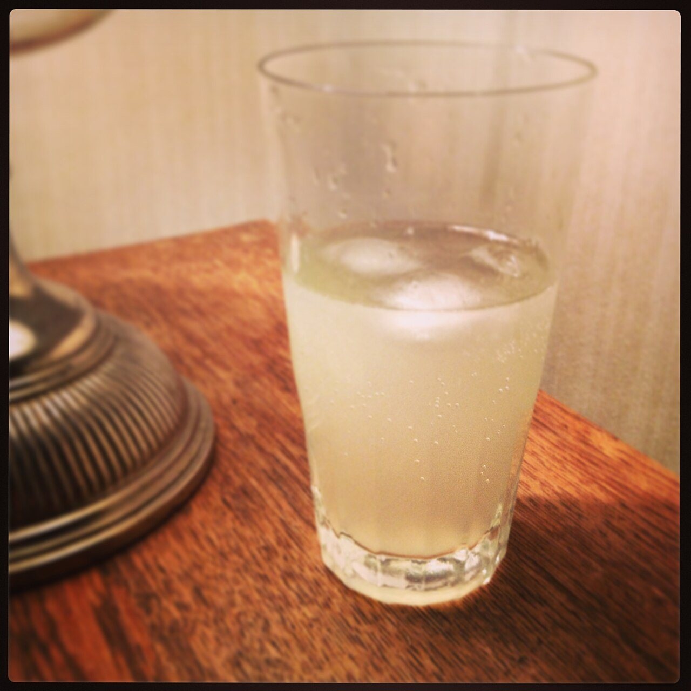

# Highball glass

A highball glass is a straight-sided, tall, fairly large glass for long drinks. It is used for drinks served over ice and for sparkling cocktails such as the Mojito, gin and tonic or whisky soda. It has no stem and its walls usually run straight, with rim and base of similar diameter; those features decide what it suits and what it does not.

Figure: A highball glass holding an iced long drink, with condensation on the glass. Image: grosswurst, CC BY-SA 3.0, via [source page](https://commons.wikimedia.org/wiki/File:Moscow_Mule_Highball_glass.jpg).

## What a highball glass is

Two proportions define it: the height is clearly greater than the diameter, and the body is close to a straight cylinder. It is not a short, wide short-drink glass, nor a stemmed cone. The straight sides let ice stack in layers, the height gives bubbles room to rise, and the larger capacity holds liquid, ice and soda.

The name is linked to highball drinks such as whisky soda, but the glass is not limited to them. Mojitos, gin and tonics and other long drinks can all use it. The name is a convention, not a restriction. Some references treat the taller straight glass as a Collins glass; in everyday use the two names overlap, and this glass discusses them together as straight long-drink glasses.

## Shape and capacity

There is no single capacity standard for a highball glass. Common sizes range from smaller to larger, and wall thickness and rim diameter vary too. This glass therefore gives no "standard capacity" and does not assume that every highball glass holds the same number of millilitres.

Capacity differences directly affect use: a small glass with plenty of ice leaves too little room for liquid and soda and spills easily; a large glass with little ice thins the carbonation and lets aroma disperse. In practice, first see how much ice your glass can hold, then decide how much to pour. "Fill with ice" and "top up with soda" in a recipe should be adjusted to the glass.

## What it suits

A highball glass suits two situations best. The first is a long drink over ice, such as the [Mojito recipe](ref:recipe): the straight body holds plenty of ice, mint and soda, and the height gives bubbles room to rise. The second is a spirit with soda or tonic, such as whisky soda or gin and tonic, where the capacity lets spirit and sparkling water combine in proportion.

It does not suit short drinks that need to gather aroma. The wide rim and tall body let aroma spread sideways; nor does it suit neat spirits that need a very large cube, because the rim is usually too narrow for one. For aroma concentration a narrowed glass suits better; for what shape does, see [choosing a glass](ref:glass).

## Ice and temperature

The experience in a highball glass depends heavily on ice. Too little ice and the soda warms quickly, the bubbles fade and the texture goes flat; too much ice in a small glass leaves no room to stir or to place a garnish. Long drinks usually use plenty of ice, forming a visible layer, and larger cubes rather than crushed ice, to keep dilution under control.

A large cube has little surface area and melts slowly, so the drink stays cold for longer without turning watery; crushed ice chills fast but melts fast, thinning a long drink within minutes. The glass has no stem, so holding the body transfers hand heat; to keep it cold longer, hold it near the rim or use a coaster. For more on ice and temperature, see [ice and temperature](ref:ice).

## Bubbles and stirring

The tall shape helps bubbles rise, but it also means bubbles are easily lost while stirring. After adding soda, stir gently a few times just to mix; do not agitate hard. Shaking brings in air and crushed ice and drives carbonation off quickly, and a long drink usually does not need it.

Bubbles are part of a long drink's structure, not decoration. Add soda last, top up and stir gently; for a fresher drink you can raise the sparkling share, but adjust sugar and acid at the same time so the flavour is not washed out. For the general structure of long drinks, see [cocktail basics](ref:cocktails).

## Holding and keeping cold

How you hold the glass affects both temperature and presentation. Holding the body is convenient but transfers heat quickly; holding near the rim transfers less heat but puts fingers near the rim, which may affect hygiene and aroma. A compromise is to hold the lower body, reducing hand contact while keeping fingers out of the rim.

Coasters and sleeves reduce heat transfer from the table and the hand but do not change how fast the ice melts. To keep a drink cold longer, prioritise larger ice, a pre-chilled glass and less hand contact rather than relying on a coaster. Long drinks are usually drunk slowly, so keeping them cold matters more than for a short drink.

## Differences from similar glasses

The highball is often confused with the [rocks glass](ref:glass). A rocks glass is short and wide and suits short drinks and large cubes; a highball is tall and usually larger and suits long drinks and sparkling mixes. It also differs from a Collins glass: the Collins is usually taller and narrower with a larger capacity and suits drinks with a straw, while the highball is a little shorter and easier to drink from directly.

Compared with a narrowed nosing glass, the highball lets aroma spread more and shows fewer layers, but is easier to drink from and more stable with ice, which suits occasions that need plenty of ice and bubbles. The two are not substitutes; they are tools for different purposes.

## Cleaning and storage

The tall body makes detergent residue easy to trap where the base meets the wall, so rinse thoroughly when washing by hand. Use warm water and a little neutral detergent, then leave upside down to dry; do not wipe the inside repeatedly with a cloth, which leaves fibres and odour. The rim is thin, so avoid knocks while washing.

Start with the material and size. From there, consider the intended use, then how it affects the drink. That is how a practical judgment about Highball glass is built.

## Common misconceptions

First, assuming a highball glass has a standard capacity. Capacities vary widely; adjust ice and liquid to your own glass.

Second, filling the glass with crushed ice. Crushed ice melts fast and thins a long drink within minutes.

Third, treating the highball as universal. It suits long drinks and sparkling drinks, not short drinks that need aroma concentration.

Fourth, stirring hard or shaking. Bubbles are lost quickly; a long drink only needs gentle stirring.

Fifth, skipping pre-chilling. A warm glass speeds up ice melting and disrupts the dilution rhythm.

## Buying advice

Check three things first: whether the height suits your hand and the amount of ice you usually use; whether the rim is wide enough for ice and a garnish; whether the walls are even and the rim level. Capacity need not match a particular number, but it should match the recipes you make.

If you buy only one, choose a straight, medium-to-large, slightly thick-walled glass; it is usually more durable and better suited to ice. If you make long drinks often, keep two so guests can be served. Do not buy very thin or very small glasses for a "professional" look; they are limited in real use.

## Limits

A highball glass is a tool, not a badge of identity. Capacity, ice shape and bubbles usually affect the drink more than the price of the glass. This glass does not recommend brands or present one shape as the only correct choice; use should follow your own glass and your own taste.
