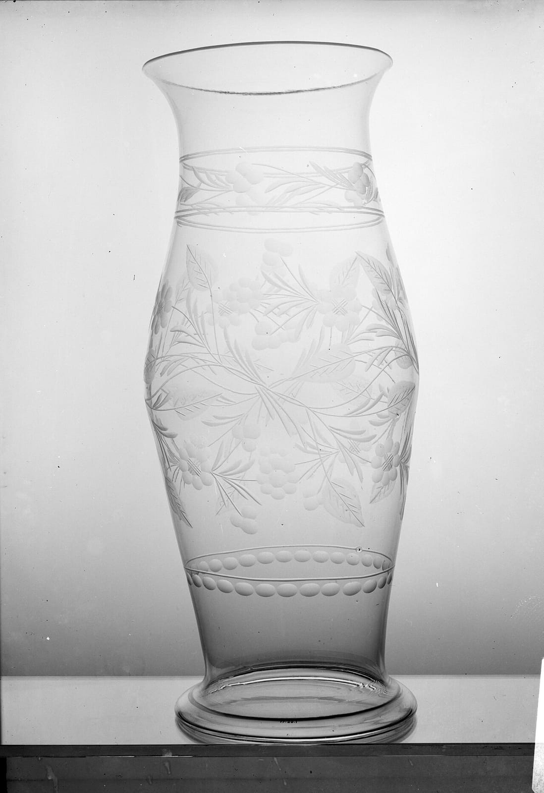

# Hurricane Glass

A hurricane glass is a tall glass with a slender body, a bulging middle and a flared rim. Its outline resembles the glass chimney of an old hurricane lamp: narrow below, wide in the middle, flared at the top. The shape is not a storm imitation; it holds crushed ice, supports foam and makes a tropical cocktail look taller and fuller.

The glass is tied to tropical cocktail culture. Mid-twentieth-century New Orleans bars filled it with rum, juice, syrup and crushed ice, producing bright, oversized drinks; the glass itself became a visual sign of holiday and party.

Figure: A hurricane glass. Image: Wikimedia Commons contributor, CC0, via Wikimedia Commons ([source page](https://commons.wikimedia.org/wiki/File:Hurricane_glass_(one_of_a_pair)_MET_34989.jpg)).

## Shape and proportions

The core proportions are a slender body, a bulging middle and a flared rim. The lower body is narrow for holding; the middle is wide for crushed ice and liquid; the flared rim gives foam and garnish a place to sit and is comfortable on the lips.

Capacity usually exceeds a highball, commonly 400 to 600 millilitres. A large glass suits plenty of crushed ice and juice, but too large with too little spirit and the ice melts fast and the drink goes weak. Match the glass to the formula.

The wall is usually thin so the colour and layers show; thin walls also break more easily, so washing and storage need care. The base is narrow and the centre of gravity high, so the glass tips on an uneven table; stability matters.

## Why the curve

The curve does three jobs. First, it holds crushed ice: the wide middle takes more ice and lets it mound above the rim. Second, it supports foam: the flared rim lets foam spread into a full look. Third, it guides aroma: the flared rim sends the aroma outward, suiting fruit-forward tropical drinks.

The curve also affects the hand. The wide middle is steady to hold; the narrow base is less stable on the table. Hold the middle rather than the rim; for a photograph, the curve makes colour and garnish stand out.

The height has a practical role too. A tall glass lets crushed ice stratify and colour shift from bottom to top; it also gives a straw enough length to reach the base. It is a look-first glass, and function and decoration are hard to separate.

## What it suits

The hurricane glass suits tropical cocktails: the Hurricane, the Mai Tai, the Zombie and the Singapore Sling. It also suits long drinks with plenty of crushed ice, juice and syrup; the capacity and curve make them look generous.

It does not suit short drinks or neat spirits. The glass is too large, the liquid too little and the aroma scatters; the flared rim is also poor for fine nosing. It does not suit hot drinks either: the thin wall and tall body cool them fast and the glass is hard to hold.

With only one glass, the hurricane is not universal. Its use is tropical and crushed-ice drinks; for everyday ice drinks a rocks glass is better, and for sparkling drinks a highball. For the highball, see [highball](ref:highball).

## Use and temperature

Chill the hurricane glass before use, but freezing is unnecessary. Chilling cools the wall and stabilises the foam; freezing makes the thin wall more fragile and may frost the rim.

Build by adding crushed ice first, then the liquid and finally the garnish. Mound the ice to the rim so the glass looks full; pour down the side so the ice layer is not disturbed. For the action, see [pouring](ref:pouring).

Garnish is part of the glass. Pineapple leaves, orange slices, cherries and paper umbrellas make the drink taller and more tropical, but too much garnish blocks the rim and makes the glass top-heavy. Garnish should serve the theme, not pile up.

## Cleaning and care

The tall body and flared rim are easy to knock. Wash by hand with warm water and a little neutral detergent, paying attention to the base and middle; rinse thoroughly and dry upside down. Do not use a hard brush, which scratches the wall.

Do not stack thin-walled glasses. Stacking knocks rims and bodies together and can crack them; store separately or on a rack. Keep unused glasses dry to avoid water marks and odour.

Glass adsorbs odours, especially when unused. Rinse and dry before use; avoid strongly scented cleaners and keep the glasses away from spices or coffee beans.

## Common mistakes

First, treating the hurricane as universal. Its capacity and curve suit tropical long drinks, not short drinks, neat spirits or hot drinks.

Second, a glass too large for the pour. The ice melts fast and the drink goes weak; match glass to formula.

Third, piling on garnish. It blocks the rim and makes the glass top-heavy; garnish should serve the theme.

Fourth, using a thin glass for hot drinks. The thin wall and tall body cool the drink fast and are hard to hold; use ceramic or double-walled glass for heat. For tropical drinks, see [Mai Tai](ref:maitai) and [Zombie](ref:zombie); for rum, see [rum](ref:rum); for choosing glasses, see [how to choose a glass](ref:glass).

**Short definition:** A tall glass with a slender body, a bulging middle and a flared rim, shaped like an old hurricane lamp. It is used for tropical cocktails and crushed-ice drinks. 

For Hurricane Glass, begin with the material and size, then the intended use, and finish with how it affects the drink; that order keeps the account grounded.

[Highball glass](ref:highball) and [Zombie](ref:zombie) are the two useful reference points for Hurricane Glass. [Highball glass](ref:highball) sets out material; [Zombie](ref:zombie) brings in capacity. Read them together.

The usual confusion is to treat Hurricane Glass as a drink. Check what it is first, then what the label claims; the two need not agree.

The entry on Hurricane Glass draws on Oxford University Press, International Bartenders Association, CocktailDB, Corning Museum of Glass.

The shape holds crushed ice and fruit; it is standard for tropical cocktails and usually 15–20 oz.

**Key facts.**

| Item | Detail |
| --- | --- |
| In one line | A tall glass with a slender body, a bulging middle and a flared rim, shaped like an old hurricane lamp. It is used for tropical cocktails and crushed-ice drinks. |
| Material | Glass |
| Use | Tropical cocktails and crushed-ice long drinks |

**Sources and limits.** The key claims about Hurricane Glass are checked against the following sources: Oxford University Press (Used to check hurricane glass and tropical cocktail history), International Bartenders Association (Used to check tropical cocktail formulas and glass usage), CocktailDB (Used to cross-check hurricane glass usage and capacity) and 5 sources in total. Prices, batches and status change; the body is project-written and does not reproduce source text.

For Hurricane Glass, this glass was last checked in 2026; prices, batches and availability change, so confirm them against the sources below.
