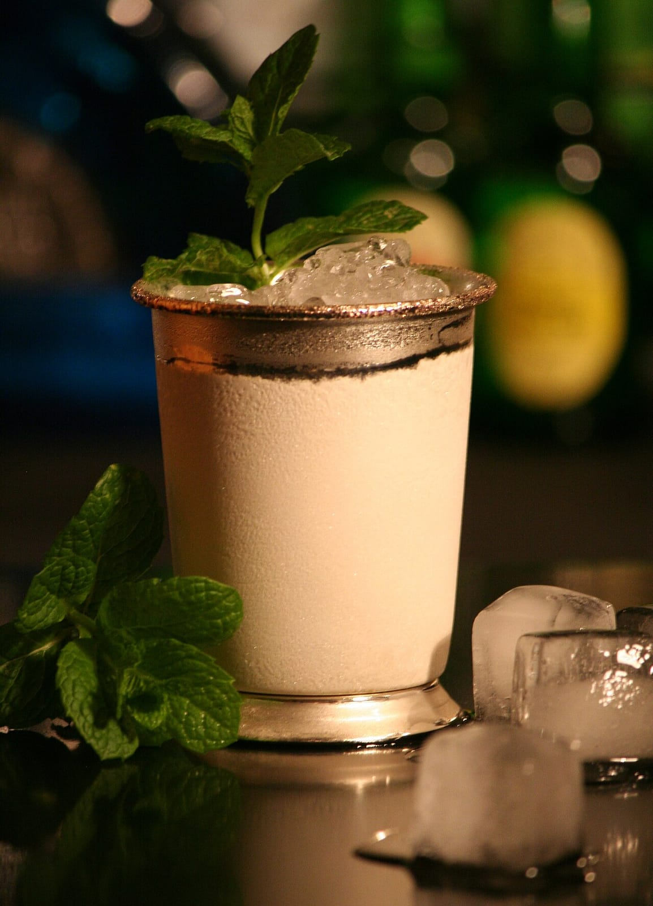

# Julep Cup

A julep cup is a small metal cup, usually silver, pewter or stainless steel, with a slightly tapered body and a flared rim. It is almost inseparable from the mint julep: crushed ice, mint, sugar and bourbon, served in metal, the wall frosted, the drink icy.

Metal works differently from glass. Glass insulates; metal conducts. A metal cup passes hand heat to the drink quickly and passes outside cold into the cup quickly. The frost on a julep cup is the visible result of that conductivity.

Figure: A silver julep cup holding a mint julep. Image: Cocktailmarler, CC BY-SA 3.0, via Wikimedia Commons ([source page](https://commons.wikimedia.org/wiki/File:Mint_Julep_im_Silberbecher.jpg)).

## Shape and capacity

The core features are metal, a tapered body, a flared rim and no handle. The body narrows at the base and widens at the top, making it easy to mound crushed ice; the flared rim is comfortable on the lips and lets a mint sprig sit in the ice; no handle keeps the cup compact.

Capacity is usually 240 to 350 millilitres, depending on the cup and the region. Too small and the ice and mint will not fit; too large with too little spirit and the ice melts fast and the drink goes weak. Capacity should match the formula, not the other way round.

Wall thickness changes the experience. A thick wall holds the cold longer but weighs more; a thin wall is lighter but passes hand heat faster. Silver is usually thinner and more expensive than pewter, and needs more care; stainless steel is more durable for daily use.

## How metal holds the cold

Metal conducts heat far faster than glass. Filled with crushed ice, the wall drops quickly to near zero; water vapour in the air condenses and forms a layer of frost. The frost is not decoration but a sign that the cup is holding the cold.

Metal also passes hand heat quickly. Holding the body warms the wall and melts the ice faster; hold the flared rim or the base instead. The colder the cup, the thicker the frost and the longer the drink stays cold.

Crushed ice is central. Its large surface area chills fast but melts fast; a large cube chills slowly but holds longer. The mint julep usually uses crushed ice to chill quickly and mound above the rim, so the drink should be finished before the ice turns to water.

## What it suits

The julep cup suits the mint julep and other crushed-ice cocktails, including variants that call for a lot of ice and mint. It does not suit a short drink with one large cube, nor clear wines and sakes where colour matters.

It does not suit hot drinks. Metal conducts heat quickly, the wall becomes too hot to hold; use ceramic or double-walled glass for heat. It also does not suit sparkling drinks, where crushed ice speeds the loss of bubbles.

With only one cup, the julep cup is not universal. Its use is narrow, but for the mint julep and summer crushed-ice drinks it offers an experience glass cannot replace. For the drink itself, see [mint julep](ref:julep).

## Use and temperature

Chill the cup before use, but do not freeze it until heavily frosted. Chilling brings the wall down faster and gives a more even frost; freezing makes it too cold to hold and may ice the rim.

Build the drink by putting mint and sugar in first, pressing lightly to release aroma, then adding crushed ice and spirit. Do not shred the mint; shredding releases bitterness. For the pressing motion, see [muddling](ref:muddling).

Pour down the side of the cup rather than onto the ice. A direct pour melts the ice fast and lifts the leaves; a slow pour is gentler and easier to control. For ice and temperature, see [ice and temperature](ref:ice).

## Cleaning and care

Silver needs separate care. It reacts with sulphides and darkens; wash with warm water and a little neutral detergent, avoid chlorine-based cleaners and dry at once. A silver cloth can remove tarnish, but do not over-polish.

Pewter is soft: no steel wool, no hard scraping. Stainless steel is the most durable and can be washed with a soft sponge. Whatever the metal, avoid sudden heat or cold, which can distort the cup.

Do not stack them. The flared rim scratches easily; store separately or wrap in soft cloth. Keep the cup dry when not in use to slow oxidation.

## Common mistakes

First, assuming colder is better. Over-freezing makes the cup impossible to hold and the frost too thick, so the ice melts faster; chill, do not freeze.

Second, holding the body. Hand heat passes through the metal and melts the ice; hold the rim or the base.

Third, using a large cube instead of crushed ice. A large cube chills slowly, cannot mound above the rim and does not suit the julep texture; crushed ice is standard.

Fourth, treating the julep cup as a universal vessel. It suits crushed-ice drinks, not hot drinks, sparkling drinks or wines where colour matters. For another short drink glass, see [rocks glass](ref:rocks); for choosing glasses, see [how to choose a glass](ref:glass).

[Mint Julep](ref:julep) and [Rocks glass](ref:rocks) answer different questions about Julep Cup: material and capacity. Read them as a pair, not as alternatives.

**Short definition:** A small metal cup, usually silver or pewter, used for the mint julep. Metal conducts cold quickly, frosts the wall and keeps the drink icy with crushed ice and mint.

Start with the material and size. From there, consider the intended use, then how it affects the drink. That is how a practical judgment about Julep Cup is built.

The usual confusion is to treat Julep Cup as a drink. Check what it is first, then what the label claims; the two need not agree.

A silver or tin julep cup frosts quickly and holds crushed ice; the classic is 12–14 oz, and the metal keeps the drink colder than glass.

Keep the cup in the freezer before use and hold it by the rim to preserve the frost.

**Key facts.**

| Item | Detail |
| --- | --- |
| In one line | A small metal cup, usually silver or pewter, used for the mint julep. Metal conducts cold quickly, frosts the wall and keeps the drink icy with crushed ice and mint. |
| Material | Silver、Pewter、Stainless steel |
| Use | Mint juleps and crushed-ice cocktails |

**Sources and limits.** The key claims about Julep Cup are checked against the following sources: Oxford University Press (Used to check mint julep and metal cup history), International Bartenders Association (Used to check the mint julep formula and method), Encyclopaedia Britannica (Used to check the cultural background of the mint julep) and 5 sources in total. Prices, batches and status change; the body is project-written and does not reproduce source text.

For Julep Cup, this glass was last checked in 2026; prices, batches and availability change, so confirm them against the sources below.
