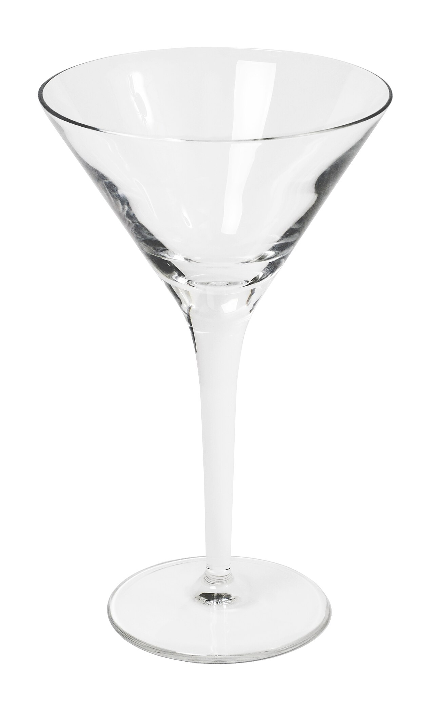

# Martini glass

A martini glass (also called a cocktail glass) is a conical, stemmed glass with a slightly narrowed rim, made for short drinks. It is used most often for the Dry Martini, and also for the Margarita, the Daiquiri and other short drinks strained and served without ice. The conical bowl and long stem are its defining features; they decide what it suits and where its limits lie.

Figure: Martini glass. Image: Evan-Amos, Public domain, via Wikimedia Commons ([source page](https://commons.wikimedia.org/wiki/File:Cocktail-glass.jpg)).

## What a martini glass is

Three features define it: a conical bowl, a stem and a slightly narrowed rim. The cone gives a wide rim and a narrow base, so aroma gathers near the rim; the stem lets you hold the glass without touching the bowl, reducing heat transfer; the narrowed rim keeps the aroma more concentrated. It is neither a straight long-drink glass nor a short, wide tumbler.

The Chinese name comes from the glass's typical use, but its uses are not limited to the Martini. Margaritas, Daiquiris and drinks such as the Manhattan often use it. The name is a convention, not a restriction; definitions of a "cocktail glass" vary slightly by region, but the conical bowl with a stem is consistent.

## Shape and capacity

There is no single capacity standard for a martini glass. Common sizes range from smaller to larger, and rim diameter, cone angle and stem height all vary. This glass therefore gives no "standard capacity" and does not assume that every martini glass holds the same number of millilitres.

Capacity differences directly affect use: too small a glass will not hold the recipe and overflows when strained; too large a glass spreads the liquid thin, so aroma disperses and the drink warms faster. In practice, see how much your glass holds and adjust the total volume of the recipe rather than filling to the rim. For the relation between shape and capacity, see [choosing a glass](ref:glass).

## What it suits

A martini glass best suits short drinks that need concentrated aroma and are strained before serving. For example, the [Dry Martini recipe](ref:recipe): the drink is already chilled and diluted, and straining it into a pre-chilled cone gathers the juniper and vermouth aroma. The [Margarita recipe](ref:margarita) uses the same kind of glass, with a half salt rim.

It does not suit long drinks over ice. The rim is wide and the bowl shallow, so only a few cubes fit and bubbles disperse; nor does it suit neat spirits that need a lot of ice. For long drinks a highball works better; for a short drink over ice a rocks glass does.

## Pre-chilling and temperature

Pre-chilling is the most important condition for a martini glass. If the glass is not cold, the drink warms within a short time and both aroma and acidity change. Chill it in the freezer or bury it in crushed ice; either way, let the bowl cool fully before straining the drink in.

The stem lets you hold the glass without passing body heat to the liquid; holding the conical bowl sends heat straight into the drink and speeds warming. Hold the stem or the base, not the bowl. For more on temperature and dilution, see [ice and temperature](ref:ice).

## Aroma and drinking

The conical bowl gathers aroma near the rim, but the rim is fairly wide, so aroma also disperses with air movement. Nose close to the rim first, then sip slowly; do not drink it down in one go, since a short drink is usually strong and the aroma needs time to open.

The narrowed rim is key to concentrating aroma, but too narrow a rim makes drinking and cleaning harder. Choose a balance between concentration and usability: too wide and the aroma escapes; too narrow and both drinking and washing become awkward.

## Garnish and placement

Garnishes on a martini glass usually sit on the rim or in the bowl: lemon peel on the rim, an olive fixed with a pick, a salt rim on the outside edge. The garnish should not sit in the drink too long; peel dries out and an olive releases too much salt.

The rim is wide, so garnishes slide easily. Fix them with a pick or a rim clip so they do not fall into the liquid. The garnish complements aroma and appearance rather than covering the drink; too many garnishes crowd the rim and get in the way of drinking.

## Cleaning and storage

A wide rim and shallow bowl make a martini glass fairly easy to clean, but detergent residue collects where the stem meets the base, so rinse thoroughly. Wash by hand with warm water and a little neutral detergent, and leave upside down to dry; do not wipe the inside repeatedly with a cloth, which leaves fibres and odour.

The stem is thin, so avoid knocks when cleaning and storing. Stacking can snap the stem, so store in a single layer or in a rack with dividers. Rinse and dry a glass that has not been used for a long time, and check that there is no cupboard smell.

## Common misconceptions

First, assuming a martini glass has a standard capacity. Capacities vary widely; adjust the total volume to your own glass.

Second, using a room-temperature glass. The drink warms quickly and both aroma and texture suffer.

Third, holding the bowl. Body heat goes straight into the liquid and speeds warming.

Fourth, treating the martini glass as universal. It suits strained short drinks, not long drinks over ice.

Fifth, over-garnishing. Rim space is limited, and too many garnishes affect both drinking and appearance.

## Choosing and substituting

Check three things first: whether the rim diameter suits the way you drink; whether the stem is stable and the base level; whether the capacity matches the recipes you usually make. Capacity need not match a particular number, but it should match the total volume of the recipe.

Without the proper glass, choose another with a slightly narrowed rim and a moderate capacity; pre-chilling and capacity matter most. Too small a glass will not hold the recipe; too large a glass lets the aroma disperse. The glass is not part of the definition, but it does shape the experience; for more, see [cocktail basics](ref:cocktails).

## Limits

A martini glass is a tool, not a badge of identity. Pre-chilling, capacity and how you hold it usually affect the drink more than the price of the glass. This glass does not recommend brands or present one shape as the only correct choice; use should follow your own glass and your own taste.

**At a glance:** A conical, stemmed short-drink glass with a slightly narrowed rim, also called a cocktail glass, used for the Dry Martini, Margarita and Daiquiri; capacity has no single standard and pre-chilling matters more than shape. 

Begin with the material and size, move on to the intended use, and finish with how it affects the drink. That order keeps the reading of Martini glass practical.
