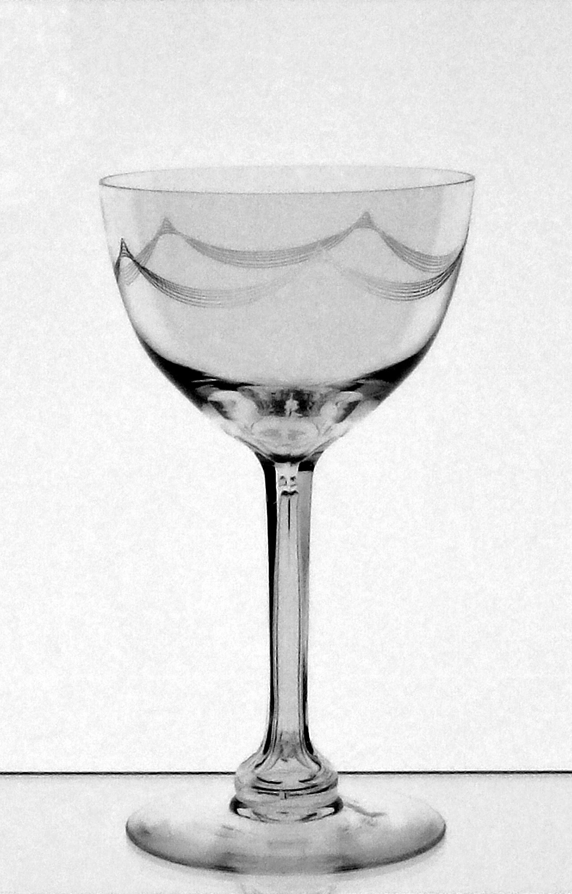

# Nick and Nora glass

The Nick and Nora is a small stemmed glass with a shallow bowl and a wide rim. It looks like a coupe that has been made smaller and pressed flatter. The name comes from Nick and Nora Charles, the married detectives played by William Powell and Myrna Loy in the 1934 film The Thin Man, and the glass is often treated as shorthand for "vintage Martini glass". It is neither a Martini glass nor a catch-all term for old-fashioned shallow glasses. Its shape and its capacity explain more than its name does.

Figure: A vintage Nick and Nora glass, about 120 ml, with an engraved wave pattern. Image: Mangomix, CC BY-SA 4.0, via [source page](https://commons.wikimedia.org/wiki/File:Nick_and_Nora_cocktail_glass.jpg).

## The name comes from a film

The Thin Man opened in 1934, adapted from Dashiell Hammett's detective novel of the same name. William Powell and Myrna Loy played Nick and Nora Charles, a couple who investigate a case while mixing drinks at the dinner table, in bars and at home. In those scenes they hold small stemmed glasses with shallow bowls and wide rims, not the V-shaped Martini glass that later became the standard image of the drink. The series ran from 1934 to 1947 and produced six films in all, so the image of the glass recurred on screen for more than a decade.

The name "Nick and Nora" was not a manufacturer's name from the 1930s. It is usually credited to the bartender Dale DeGroff, who in the late 1980s began using this kind of small glass for cocktails at the Rainbow Room in New York and called them after the couple in the film. The name spread first, and only then did more producers make the shape as a category of its own. The accurate version is therefore that the glass appeared in the film and the name was attached half a century later. Calling it "the original 1934 design" confuses the date of the image with the date of the name.

## What the glass looks like

Four features can be judged by eye: a shallow bowl, a wide rim, relatively straight sides and a fine stem.

The shallow bowl is the clearest difference from an ordinary coupe. A coupe has a deeper, rounder bowl that reads as a shallow dish; the Nick and Nora bowl is smaller, shallower, and its rim diameter is close to the widest point of the bowl. The sides flare less from the foot. It looks like a coupe that has been compressed rather than a wine glass that has been widened.

The wide rim is a purpose, not a flaw. It gives aroma a broad surface to spread across, so the nose does not have to push into a narrow opening, and it lets the liquid form a thin layer near the rim, so the first thing you meet when you sip is aroma rather than glass.

The fine stem keeps the fingers away from the bowl. A short drink has no ice, so its temperature depends entirely on pre-chilling and on the glass wall. Holding the stem transfers less body heat and avoids fingerprints on the bowl. The cost is fragility: the stem is the weakest part of the glass and needs care when washing and storing.

## Why a shallow bowl suits this drink

The first job of the shallow bowl is to shorten the distance from liquid to nose. There is very little vertical space between the surface and the rim, so aroma does not have to travel up a tall wall. For a drink built on juniper, citrus peel or herbal vermouth, that matters more than "concentrating" aroma, because the alcohol is already strong enough to mask it.

The second job is to limit the size of each pour. A shallow bowl cannot hold much even when filled to the brim, which pushes the serve towards roughly 60–100 ml, about the amount one person can finish before the drink warms. Put the same volume in a large glass and the liquid lies too thin, aroma disperses faster and temperature is harder to hold.

The third job is visual. A shallow bowl lets a modest pour fill most of the bowl, so the drink does not look half-empty. That matters for a drink with no ice to take up space: an empty glass turns the headspace into dead air.

It is a poor choice for drinks with ice. The bowl is too shallow for more than a couple of cubes and the wide rim does not hold the cold. Long drinks and anything built on ice belong in a highball or a rocks glass.

## Open aroma versus rising temperature

A wide rim gives openness, not concentration. Aroma spreads across the surface and reaches the nose as a broad band: citrus, florals and herbs arrive together. It is not compressed into a narrow column as it would be in a closed glass, so fine layers are easily diluted. This is the central trade-off of the glass: it prefers breadth of aroma to depth.

Temperature is the other half of that trade-off. A small bowl with a relatively large surface warms quickly, and the wide rim speeds the loss of aroma and alcohol. A stirred, strained short drink is usually served at around zero, and in a room-temperature glass it rises noticeably within minutes. Warming is not entirely bad: aroma compounds escape more readily and the nose opens up. But alcohol also becomes more prominent, the entry turns hot, and the balance of bitterness and acidity shifts.

The practical response is to accept the trade-off rather than fight it. Chill the glass in a freezer for ten to fifteen minutes and take it out just before pouring, so no frost dilutes the drink. Hold the stem or foot, never the bowl. Finish the drink within about ten minutes. If you want it cold for longer, pour less and shorten the gap between straining and drinking rather than reaching for a bigger glass.

## How it differs from a coupe and a Martini glass

The [coupe](ref:coupe) is the nearest source of confusion. Both are stemmed shallow bowls, but a coupe is deeper and rounder, with a wider rim and usually a larger capacity; it was first associated with Champagne, and its open mouth lets bubbles and aroma out together. The Nick and Nora is smaller and shallower, with straighter sides and a rim that flares less relative to the bowl, so aroma sits closer to the nose and the liquid sits closer to the rim. Serving a Martini in a coupe is not wrong, but the liquid spreads wider and warms faster.

The [Martini glass](ref:martini-glass) is a different structure. Its bowl is a V-shaped cone, wide at the rim and narrow at the base, usually with a larger capacity and a higher centre of gravity. The cone gathers aroma near the rim, but the rim is just as open; its advantage is the visual signature of a Martini, its disadvantage is a thin layer of liquid, fast warming and easy spills.

The differences come down to three points: capacity, where the Nick and Nora is the smallest; the ratio of depth to rim, where it is the shallowest and closest to a small bowl; and the centre of gravity, where it sits lowest and steadiest. It gives up some aroma concentration in exchange for a more sensible single serve and a more stable grip.

## Capacity and how much to pour

Typical capacity is about 150–200 ml, although smaller glasses of around 120 ml and larger ones above 200 ml also exist. Capacity depends on the specific product, so check the stated figure rather than assuming a standard 180 ml.

Pour to roughly one half to two thirds of the bowl, leaving room for aroma. In a 150 ml glass, 60–90 ml of liquid fills about half the bowl; in a 200 ml glass the same volume looks shallower, leaves more headspace and warms faster. Fill it too far and the first thing the nose meets is alcohol; pour too little and there is not enough surface to carry the aroma.

Capacity also changes the recipe. A 90 ml stirred drink nearly reaches the rim of a 120 ml glass, but looks half full in a 200 ml one. The first suits a single serving drunk quickly, the second suits slow nosing. Measure your own glass first and then set the batch size, not the other way round.

## Which drinks belong in it

The best match is a short drink that is stirred or shaken, strained and served without ice. The [Dry Martini](ref:martini) is the model: stirred, strained into a chilled small glass, modest in volume, built on juniper and dry vermouth, with aroma that reaches the nose immediately. The [Manhattan](ref:manhattan) works just as well: whiskey, sweet vermouth and bitters seem sweeter and more aromatic in a wide glass, but bitterness grows as the drink warms, so it rewards a brisk pace.

Sour-style short drinks such as the Sidecar, Gimlet and Daiquiri can also be served this way, though acidity sharpens as they warm; sweeter recipes hold up better than dry ones. Drinks with bubbles do not belong here, since a wide rim lets the gas escape quickly, and long drinks with ice do not either, because the bowl cannot hold the ice.

On a bar menu, "up" or "straight up" usually means this kind of serve: strained, no ice, a short drink. If you want more concentrated aroma, ask for a narrower glass; if you prefer open aroma, this one is the better fit. For the general relationship between shape, aroma and temperature, see [choosing a glass](ref:glass).

## Holding, chilling and washing

Hold only the stem or the foot. The bowl is shallow and the fingers easily touch the wall; body heat passes straight into the drink, warms it and leaves prints that spoil the look. The stem is thin, so lift the glass without gripping the bowl and avoid the joint where the stem meets the foot.

Chilling matters more than the shape. Leave the glass in a freezer for ten to fifteen minutes, or stand it in an ice bucket for a few minutes, then dry the outside before pouring. A warm glass starts warming the drink at once: the aroma has not opened before the texture goes soft. Never add ice to chill the glass with the drink in it, because that dilutes the recipe.

Hand washing is best: warm water, a little neutral detergent, a thorough rinse where the bowl meets the rim, then upside-down drying. Do not wipe the inside repeatedly with a cloth, which leaves fibres and odour, and avoid knocks on the thin rim. If the product is dishwasher-safe, use a gentle cycle and make sure the glasses cannot touch each other. Store them without stacking, since the fine stem is the most fragile part; a single layer or a rack with dividers is safer.

## Common misconceptions

First, "it is the dedicated Martini glass". It is not, and it does not belong to the Martini alone: the Martini glass usually means the V-shaped cone, while this is a shallow bowl. The name comes from a film, not from a recipe.

Second, "all vintage shallow glasses are Nick and Noras". They are not. A coupe, a Champagne saucer and a small cocktail glass can all look similar; distinguish them by bowl depth, rim ratio and capacity, not by whether they look old.

Third, "the name is as old as the glass". The glass appears in the 1934 film, but the name only became common in the late 1980s. Describing it as a 1930s commercial product is a timeline error.

Fourth, "a bigger glass is more generous". A larger glass spreads the same drink thinner, loses aroma faster and warms more visibly. The value of this shape lies precisely in its small size.

Fifth, "the wider the rim the better the aroma". A wide rim opens aroma but also lets it escape; for a delicate short drink, too wide a mouth weakens the layers.

Sixth, "a thin stem is too fragile to use". It is more fragile, but normal handling and hand washing are fine. The real risks are stacking, knocks and dishwasher jets.

## See also

- [Dry Martini](ref:martini): the classic short drink for this glass.
- [Manhattan](ref:manhattan): a whiskey-based drink served up.
- [Coupe glass](ref:coupe): a deeper stemmed shallow bowl with a more open aroma.
- [Martini glass](ref:martini-glass): the V-shaped alternative.
- [Choosing a glass](ref:glass): how shape, capacity and aroma relate.
