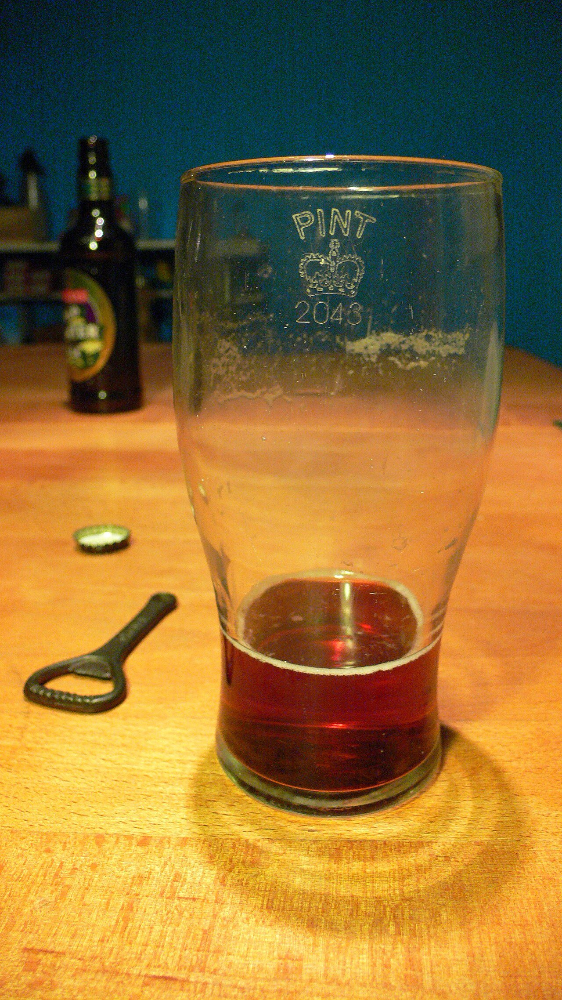

# Pint glass

The pint glass is easy to underestimate. It looks like a thick-based tumbler with a straight body, yet "pint" is first a unit of volume and only second a name for a glass. A pint glass in a British pub, a pint glass in an American bar and an Irish stout pint may hold different amounts and have different outlines. The first question is therefore not what shape the glass is, but how large a pint is where you are standing.

Figure: A British pint glass marked “PINT” with the Crown stamp, holding a little beer. Image: Justinc, CC BY-SA 2.0, via [source page](https://commons.wikimedia.org/wiki/File:Pint_Glass_with_some_beer.jpg).

> **Quick verdict**
> **In one line:** This glass explains why Pint glass changes aroma, and which drinks it suits.
>
> - **Best for:** Anyone who wants to understand why Pint glass changes aroma and texture.
> - **Not for:** If you want want a “buy the most expensive glass” verdict without matching the drink.
> - **Check first:**
>   - The rim of a pint glass is essentially open.
>   - Nominal capacity changes with the market: 568 ml in the UK, 473 ml in the US and commonly 570 ml in Australia.

## One name, two volumes: 95 ml apart

A UK pint is 568 ml, exactly 568.26125 ml. A US liquid pint is 473 ml, exactly 473.176473 ml. The gap is about 95 ml, and the British pint is roughly one fifth larger than the American one.

The difference comes from the ounce, not from the glass. The UK pint is 20 imperial fluid ounces, at about 28.413 ml each. The US pint is 16 US fluid ounces, at about 29.574 ml each. Twenty times 28.413 is about 568, and sixteen times 29.574 is about 473. Both are called a pint, but one counts twenty smaller ounces and the other counts sixteen slightly larger ones.

This is also why the UK still permits the pint as a standalone unit for draught beer and cider while most other goods are sold in metric units. The US keeps customary units, and the pint is part of everyday trade. For a drinker, the practical result is simple: ordering "a pint" in London and in New York does not buy the same volume.

Other markets have their own habits. Australia commonly treats a pint as about 570 ml, Ireland usually follows the UK, and Canada varies by province. These differences confirm that the pint glass is not one global specification. It is a family of glasses built around a local pint.

## Conical, nonic and the handled jug

The conical pint is the most common form. The body widens slightly from a narrower base to a wider rim, forming a truncated cone. It stacks, it is cheap to make, and its thick base gives it a low centre of gravity. It has no stem and no inward taper. Its job is to deliver a large, cold drink quickly and survive a busy bar.

The nonic has a pronounced bulge just below the rim. The name is often explained as "no nick": when glasses are stacked, the rim does not take the load directly, so chipping is reduced. The bulge also gives the hand a natural place to grip. Whatever the folk etymology, the feature serves stacking, chip resistance and grip at the same time. The body is usually straighter than a conical pint, and the rim may flare slightly. The volume is still the local pint.

The handled jug, often called a tankard, adds a handle to the side. The handle keeps the fingers off the bowl, which makes the glass easier to hold and reduces direct hand heat. British dimpled jugs add a pattern of bumps that stiffens the glass and signals a traditional look. A jug may hold one pint or two, but the handle changes grip, not the definition of the measure.

A further variant is the tulip pint used for Irish stout. It has a slight belly and a gentle inward curve near the rim, which supports a thick head. It is still a pint glass, and its taper is much milder than that of a true aroma glass. Do not confuse it with a [tulip glass](ref:tulip), which is built around aroma first and has a different capacity and proportion.

## Why thick walls do not simply mean colder beer

Pint glasses usually have thick walls and a very thick base. The first impression is strength; the second is weight. The effect on temperature is mixed. Glass is a poor conductor, so a thick wall does slow heat transfer from the room. But thick glass also has a larger thermal mass. If the glass comes from a warm shelf, it holds more heat and can warm the first pour slightly. If it comes from a cold store, the thick wall holds the cold longer.

"Thick glass keeps beer colder" is therefore only true under certain conditions. The real variables are the temperature difference between beer and room, the starting temperature of the glass, the surface area of the liquid and how long you hold the glass. The thick base is mainly there for stability and impact resistance, not insulation.

Thick walls also change the feel at the lip. A thick rim gives a broad contact area and a solid, substantial sip. It feels less precise than a thin rim, but for a glass designed for large mouthfuls that is a trade-off rather than a fault.

The inner surface matters for bubbles. Carbon dioxide prefers to nucleate at scratches and rough spots. A heavily scratched glass releases a steady stream of small bubbles; a very smooth one releases fewer. Some glasses have laser-etched points in the base to steady the head, but most ordinary pint glasses do not. Scrubbing the inside with a hard brush can create too many nucleation points and make foam behaviour less predictable.

## What an open rim does to aroma

The rim of a pint glass is essentially open. Its diameter is close to that of the body, sometimes slightly flared. It is not designed to gather aroma at the nose or to restrain alcohol. The open mouth lets aroma spread into the room, so you smell the general impression of the beer rather than a concentrated extract.

This is the opposite of a narrowed rim. A narrow rim reduces the escape of aroma and raises its concentration in the headspace. An open rim lets aroma mix quickly with room air. For a cold, highly carbonated lager whose point is refreshment and bitterness, that is reasonable: you do not need to hunt for aroma, and a large mouthful delivers bubbles and bitterness together. For an aromatic Belgian ale with noticeable alcohol, the open rim lets the aroma dissipate too quickly; a [goblet](ref:goblet) or a [tulip glass](ref:tulip) does a better job.

Rim shape also decides where the liquid meets the mouth. A wide rim spreads beer across the tongue and makes carbonation more obvious. A slightly narrowed rim directs the liquid towards the centre and concentrates flavour and aroma. The pint glass is built for drinking, not for nosing.

The bulge on a nonic sits outside the rim, not inside it, so it does not create a real aroma trap. It changes strength and grip, not the path of aroma. Treating a nonic as an aroma glass is a common misreading.

## Holding the glass and hand heat

A pint glass has no stem, so the fingers must touch the bowl or the base. Holding the base is the steadier choice: the palm does not wrap the body and heat transfer is slower. Holding the upper body is more secure when moving through a crowd, but the hand warms the beer continuously. In British pubs, both grips are common; the base grip suits slow drinking, the body grip suits carrying.

A handled jug separates the fingers from the bowl, but the handle itself conducts heat, so the benefit is not absolute. A thick-walled glass feels more insulating for a short time, yet a 568 ml beer is usually drunk over ten or fifteen minutes, and hand heat still finds its way in.

The starting temperature of the glass is often ignored. A glass straight from a hot dishwasher will raise the temperature of the first pour and make foam overflow more likely. A glass from a freezer will collect condensation and become slippery. The practical approach is to let the glass sit near room temperature or slightly below it, then give the pour enough time for the head to settle.

## Foam, lacing and a beer-clean glass

Beer foam is a network of protein, bitter compounds and gas bubbles. Grease, detergent residue, lipstick and fingerprints on the glass break that network and make the head collapse. A "beer-clean" glass is not merely one that looks clean; it is one free of grease and detergent residue.

Wash a pint glass with warm water, a dedicated brush and a little neutral detergent, then rinse thoroughly and let it drain upside down. Do not dry the inside with a scented cloth: fibres and perfume remain on the wall and affect both foam and aroma. If the glass is dishwasher-safe, use a gentle cycle and make sure it cannot knock against other items.

Lacing is the ring pattern that foam leaves on the wall as the level falls. It depends on the beer's proteins as well as the cleanliness of the glass. Strong lacing does not prove that a beer is good, but a head that vanishes at once and leaves no trace usually points to a dirty glass or a beer with too little foam-positive protein.

To pour, tilt the glass to about 45 degrees, let the beer run down the wall, then straighten it and leave a head of one or two centimetres. A hand pump and sparkler in a British pub change the texture of the head, but the glass does not create foam. A fill line refers to liquid, not foam; on a lined glass the line is the minimum liquid level, while an unlined glass is normally filled to the brim, subject to local measurement rules.

## Capacity ranges and how much to pour

Nominal capacity changes with the market: 568 ml in the UK, 473 ml in the US and commonly 570 ml in Australia. The brim capacity of an actual glass is often larger than the nominal figure because room must be left for foam. A glass marked 568 ml may hold close to 600 ml to the brim; a US pint glass may also hold slightly more than 473 ml. Capacity depends on the specific product, so appearance is not enough.

Before pouring, check the nominal volume. A 500 ml bottle poured into a UK pint glass fills only part of the body and leaves plenty of room for foam; the same bottle in a US pint glass comes close to the brim and may overflow. A 330 ml bottle in a US pint glass leaves a large headspace, so aroma disperses quickly and the beer warms faster against the walls.

If you drink beer at home, calibrate your own glass once. Fill it with water to the brim and record the actual volume, then fill it to your usual drinking level and record that line. These two numbers are more useful than any decoration printed on the glass.

## A fill line is not a measuring cylinder

A line printed or etched on a pint glass is a capacity mark, not a laboratory graduation. Glass expands slightly with temperature, the angle of the glass changes the reading, the meniscus and the foam affect where the surface appears, and a decorative line may be only a pattern. Using a pint glass as a cocktail measure will produce a larger error than using a proper jigger.

The point of a capacity mark is trade, not precision. It gives a drink a checkable minimum. The UK has a system of verification and marking for capacity serving measures, and a marked glass should deliver its nominal volume under normal use. But "has a line" does not mean "accurate to the millilitre", and it does not make the glass a kitchen measure.

In a bar, a customer who receives clearly less than the stated measure can ask for a top-up. That is a protection created by measurement law, not a function of the glass. Once you see the line as a trade mark rather than a recipe mark, you stop expecting laboratory precision from it.

## How it fits with other glasses

The strength of the pint glass is capacity, durability and speed of service. It suits cold, carbonated [beer](ref:beer) that is meant to be drunk in large mouthfuls, and it also works for cider, shandy and some long drinks with ice. Its open rim does not gather aroma, so it is a poor choice for a strong beer that needs careful nosing.

When aroma matters, a [tulip glass](ref:tulip) is better: a wide bowl and a narrowed rim hold aroma while keeping some bubbles. When the point is the ester profile and thick foam of a Belgian ale, a [goblet](ref:goblet) is better: a rounder bowl and a more open rim give the head room to expand. When the drink needs a lot of ice, a [highball](ref:highball) is better: the tall body cools the drink efficiently. For the general relationship between shape, aroma and temperature, see [choosing a glass](ref:glass).

The pint glass is not a lesser vessel. It solves a specific problem: in a crowded, fast-moving bar with a high volume of washing, it delivers a correctly sized, properly cold beer in a cheap, strong glass. Judging it by the standards of an aroma glass is judging it for the wrong job.

## Common misconceptions

First, "a pint is the same everywhere". It is 568 ml in the UK, 473 ml in the US and commonly 570 ml in Australia, and local habits vary further.

Second, "there is only one pint glass shape". Conical, nonic, handled jug and tulip pint versions all exist, with different rims, walls and grips.

Third, "thicker glass always keeps beer colder". A thick wall slows heat transfer but also stores more heat; the starting temperature of the glass and the time spent holding it matter just as much.

Fourth, "a marked line makes it a precise measure". A line is a capacity mark with manufacturing and reading tolerances; it does not replace a jigger.

Fifth, "the nonic bulge is only decoration". It helps stacking, reduces chipping and provides a grip.

Sixth, "a pint glass is only for beer". Cider, shandy, some long drinks and table water are also served in similar straight glasses.

## See also

- [Beer](ref:beer): the main category for the pint glass.
- [Tulip glass](ref:tulip): the aroma-first alternative with a narrowed rim.
- [Goblet](ref:goblet): the wide-bowled stemmed glass used for Belgian ales.
- [Highball](ref:highball): the tall glass for long drinks with ice.
- [Choosing a glass](ref:glass): how shape relates to aroma and temperature.
