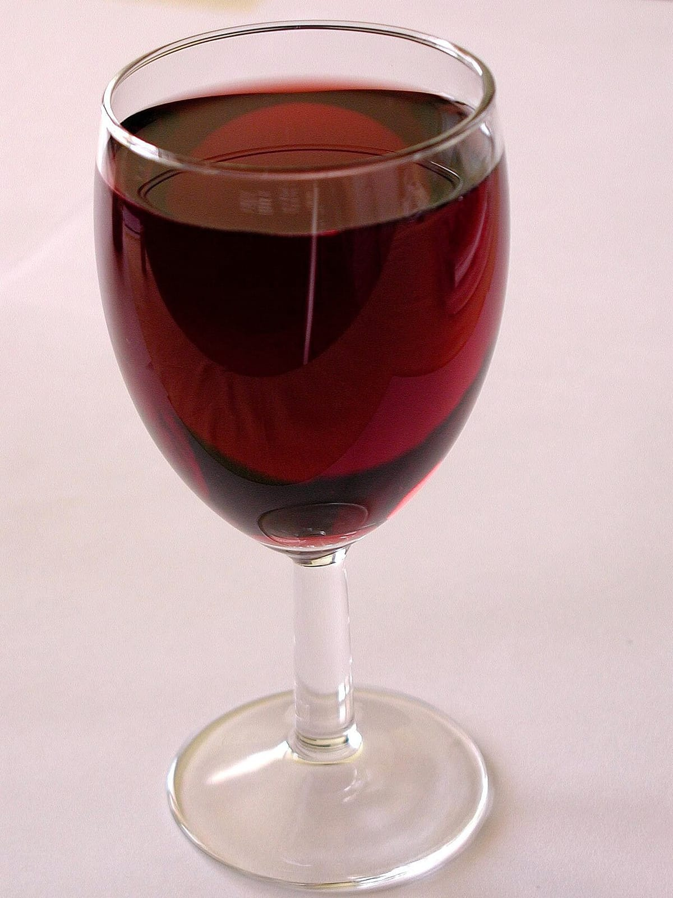

# Red Wine Glass

A red wine glass is a stemmed glass with a wide bowl and a slightly narrowed rim. Its shape is not decorative: the wide bowl lets the wine meet the air, the narrowed rim gathers the aroma at the nose, and the stem keeps the fingers off the bowl. Hold the stem between thumb and fingers rather than cradling the bowl, which would warm the wine.

The same name covers different shapes. A Bordeaux glass is taller and straighter; a Burgundy glass is wider and rounder. Both are red wine glasses, but they serve different aroma profiles. Understanding the link between shape and aroma matters more than memorising a brand. For red wine itself, see [red wine](ref:red).

Figure: A glass of red wine. Image: Paolo Neo, Public Domain, via Wikimedia Commons ([source page](https://commons.wikimedia.org/wiki/File:Red_wine_in_glass_in_restaurant.jpg)).

## Shape and proportions

The core proportions are a large bowl, a narrower rim and a long stem. The bowl usually holds 350 to 600 millilitres, but the pour fills only about a third; the empty space is not waste but a buffer for aroma and air.

A slightly narrowed rim concentrates the aroma. A fully open rim lets it scatter; a rim too narrow can smother it. The curve of the rim, the width of the bowl and the length of the stem together decide how the wine smells.

The stem has a practical job too. A long stem keeps the fingers away from the bowl and reduces body heat; a short stem or a stemless glass is more portable and durable, but less precise for tasting.

## Why a large bowl

Red wine aroma comes from alcohol, esters, phenols and fruit. Poured into a large bowl, the wine has more surface area and releases aroma more easily; the narrowed rim then keeps that aroma from escaping at once. Release first, gather second: that is the value of the large bowl.

The large bowl also holds more air. A young, tannic red may open in the glass; an old wine may fade within minutes. A large bowl is therefore not "better for older wine"; it depends on the wine's state.

Small glasses are not useless. They concentrate aroma, but offer less air, suiting wines that are already decanted and open; for a big wine, a small glass feels crowded and the layers cannot unfold.

## What it suits

The red wine glass suits reds with clear fruit and structure: Cabernet Sauvignon, Merlot, Syrah, Tempranillo, Nebbiolo. Different varieties call for different shapes: Cabernet often suits a taller glass, Burgundy and Pinot Noir a wider bowl.

It does not suit Champagne or sparkling wine. Bubbles need a tall, narrow vessel and the wide rim of a red wine glass lets them escape. It also does not suit crisp white wines, whose aroma the large bowl would oxidise too quickly.

With only one glass, a medium-sized red wine glass is the most versatile. It handles most reds and some whites, but it is not universal; delicate wines still need a more suitable shape.

## Temperature and pouring

Red wine is usually served at 16 to 18 degrees Celsius, depending on body and age. Too warm and the alcohol dominates and the aroma turns muddy; too cool and the aroma is muted and the tannin feels rigid.

Pour to about one third of the bowl. A full glass leaves no room for aroma and makes swirling unsafe; too little wine gives too small a surface and the aroma releases slowly. One third is a rule of thumb, not a law.

Pour slowly down the side of the glass rather than straight into the bottom. A direct pour disturbs sediment and over-releases aroma; a slow pour is gentler and easier to control. For the action itself, see [pouring](ref:pouring).

## Holding and cleaning

Hold the stem or the foot, not the bowl. Body heat warms the wine within minutes, and fingerprints on the bowl spoil both the look and the aroma. Holding the stem is stable and does not transfer heat.

Wash with warm water and a little neutral detergent, rinse thoroughly and dry upside down. Do not rub the inside with a towel: fibres and detergent residue affect the aroma. For water marks, press gently with a clean microfibre cloth rather than scrubbing.

Store away from strongly scented items. Glass adsorbs odours, especially when unused for a long time; rinse and dry before use. For more on choosing glasses, see [how to choose a glass](ref:glass).

## Common mistakes

First, assuming bigger is better. A bowl too large with too little wine feels hollow; a bowl too small cannot open the aroma. Size should match the wine and the pour.

Second, filling the glass. A full glass has no aroma space, is unsafe to swirl and hides the colour. One third is the right starting point.

Third, holding the bowl. Body heat warms the wine and fingers leave marks; hold the stem or foot instead.

Fourth, using a red wine glass for Champagne. The wide rim lets the bubbles vanish; sparkling wine needs a taller, narrower shape. For the white wine counterpart, see [white wine glass](ref:white); for the logic of a narrowed rim, see [tulip glass](ref:tulip).

**At a glance:** A stemmed glass with a wide bowl and a slightly narrowed rim, used for red wine. The wide bowl opens the aroma and the narrowed rim gathers it at the nose. 

Red Wine Glass is best approached through the material and size, then the intended use, and then how it affects the drink. One check alone will not settle it.

[Red wine](ref:red) explains material; [Tulip glass](ref:tulip) adds capacity. Put Red Wine Glass between them before deciding what it is.

The usual confusion is to treat Red Wine Glass as a drink. Check what it is first, then what the label claims; the two need not agree.

Sources for Red Wine Glass include Oxford University Press, Encyclopaedia Britannica, Corning Museum of Glass, Riedel.

A wide bowl and narrowed rim release and gather aroma; fill to the widest point, not the brim.

**Key facts.**

| Item | Detail |
| --- | --- |
| In one line | A stemmed glass with a wide bowl and a slightly narrowed rim, used for red wine. The wide bowl opens the aroma and the narrowed rim gathers it at the nose. |
| Material | Glass、Crystal glass |
| Use | Red wine and some dark, fruit-forward wines |

**Sources and limits.** The key claims about Red Wine Glass are checked against the following sources: Oxford University Press (Used to check glass shapes, aroma and tasting background), Encyclopaedia Britannica (Used to check general wine tasting and service background), Corning Museum of Glass (Used to check glass forms and craft background) and 5 sources in total. Prices, batches and status change; the body is project-written and does not reproduce source text.

For Red Wine Glass, this glass was last checked in 2026; prices, batches and availability change, so confirm them against the sources below.
