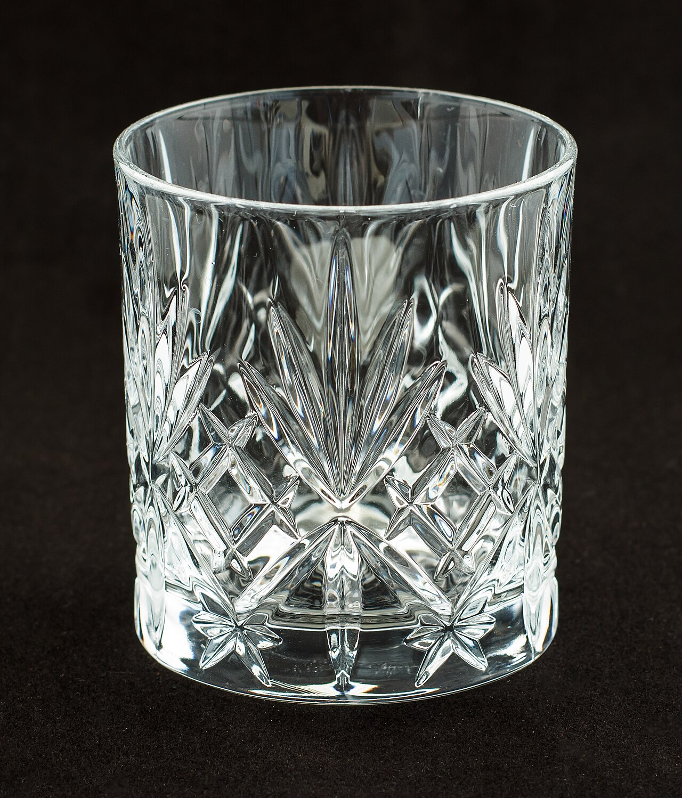

# Rocks glass

A rocks glass (also called an old-fashioned glass or lowball) is a short, wide-mouthed glass tumbler. It is used for spirits served over ice and for cocktails that are strained or built over ice. It has no stem and usually thicker walls, which lets it hold a large ice cube; those features define its uses and also its limits.

Figure: Rocks glass. Image: Andreas Argirakis, CC BY-SA 3.0, via Wikimedia Commons ([source page](https://commons.wikimedia.org/wiki/File:Old_Fashioned_Glass.jpg)).

## What a rocks glass is

Two proportions define it: the rim diameter is large relative to the height, and the body is short and wide. It is not a stemmed glass and not a tall long-drink glass. The wide rim makes room for a large ice cube and a garnish; the short body is easy to hold and gives the liquid a larger surface in contact with air.

The Chinese name for this glass comes from its typical use, the Old-fashioned cocktail. But its use is not limited to that: whisky over ice, stirred short drinks and some drinks that need a large cube can all use it. The name is a convention, not a restriction.

## Shape and capacity

There is no single capacity standard for a rocks glass. Common sizes range from smaller to larger, and wall thickness, base thickness and rim diameter all vary. This page therefore gives no "standard capacity" and does not assume that every rocks glass holds the same number of millilitres.

Capacity differences directly affect use: a small glass with a large cube leaves too little room for liquid and spills easily; a large glass with small ice creates too much headspace and aroma disperses. In practice, first see what size of ice your glass can hold, then decide how much to pour. "Ice as needed" in a recipe should be adjusted to the glass, not copied blindly.

## What it suits

A rocks glass suits two situations best. The first is spirits over ice, such as [whisky](ref:whisky) with one large cube: the short, wide body holds the cube and the wide rim makes nosing easy. The second is a stirred short drink, such as the [Negroni recipe](ref:recipe): the drink is already chilled and diluted, and straining it over ice in a rocks glass keeps it cold and fresh.

It does not suit long drinks that need plenty of bubbles, because the wide rim and short body let carbonation escape; it also does not suit drinks that need to gather fine aroma, because the wide rim lets aroma spread sideways. For aroma concentration a narrowed glass suits better; for what shape does, see [choosing a glass](ref:glass).

## Ice and temperature

The experience in a rocks glass depends heavily on ice. A large cube has little surface area, melts slowly, chills for longer and dilutes in a controlled way; crushed ice chills fast but also melts fast, thinning the drink within minutes. With large ice, chill the liquid first, or the cube will be warmed quickly by the drink and melt faster.

The glass has no stem, so holding the body transfers body heat. To keep it cold longer, hold it near the rim, or use a coaster or sleeve; you can also chill the glass before adding ice. For more on ice shape and temperature, see [Ice and temperature](ref:ice) and [Cocktail basics](ref:cocktails).

## Holding and keeping cold

How you hold the glass affects both temperature and presentation. Holding the body is convenient but transfers heat quickly; holding near the rim transfers less heat but puts fingers near the rim, which may affect hygiene and aroma. A compromise is to hold the lower body, reducing the area of hand contact while keeping fingers out of the rim.

Coasters and sleeves reduce heat transfer from the table and the hand, but do not change how fast the ice melts. To keep a drink cold longer, prioritise larger ice, a pre-chilled glass and less hand contact rather than relying on a coaster.

## Differences from similar glasses

The rocks glass is often confused with the highball. A highball is tall and narrow, usually larger, and suits long drinks and sparkling mixes; a rocks glass is short and wide and suits short drinks and large ice. It also differs from a plain tumbler: a tumbler usually has thinner walls and a wider rim and is not designed for aroma concentration or heat retention.

Compared with a narrowed nosing glass, the rocks glass lets aroma spread more and shows fewer layers, but is easier to drink from and more stable with ice. The two are not substitutes; they are tools for different purposes.

## Cleaning and storage

A wide rim makes a rocks glass easy to clean, but a thick base and thick walls can make detergent residue harder to rinse out. Wash by hand with warm water and a little neutral detergent, rinse thoroughly, and leave upside down to dry; do not wipe the inside repeatedly with a cloth, which leaves fibres and odour.

For Rocks glass, begin with the material and size, then the intended use, and finish with how it affects the drink; that order keeps the account grounded.

## Common misconceptions

First, assuming a rocks glass has a standard capacity. Capacities vary widely; adjust ice and liquid to your own glass.

Second, filling the glass with crushed ice. Crushed ice melts fast and thins the drink within minutes; short drinks usually suit large ice better.

Third, treating the rocks glass as universal. It suits short drinks and spirits over ice, not situations that need aroma concentration or plenty of bubbles.

Fourth, skipping pre-chilling. A warm glass speeds up ice melting and disrupts the dilution rhythm.

Fifth, choosing only by looks. A level rim, even walls and a capacity that suits your use matter more than appearance.

## Buying advice

Check three things first: whether the rim diameter fits the large ice you usually use; whether the height suits your hand; whether the walls are even and the rim level. Capacity need not match a particular number, but it should fit the recipes you make most.

If you buy only one, choose a medium-capacity model with slightly thicker walls; it is usually more durable and better suited to ice. If you often make short drinks, two glasses make hosting easier. Do not buy an overly small or very thin-walled model just for a "professional" look; it will limit everyday use.

## Boundary

A rocks glass is a tool, not a status symbol. Capacity, ice shape and temperature usually affect the result more than price. This page recommends no specific brand and does not present any one shape as the only correct choice; actual use should follow the glass you have and your own impression.

Read [Negroni recipe (IBA version)](ref:recipe) for the material side of Rocks glass, and [Ice is a choice, not a test](ref:ice) for the capacity side. Together they locate it.

**Short definition:** A short, wide-mouthed short-drink glass used for spirits over ice and stirred cocktails; capacity has no single standard, so adjust ice to your own glass.
