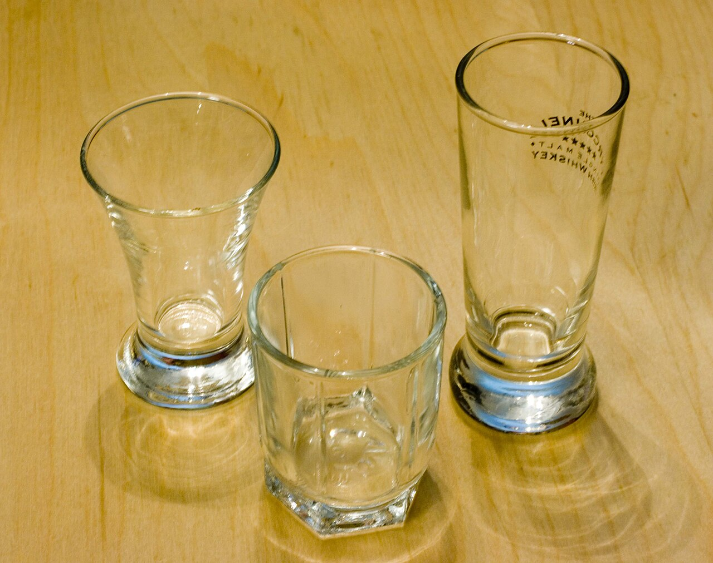

# Shot Glass

A shot glass is a small, thick-walled glass. The name comes from the "shot": a small serving of spirits taken in one swallow. It is not built for aroma or slow tasting; it is built for convenience, intensity and rhythm.

Capacities vary, commonly from 30 to 60 millilitres. Small glasses serve one swallow, larger ones measure or hold a little ice; thick walls survive knocks and cold and keep the liquid at temperature for a short while. Its simplicity is a practical design. Chill the glass, not the spirit, if you want it cold without diluting it, and never freeze it, where the glass can crack.

Figure: Three shot glasses. Image: Kelly Martin, CC BY-SA 2.5, via Wikimedia Commons ([source page](https://commons.wikimedia.org/wiki/File:Three_shotglasses.jpg)).

## Shape and capacity

The core features are small capacity, thick walls and a straight or slightly tapered rim. A straight rim is easy to fill and drink from; a slight taper gathers a little aroma; a thick base adds stability and lowers the centre of gravity.

Capacity changes use. A 30-millilitre glass suits one swallow; a 45 to 60-millilitre glass suits measuring or a little ice. Too large and the drink cannot be finished in one go, so it warms and changes; too small and measuring spills.

The rim matters too. A wide rim lets aroma escape but is easy to fill; a narrow rim gathers aroma but is harder to pour into. Shot glasses rarely need fine nosing, so the design leans toward easy filling and easy drinking.

## History and bar culture

The shot glass spread with twentieth-century American bar culture. Its ancestors were the jigger and the small bar glass; as bars turned the "one swallow" into a way of selling, a dedicated shot glass appeared.

The origin of the word "shot" is not reliably recorded. Some trace it to the metaphor of a gunshot, others to capacity or the manner of drinking. What is certain is that the shot glass became a standard American bar item in the later twentieth century.

Shot culture came with it: fast drinking, clinking glasses, finishing the spirit in one go. That practice pursues intensity and social rhythm rather than flavour, and understanding it explains the glass.

## What it suits

The shot glass suits high-strength spirits: vodka, gin, rum, tequila and some liqueurs. It does not suit delicate whisky or cognac, which need a nosing glass to show their layers.

It is also used for layered cocktails. Layering relies on the density difference between syrup, liqueur and spirit; a small glass keeps each layer visible and the thick wall stabilises the pour. For the method, see [layering](ref:layering).

The order is not arbitrary. Syrup is heaviest and goes first; liqueur next; spirit lightest and last. Each layer is poured slowly down the side, and the narrower the rim the better the layers hold; a wide rim mixes more easily. The small glass shortens the distance between layers and concentrates the visual effect. A very short glass makes each layer thin and hard to read; a very tall one increases the impact of the pour and mixes the layers.

A shot glass can also serve as a rough measure. Without a jigger, a known-capacity shot glass can measure, but its markings are usually imprecise. For accuracy, use a [jigger](ref:jigger).

## Use and temperature

Shot glasses are usually not warmed and hold no ice; the spirit is poured at room temperature and taken in one go. To chill it, chill the glass or the spirit; do not freeze the glass, since a sudden chill stresses the glass.

Fill to just below the rim, not to the top. A full glass spills easily and is awkward to lift; a little space gathers aroma and keeps fingers out of the liquid.

For layering, pour the heaviest syrup first, then the liqueur, then the spirit, each slowly down the side. Too fast and the layers mix; too slow and the liquid clings to the wall. For the basics, see [cocktail basics](ref:basics).

## Cleaning and storage

The narrow rim and thick base make rinsing difficult. Wash by hand with warm water and a little neutral detergent, rinse thoroughly and dry upside down; do not rub the inside with a towel, which leaves fibres and odour.

Do not stack them. The walls are thick but the rim is still fragile; stacking knocks rims together and can crack them. Store on a rack or a soft mat, separately.

Glass adsorbs odours, so rinse and dry an unused glass before use. Avoid strongly scented cleaners and keep the glasses away from spices, coffee beans or tobacco.

## Common mistakes

First, assuming all shot glasses hold the same volume. Capacities vary widely; check the actual volume before measuring.

Second, using a shot glass to taste whisky. The small glass cannot gather aroma and alcohol overwhelms detail; use a nosing glass.

Third, filling to the rim. A full glass spills and is awkward to lift; leave a little space.

Fourth, treating a shot glass as a precise measure. Its markings are usually approximate; use a jigger for accuracy. For ice drinking, see [rocks glass](ref:rocks); for vodka service, see [vodka](ref:vodka).

**Short definition:** A small, thick-walled glass used for one-swallow servings of spirits, for measuring and for layered cocktails. It is built for convenience and intensity, not aroma.

Read Shot Glass through the material and size, then the intended use, and finally how it affects the drink. The sequence matters.

[Jigger](ref:jigger) and [Layering](ref:layering) are the nearest useful comparisons: one clarifies material, the other tests capacity.

Do not reduce Shot Glass to a drink. 

Oxford University Press, International Bartenders Association, CocktailDB, Corning Museum of Glass are the main sources behind this entry on Shot Glass. Each is cited where it bears on a specific claim; none is asked to carry the conclusion alone.

“Shape and capacity” comes before “History and bar culture” because material has to be settled before capacity. Read in the other order, and Shot Glass is easily mistaken for a drink.

**Key facts.**

| Item | Detail |
| --- | --- |
| In one line | A small, thick-walled glass used for one-swallow servings of spirits, for measuring and for layered cocktails. It is built for convenience and intensity, not aroma. |
| Material | Glass、Crystal glass |
| Use | One-swallow spirits, measuring and layered cocktails |

**Sources and limits.** The key claims about Shot Glass are checked against the following sources: Oxford University Press (Used to check shot glasses and bar measuring culture), International Bartenders Association (Used to check cocktail structure and layering practice), CocktailDB (Used to cross-check layered cocktails and glass usage) and 5 sources in total. Prices, batches and status change; the body is project-written and does not reproduce source text.

For Shot Glass, this page was last checked in 2026; prices, batches and availability change, so confirm them against the sources below.
