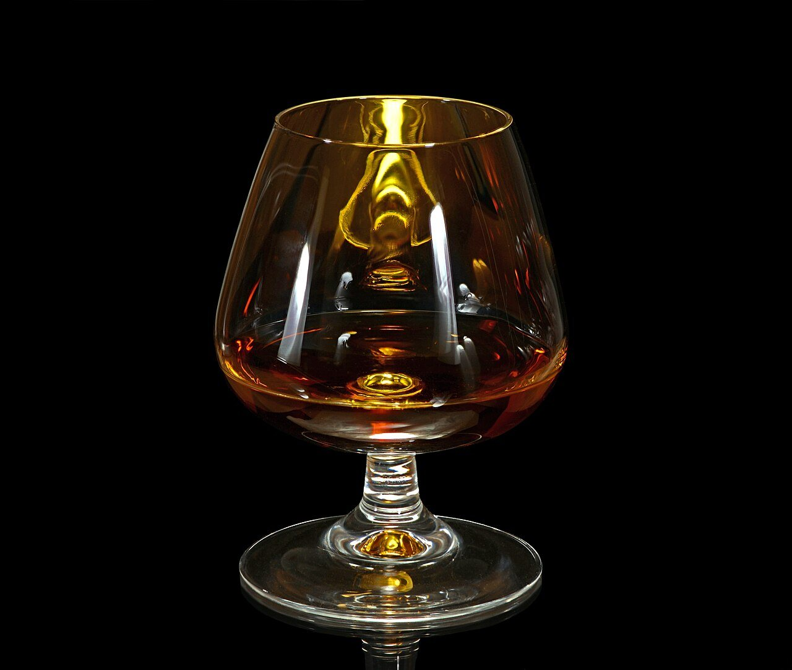

# Snifter

A snifter, also called a balloon glass, is a short-stemmed glass with a large bowl and a narrowed rim. The bowl swells like a balloon, widest below the middle and tapering upwards; the stem is short enough that the fingers can cradle the bowl. It is most closely associated with Cognac and [brandy](ref:brandy), and is also used for other aged spirits and some strong beers. Its reputation rests on a ritual of warming the glass in the hand so that aroma rises, but what really shapes the experience is capacity, pour size and how tightly the rim closes.

Figure: A brandy snifter (balloon glass) holding Cognac, against a black background. Image: Didier Descouens, CC BY-SA 3.0, via [source page](https://commons.wikimedia.org/wiki/File:Cognac_glass.jpg).

## A glass that is easy to misuse

The snifter's image is so strong that many people treat it as the dedicated Cognac glass and assume that a bigger glass is more impressive and a fuller pour more generous. Neither assumption holds.

It is indeed traditionally tied to brandy, Cognac above all, but the same shape is used for whisky, rum, aged tequila and liqueurs; in beer, a similar glass is also called a snifter and is used for strong, aromatic styles such as barley wine and imperial stout.

The large capacity is not an invitation to pour more. The big bowl exists to leave aroma space, giving the liquid a large surface and plenty of air above it. The actual pour is usually only a few tens of millilitres. Filling a large snifter reverses the design.

## Short stem, big bowl, narrow rim

The short stem is the first feature. It is not the long stem of a wine glass but short enough to be gripped between the fingers while the bowl rests in the palm. That structure defines how the glass is used: the bowl can be cradled, or the stem alone can be held.

The large bowl is the second. Its widest diameter is clearly greater than the rim, creating a large surface and a large volume of air. A large surface releases aroma quickly; a large headspace lets aroma mix instead of hitting the nose the moment it is poured.

The narrowed rim is the third. The rim is smaller than the widest part of the bowl and closes in without shutting completely. It guides rising aroma towards the centre of the opening and reduces losses to the sides, yet it does not pinch as tightly as a tulip, so the nose still fits comfortably.

Together these features make a wide-bottomed, narrow-topped aroma chamber. Its strength is holding and gathering; its weakness is fast warming and fast alcohol evaporation.

## Is hand heat a help or a distraction?

The traditional move is to grip the short stem between the fingers, rest the bowl in the palm and let body heat bring the liquid slightly above room temperature so the aroma lifts. There is real physics behind it. Brandy aroma comes from esters, aldehydes, terpenes and oak-derived compounds such as vanillin, and warming increases their volatility, so the nose reads more open, sweeter and more layered.

But hand heat also interferes. Ethanol is more volatile than water, and warming raises its evaporation too. Once the liquid is too warm, the first thing the nose meets is alcohol, the fruit, floral and wood notes are pushed back, and the palate turns hot. A hand sits at roughly thirty degrees, and cradling a small pour for a long time is easily enough to warm it noticeably.

The practical balance is this: start at room temperature, cradle the bowl briefly, and stop as soon as the aroma opens. Do not hold the glass in your hand for ten minutes while talking. If the room is already warm, or the spirit is strong, it is better not to warm it at all than to let hand heat keep working. For how to judge what you smell, see [nosing](ref:nosing).

## Where the narrowed rim sends the aroma

The rim does not lock aroma in; it changes where the aroma goes. In a wide bowl, rising aroma would spread outwards, and the narrowed rim guides the upward flow towards the centre of the opening, forming a narrower column. The nose, close to the rim, meets a higher concentration.

How tightly the rim closes determines the experience. Too open and the aroma escapes quickly, so the glass behaves like an ordinary large tumbler; too closed and the aroma is concentrated but so is the alcohol, which tires the nose. A good snifter closes gently, with a rim that turns slightly outwards so the liquid flows to the front of the tongue rather than the throat.

The rim also affects swirling. With a wide bowl, swirling spreads a film of liquid up the inner wall, increasing the surface in contact with air and releasing more aroma. Swirl too hard, though, and the alcohol surges up, especially with a strong Cognac; a gentle turn is enough.

## Capacity of 300–800 ml, and how much to pour

Typical capacity runs from 300 to 800 ml, a very wide spread; some producers recommend a balloon of around 250 ml for concentrating aroma. Capacity depends on the specific product, so check the stated figure before buying.

The pour cannot be inferred from capacity. A normal neat serve is 25–50 ml, roughly one or two finger-widths deep, kept below the widest part of the bowl and leaving most of the glass empty. In a 300 ml glass, 30 ml is about a tenth of the volume; in an 800 ml glass the same amount barely covers the base and the aroma struggles to gather. A bowl that is too large with too little liquid produces an odd combination: nothing to smell, a drink that disappears too fast, and very slow warming.

A useful test: after pouring, let the glass stand for ten or fifteen seconds. If a stable layer of aroma forms at the rim, the amount is right. If you have to put your nose inside the bowl to smell anything, there is too little liquid or the glass is too big. If alcohol hits you as you approach, there is too much.

## How it divides the work with a tulip glass

The [tulip glass](ref:tulip) is the usual comparison. It has a longer stem, a narrower rim and a smaller bowl, and it is designed for precise nosing: aroma is held more tightly, the hand is less likely to touch the bowl and the temperature is more stable. Cellar masters and professional tasters often prefer a tulip for Cognac because it removes hand heat from the equation and makes fine layers easier to catch.

The snifter's advantages lie elsewhere. A large bowl gives aroma room to unfold, which suits an old, aromatic spirit that you want to nose slowly; the short stem makes cradling natural and adds a sense of ceremony; the wider mouth makes it easy to add a drop of water or a cube of ice.

The two are not substitutes but different tools. Use a tulip when you want to judge; use a snifter when you want to linger. If you keep only one glass, a tulip covers more ground; if you enjoy the ritual of holding the bowl, a snifter is the better fit.

## Swirling, nosing and the first sip

Swirling is for contact with air, not for show. Rest the glass on the table, turn it gently around the foot and let the liquid climb the wall in a thin film; do not shake it hard, because a strong spirit will release a sharp burst of alcohol.

Nose it in two stages. First a short sniff to check for obvious alcohol or faults; then place the nose just below the rim and inhale slowly to separate fruit, floral, wood and spice. Do not inhale repeatedly and deeply, because the nose tires. After two or three sniffs, smell the back of your hand to reset.

Keep the first sip small. Let the liquid rest in the mouth for a second or two so it warms to body temperature and the aroma travels back through the nose, then swallow. A large gulp skips the aroma and leaves only the alcohol. For the order and pace of a tasting, see [a first tasting](ref:tasting).

## Ice, water and other uses

Ice is not the snifter's strength. The bowl is big, but the rim is narrow, which makes a large cube awkward, and melting ice keeps diluting the spirit. For ice, a [rocks glass](ref:rocks) is better: a wide mouth and a short body give the ice room and keep the temperature steadier.

Water is a different matter. A few drops of room-temperature water can reduce the surface activity of the alcohol and help aroma escape, especially in a strong Cognac; add drops to a small spoonful and stop when the nose opens and the entry softens. Do not use ice water, since the cold suppresses aroma.

Snifters are also used for liqueurs, aged rum and tequila; in beer, the related shape serves barley wine and imperial stout, where aroma and strength are high. The uses can expand, but the rule on pour size does not: keep it small and leave space.

## Four visible details when buying

First, the ratio of bowl to rim. The bowl should be clearly wider than the rim, or the glass degenerates into a large tumbler. Second, wall thickness. A thinner rim feels cleaner to drink from; thick walls make the aroma seem dull.

Third, the short stem and the foot. The stem should sit comfortably between the fingers and the foot should be flat and stable; a large bowl has a high centre of gravity, and a small foot tips. Fourth, clarity. Tasting depends on colour, so coloured, frosted or heavily cut glass gets in the way; producers also recommend clear glass so that colour and brightness can play a part.

Do not be led by the words "handmade" or "crystal". Crystal is thinner and brighter but breaks more easily; ordinary glass is more durable. Capacity depends on the specific product, so decide on your usual spirit and pour first and then choose the bowl size; an 800 ml glass is not better for everyone than a 300 ml one.

## Cleaning and storage

The bowl is wide and the hand can reach inside, but detergent tends to collect where the base meets the bowl. Hand washing is best: warm water, a little neutral detergent, a soft sponge around the inside, a thorough rinse and upside-down drying. Do not wipe the inside repeatedly with a cloth, which leaves fibres and odour, and do not leave the glass soaking overnight.

The rim is thin, so avoid knocking it against other glasses; the joint between the short stem and the foot takes the stress, so hold the foot or the stem rather than the rim. Do not stack snifters: large bowls jam together and the rims crack under pressure. A single layer or a rack is better. Before using a glass that has been stored for a long time, rinse and dry it so it carries no cupboard smell.

## Common misconceptions

First, "a big capacity means a big pour". Capacity is aroma space, not a serving size; filling it ruins the aroma and encourages fast drinking.

Second, "a snifter is only for Cognac". It also holds other brandies, aged spirits and strong beers; the shape does not restrict the drink.

Third, "you must warm it in the hand". Hand heat can help aroma open, but it is not compulsory; too much heat puts alcohol ahead of aroma, and room-temperature serving is perfectly reasonable.

Fourth, "the bigger the glass the more professional". Too large a glass with too little spirit scatters the aroma; size should match the pour.

Fifth, "the tighter the rim the more aroma it gathers". A tight rim gathers alcohol as well, which stings over time; a gentle closure is more usable.

Sixth, "a snifter is good for ice". Ice belongs in a rocks glass; the narrow rim and short stem of a snifter do not suit a long, cold drink.

## See also

- [Brandy](ref:brandy): the traditional drink for a snifter.
- [Tulip glass](ref:tulip): a more concentrated alternative for precise tasting.
- [Rocks glass](ref:rocks): the alternative when ice is involved.
- [Nosing](ref:nosing): how to tell whether alcohol is covering the aroma.
- [A first tasting](ref:tasting): tasting order and temperature control.
