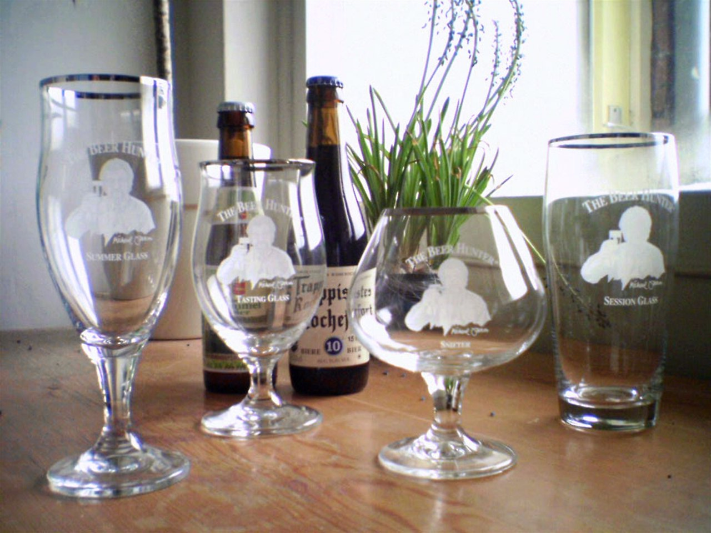

# Tasting glass

A tasting glass is not just any glass used for tasting. It is a glass with a written definition. The best-known example is the wine-tasting glass specified by ISO 3591, often called the INAO glass after the French body associated with appellation tasting. Its bowl resembles an elongated egg, its opening is narrower than the widest part of the bowl, and a short stem connects the bowl to the foot. It exists not to make a drink taste better but to let different drinks be compared under the same geometry.

Figure: Tasting glass. Image: Sietske at Dutch Wikipedia, CC BY-SA 3.0, via Wikimedia Commons ([source page](https://commons.wikimedia.org/wiki/File:Michaeljacksonbierglazen.jpg)).

## A glass with a written definition

ISO 3591 was published in 1977 under the title Sensory analysis — Apparatus — Wine-tasting glass. The standard describes the bowl as an elongated egg supported by a stem on a base, with an opening narrower than the convex part so that the bouquet is concentrated. It also sets out physical, dimensional and special characteristics, and an annex gives recommendations for use. The standard was reviewed and confirmed in 2022, which suggests that its proportions have not been displaced by decades of tasting practice.

The point of standardizing is to remove variables. Bowl volume, the distance from liquid surface to rim, the diameter of the opening and the thickness of the wall all affect aroma concentration and the angle at which the liquid enters the mouth. If every taster uses a different glass, a comparison becomes a comparison of glasses. ISO 3591 fixes the geometry so that "the same wine" becomes a controllable object across settings.

It is important to separate the standard from its extensions. ISO 3591 is written for the sensory analysis of wine. Using a similar glass for spirits or sake is an industry adaptation, not a provision of the standard. Keeping that distinction clear prevents the "standard glass" from being mistaken for a universal glass.

## Where 215 ml comes from

The nominal capacity of this style of tasting glass is usually given as 215 ml. The figure corresponds to a bowl large enough to hold a tasting pour, yet small enough to keep the headspace from becoming excessive. With the glass filled to about one third of the bowl, there is still room for aroma above the liquid; several samples can be lined up on a tasting table; the bowl is wide enough to swirl and narrow enough at the opening to gather the bouquet.

215 ml is the nominal value for the standard form, and actual products vary slightly. Manufacturers differ in wall thickness, rim diameter and stem height, and glass and crystal glass behave differently with heat. Treat 215 ml as a reference for the category, not as a promise that every glass is accurate to the millilitre. Capacity depends on the specific product.

The small size has a practical side. A tasting often involves several wines in sequence. A large glass means a large pour for each sample, which increases both alcohol intake and palate fatigue. A glass that is too small leaves too little liquid to cover the tongue or to release a useful aroma. At 215 ml, the glass makes "smellable, tasteable and finishable" possible at the same time.

## The tulip shape and the narrowed rim

The profile is tulip-like: the lower bowl swells, the body narrows towards the top, and the rim is slightly smaller than the widest point. Aroma leaves the liquid surface and forms a layer of higher concentration in the headspace; the narrowed opening reduces exchange with room air, so aroma accumulates near the rim. When you put your nose close, you compare samples at a more similar concentration.

This is the opposite of a wide, open rim. An open glass lets aroma spread freely, which feels generous but produces a low and quickly changing concentration. A narrowed glass traps aroma at a small exit, which raises concentration and makes layers easier to separate, but also magnifies alcohol. The tasting glass chooses the stable signal because tasting needs consistency rather than comfort.

The rim also shapes what happens after a swirl. Rotating the bowl leaves a thin film of liquid on the wall, increasing the area in contact with air. The narrowed opening keeps the newly released aroma inside long enough to be examined. That is one reason the tasting glass works better for nosing than an ordinary water tumbler.

The narrowing has a limit. If the opening is too small, the nose cannot enter, the liquid splashes against the rim when swirling, and washing becomes awkward. The standard's taper is moderate: it guides aroma rather than sealing it in.

## What a common glass buys you

The core of tasting is not "which glass is best" but "how to make comparison valid". The same glass, the same pour, the same temperature and the same resting time allow differences to be attributed to the drink. A common glass controls at least four variables: surface area, headspace volume, the path from liquid to rim, and the angle at which the liquid meets the mouth.

Surface area governs the rate at which aroma volatilizes. Two glasses with the same bowl, filled with the same volume, present the same surface area and therefore a comparable aroma concentration. Headspace governs dilution; rim diameter governs escape; bowl shape governs where the liquid lands on the tongue. Change any one of these and the taster's judgement may shift.

This is why professional tastings stress "one set of glasses" rather than "a glass that feels right to each taster". In competitions, appellation checks and laboratory sensory tests, the glass is part of the controlled conditions, recorded alongside temperature, pour and resting time. To try a simple comparison at home, see [First sip, hold the verdict](ref:first).

## Pouring to one third of the bowl

The usual pour is about one third of the bowl. In a 215 ml glass that is roughly 70 ml; in practice many tastings use 50 to 70 ml, depending on the drink, the purpose and the protocol. The important thing is to leave enough headspace for aroma to gather and enough liquid depth to swirl.

Overfill the glass and the headspace shrinks, aroma crowds into a small volume, alcohol dominates the detail, liquid splashes during swirling and the rim becomes wet for the next nose. Underfill and the surface area is too small, the aroma is weak, and the temperature is more easily influenced by the glass wall. One third is a useful starting point, not a recipe.

For spirits the pour is usually smaller, often 20 to 30 ml, because the alcohol and aroma are concentrated and a small amount is enough. For sake, the glass may be filled closer to one third of the bowl, and the temperature is often at or slightly below room temperature. In every case the test is the same: there must be room above the liquid for aroma to collect.

## Swirling: room and limits

The bowl is small, so the freedom to swirl is limited. A gentle rotation spreads the liquid and releases aroma; a hard swirl sends liquid towards the rim and may spill it. For wine, a few slow turns around the bowl are usually enough. For spirits, the point is contact with air rather than the creation of foam.

The rim imposes a second limit. A narrow opening concentrates both aroma and alcohol after a swirl. Holding a high-strength spirit under the rim for too long produces a sting in the nose and dulls judgement. Move the nose back a little, or add a drop of water to lower the alcohol signal, then nose again. The glass concentrates the signal; it does not remove the alcohol.

Temperature is a third limit. A small bowl with a small pour warms quickly from the hand. Hold the stem or the foot, not the bowl, and let the glass rest on the table between samples. A rise in temperature makes the aroma look broader and the alcohol stronger, which is a change in the sample as presented, not a change in the drink itself.

## Spirits and sake in a wine glass

Spirit tasting needs a stable aroma signal, and the tasting glass supplies it with a narrowed rim and a short stem. Whisky, cognac, rum and tequila tastings often use a small tulip-shaped glass of this kind. Some settings prefer a smaller copita or a dedicated spirit glass, but the logic is the same: a small pour, a generous headspace and a gathered nose. For [whisky](ref:whisky), the amount of water and the strength of the spirit should be adjusted to the drink rather than forced into one protocol.

Sake tasting also borrows the wine glass or the tasting glass. Ginjo-style sake has pronounced fruit and floral notes that benefit from a narrowed rim, and a clear, colourless bowl makes it easier to judge colour and clarity. Traditional sake service uses small cups and focuses on temperature and drinking; a tasting setting focuses on aroma and comparison, which is why an ISO-style glass appears there. The two are not in conflict; they serve different purposes. For [sake](ref:sake) styles and temperatures, see the dedicated page.

This is also the split between a tasting glass and a drinking glass. A drinking glass optimizes pleasure and occasion; a tasting glass optimizes information and comparability. One glass for a whole bottle may be less comfortable; one glass for ten samples is far more convenient.

## Clear, colourless and unmarked

A tasting glass is normally clear and colourless, with no cutting, engraving or large printed pattern on the bowl. The reason is direct: tasting requires judging colour, clarity, viscosity and bubbles, and any tint or texture interferes. The less decoration on the wall, the more reliable the visual signal.

Some tasting glasses carry a line or a printed mark to suggest a fill level; others have no mark at all and rely on the taster's judgement. A line is an aid, not a precision instrument. Actual capacity varies with manufacturing tolerance, wall thickness and temperature, and the meniscus changes the apparent reading. Treat the line as "about here" rather than as a laboratory graduation.

Cleanliness affects judgement just as much. Detergent residue leaves odour, grease changes surface tension, and hard-water deposits interfere with the view of clarity. Before a tasting, wash with unscented neutral detergent, rinse thoroughly and drain upside down. Do not polish the inside with a scented cloth.

## What it gives up

The tasting glass trades some pleasure for comparability. Its capacity is small, so a generous mouthful finishes the sample; the bowl is small, so swirling is restricted; the rim is narrow, so aroma is concentrated but so is alcohol; the stem is short, so the hand sits closer to the bowl and temperature control is less relaxed. It is not designed for a long, comfortable dinner.

That does not make it difficult or superior. It changes the goal from "taste good" to "compare well". In blind tastings, competitions, appellation checks and laboratory tests, the trade is worth it. At a party, with food, or over a celebration, a larger wine glass or a suitable beer glass may be more enjoyable.

Once that is clear, the tasting glass stops being "the professional glass" to use everywhere. Professionalism depends on the purpose, not on the outline. For the general relationship between shape, aroma and temperature, see [choosing a glass](ref:glass). If you want a narrowed rim with a more generous bowl for everyday drinking, a [tulip glass](ref:tulip) is the closer choice.

## Common misconceptions

First, "drinking from a tasting glass makes a drink taste better". The glass optimizes aroma signal and comparability, not the pleasure of a large mouthful; the small pour and narrow rim can make alcohol more prominent.

Second, "every tulip glass is an ISO glass". ISO 3591 sets specific bowl, rim and dimensional requirements, and many tulip-shaped glasses only resemble the outline without matching the proportions.

Third, "215 ml is the exact capacity of every glass". 215 ml is the nominal value for the standard form; real products vary, and capacity depends on the specific product.

Fourth, "the fuller the glass the stronger the aroma". Overfilling compresses the headspace and crowds the aroma, and it makes swirling messy; about one third is more effective.

Fifth, "a tasting glass is only for wine". Spirits and sake are also tasted in similar glasses, but that is an extension beyond the original scope of ISO 3591.

Sixth, "a standard glass makes you a taster". The glass controls variables; judgement comes from training, comparison and notes. A shape cannot replace experience.

## See also

- [Wine](ref:wine): the original purpose of the tasting glass.
- [Whisky](ref:whisky): spirit tasting in a similar glass.
- [Sake](ref:sake): aroma and temperature in sake tasting.
- [Tulip glass](ref:tulip): a larger, more everyday narrowed-rim glass.
- [First sip, hold the verdict](ref:first): a method for comparative tasting at home.
