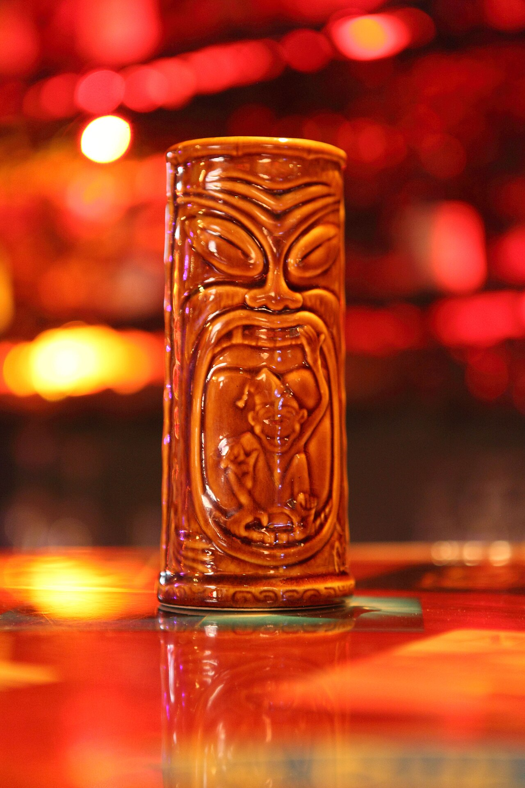

# Tiki Mug

A tiki mug is a shaped vessel, usually ceramic or glass, carved as a tiki god, mask, totem or animal. It is not a neutral container but part of tropical cocktail culture: the mug itself is decoration, narrative and atmosphere.

Tiki culture spread in the mid-twentieth-century United States, associated with bars such as Trader Vic's and Don the Beachcomber. They mixed rum, juice, syrup and spice, served it in carved mugs with flowers, bamboo leaves and umbrellas, and sold a South Seas fantasy. The mug carries that fantasy.

Figure: A tiki mug. Image: Sam Howzit, CC BY 2.0, via Wikimedia Commons ([source page](https://commons.wikimedia.org/wiki/File:Tiki_mug_from_the_Purple_Orchid_Exotic_Tiki_Lounge.jpg)).

## Shape and capacity

There is no single tiki shape. Common forms include god mugs, mask mugs, barrel mugs, shell mugs and animal mugs; materials include ceramic, glass and even resin. Their common point is form first: the mug is a sculpture before it is a container.

Capacity usually exceeds a standard cocktail glass, commonly 300 to 500 millilitres. A large mug suits crushed ice and juice, but too large with too little spirit and the ice melts fast and the drink goes weak. Match the mug to the formula, not only to the look.

The rim is usually wide enough for crushed ice, a straw and garnish; too narrow and the garnish will not fit and drinking is awkward. Thick walls hold the cold and survive knocks, but they add weight and make long holding tiring. A mug with a narrow base should sit on a coaster, since the sculpture makes it top-heavy.

## Form and narrative

Tiki mugs draw on a fantasy of the South Seas rather than a single real island culture. In Polynesian usage a tiki is a god or ancestor image; mid-century American bars commercialised it into masks, totems and cartoon figures.

That fantasy has a history and a controversy. Tiki culture mixes elements from different islands into a fictional tropical paradise; for some it is nostalgia and fun, for others it flattens real cultures. Understanding the background matters more than the look alone.

The narrative shapes the way the drink is served. The more theatrical the mug, the more the drink becomes a prop; bars use dry ice, flame, flowers and layered garnish to make the mug a photograph. The mug is part of the experience, not just a container.

## What it suits

The tiki mug suits tropical cocktails such as the Mai Tai, Zombie, Painkiller, Saturn and Jungle Bird. It also suits long drinks with crushed ice, juice and syrup; capacity and form make them look generous.

It does not suit short drinks or neat spirits. The mug is too large, the liquid too little and the aroma scatters; a wide rim is also poor for fine nosing. It does not suit hot drinks: thick walls and a sculpted body cool them fast and are hard to wash.

With only one vessel, the tiki mug is not universal. Its use is tropical and decorative; for everyday ice drinks a rocks glass is better, and for sparkling drinks a highball. For the highball, see [highball](ref:highball).

## Use and temperature

Chill the tiki mug before use, but freezing is unnecessary. Chilling cools the wall and steadies the foam; freezing makes ceramic or glass more fragile and may frost the rim.

Build by adding crushed ice first, then the liquid and finally the garnish. Mound the ice to the rim so the mug looks full; pour down the side so the ice layer stays intact. For the action, see [pouring](ref:pouring).

Garnish is part of the tiki mug. Flowers, bamboo leaves, pineapple leaves, cherries and umbrellas make the drink taller and more tropical, but too much blocks the rim and makes the mug top-heavy. Garnish should serve the theme, not pile up.

## Cleaning and care

Ceramic and glass need different washing. For ceramic, use warm water and a little neutral detergent, working into the base and carved grooves; for glass, use a soft sponge to avoid scratches. Either way, rinse thoroughly and dry upside down.

Carved grooves trap residue. Use a soft brush, never a hard brush or steel wool; blot water from the grooves with a clean cloth rather than rubbing hard. Keep unused mugs dry to avoid a musty smell.

Tiki mugs are often fragile, so do not stack them. Stacking knocks rims and raised carving together and can crack them; store separately or on a rack. Glass adsorbs odour, so rinse and dry before use. Rinse by hand, since a dishwasher can dull the glaze.

## Common mistakes

First, treating the tiki mug as universal. Its capacity and form suit tropical long drinks, not short drinks, neat spirits or hot drinks.

Second, a mug too large for the pour. The ice melts fast and the drink goes weak; match mug to formula.

Third, piling on garnish. It blocks the rim and makes the mug top-heavy; garnish should serve the theme.

Fourth, ignoring the carved grooves when washing. Residue collects there and spoils flavour and hygiene over time. For tropical drinks, see [Mai Tai](ref:maitai) and [Zombie](ref:zombie); for rum, see [rum](ref:rum); for choosing glasses, see [how to choose a glass](ref:glass).

[Rum](ref:rum) explains material; [Zombie](ref:zombie) adds capacity. Put Tiki Mug between them before deciding what it is.

**Short definition:** A shaped ceramic or glass mug carved as a tiki god, mask or totem. It belongs to tropical cocktail culture, and its capacity and form are more theatrical than an ordinary glass.

Tiki Mug is best read by starting with the material and size, moving to the intended use, and ending with how it affects the drink.

A frequent error is to treat Tiki Mug as a drink. Establish what it is, then what the label claims. Neither answer settles the question alone.

Material, size and condition affect the result, so the maker’s specification remains the practical check.

Tiki mugs are ceramic or glass vessels shaped as faces, coconuts or islands; they hold 12–20 oz and are used for tropical drinks.

The mugs are often designed by artists and collected, not just used for drinks.

**Key facts.**

| Item | Detail |
| --- | --- |
| In one line | A shaped ceramic or glass mug carved as a tiki god, mask or totem. It belongs to tropical cocktail culture, and its capacity and form are more theatrical than an ordinary glass. |
| Material | Ceramic、Glass |
| Use | Tropical cocktails and tiki-style drinks |

**Sources and limits.** The key claims about Tiki Mug are checked against the following sources: Oxford University Press (Used to check tiki culture and tropical cocktail background), International Bartenders Association (Used to check tropical cocktail formulas and glass usage), CocktailDB (Used to cross-check tiki mug usage and capacity) and 5 sources in total. Prices, batches and status change; the body is project-written and does not reproduce source text.

For Tiki Mug, this page was last checked in 2026; prices, batches and availability change, so confirm them against the sources below.
