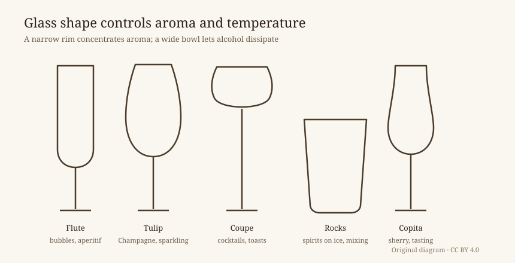

# Tulip glass

A tulip glass is a glass with a wide bowl that narrows towards a slightly closed rim. Its outline resembles a tulip bud: the lower bowl has enough room for the liquid and the aroma to open, while the upper rim gathers the aroma towards the nose. It is used for Champagne and sparkling wine, for beer, and by some bars for short drinks where aroma comes first.

Figure: common glass shapes and what they are for. A narrow rim concentrates aroma; a wide one lets alcohol dissipate. Original diagram, CC BY 4.0.

## What the glass is

The defining feature is a wide bowl with a narrowed rim. The body rises from the foot, reaches its widest point, then narrows towards the rim. The rim diameter is usually smaller than the widest part of the bowl, which is the clearest difference from a straight glass or a flute.

It is usually stemmed, though some stemless beer versions exist. A stemmed version suits Champagne and short drinks, since the stem can be held to reduce hand heat; a stemless version is closer to an everyday beer glass and is held differently. Capacity and height vary widely, and there is no single specification.

A tulip glass is not simply a variation of a flute or a coupe; it is a different structural choice. A flute puts bubbles first, a coupe puts open aroma first, and a tulip seeks a compromise between the two.

## How shape affects aroma and temperature

The wide bowl provides a larger liquid surface and more area for aroma to volatilise, giving aroma room to open. The narrowed rim then gathers aroma near the opening, so layers are easier to catch when nosing. This "open, then gather" structure is what the tulip is valued for.

The width of the bowl also gives bubbles room to rise and circulate, rather than confining them to a thin line as an extremely narrow flute does. Bubbles still escape, but usually more slowly than in a coupe and less slowly than in a flute.

For temperature, a larger bowl means a larger surface in contact with air, so the drink warms relatively quickly. The stem reduces hand heat but cannot stop the effect of room temperature. When a large glass holds a small drink, there is more room for aroma but also more exposure to the walls.

The narrowed rim has a practical effect as well: the drink flows towards a more focused point in the mouth, so bubbles and aroma arrive together. For wines with complex aroma and fine bubbles, this shape presents layers more easily than a wide-open glass.

## Capacity and suitable drinks

There is no single capacity standard for a tulip glass, and bowl size, rim width and height vary widely. This page gives no fixed capacity figure; capacity depends on the specific product. Adjust the pour to your glass so that the drink is not so full that the aroma space is compressed.

Drinks that suit a tulip include Champagne and [sparkling wine](ref:sparkling), especially when both aroma and bubbles matter, and [beer](ref:beer), since many beer glass shapes use a tulip outline to gather malt and hop aroma. Some aroma-first, ice-free short drinks also use a tulip glass; the specific choice depends on the recipe and bar practice.

It does not suit drinks that need a lot of ice. The bowl may be wide, but the narrowed rim makes stirring difficult once a large cube is in the glass and limits the garnish. Long drinks that need to stay cold are better in a straight glass.

The same drink behaves differently in tulips of different sizes. A large bowl with a narrow rim concentrates aroma more; a small bowl with a wide rim is closer to an ordinary wine glass. Choose according to whether you care more about aroma or bubbles.

## Material and cleaning

Tulips are commonly made of glass or crystal glass. Ordinary glass is durable and costs less; crystal is thinner and more brilliant but breaks more easily. The curved body makes it more important to rinse thoroughly where the bowl meets the rim.

Hand washing is recommended, with warm water and a little neutral detergent, thorough rinsing and upside-down drying. Do not wipe the inside repeatedly with a cloth, which leaves fibres and odour; the rim is thin, so avoid knocks. If the product is dishwasher-safe, use a gentle cycle and make sure the glasses cannot knock together.

Store without stacking. A wide bowl and a narrow rim can jam together or take uneven stress; a rack or enough shelf space is better. The joint between stem and foot is a weak point, so hold the stem or foot.

## How to choose

First, look at the ratio of bowl to rim. A bowl clearly wider than the rim concentrates aroma more; a ratio close to a straight cylinder behaves more like an ordinary wine glass.

Second, look at bowl capacity. Capacity depends on the specific product and should match your usual drinks and pour; too small a bowl leaves no room for aroma.

Third, look at the stem and foot. The stem should be comfortable to hold and the foot steady; a small foot tips easily.

Fourth, look at wall thickness and evenness. Thin walls feel lighter but are less durable, and uneven walls affect appearance and cleaning.

Fifth, consider the use. For Champagne and sparkling wine, choose a slightly larger bowl with a gently narrowed rim; for beer, refer to common beer glass proportions.

Sixth, consider washing and storage. A curved shape is harder to clean than a straight one and needs space and patience.

Do not judge only by appearance. The value of a tulip lies in the balance between aroma and bubbles, and the bowl-to-rim ratio matters more than colour or decoration.

## Alternative glasses

The [Champagne flute](ref:flute) is the bubbles-first alternative: tall and narrow with a narrow rim, it keeps bubbles longer but opens aroma less.

The [coupe](ref:coupe) is the open-aroma, retro alternative: wide and shallow, it spreads aroma quickly but also lets bubbles fade quickly.

An ordinary wine glass can also hold Champagne and short drinks, with a wider bowl and rim that open aroma more but let bubbles fade faster. Choose according to the drink and the occasion, not just which glass looks better. For general principles of glass selection, see [choosing a glass](ref:glass).

## Common misconceptions

First, "a tulip glass is only for beer". It is also common for Champagne, sparkling wine and some short drinks; the shape does not restrict the drink.

Second, "the narrower the rim the more aroma it gathers". A narrowed rim helps concentration, but too narrow makes nosing difficult and drinking awkward.

Third, "the bigger the bowl the better". When the bowl is too large and the drink too small, aroma space may be ample but temperature and bubble behaviour suffer.

Fourth, "all tulip glasses hold the same volume". Capacities differ widely, and capacity depends on the specific product.

Fifth, "a tulip keeps bubbles forever". Bubbles keep escaping; the shape can slow this but cannot stop it.

Sixth, "the glass determines the quality of the drink". The glass affects aroma and temperature, but quality depends on the drink itself and how it has been stored.

## See also

- [Sparkling wine](ref:sparkling): a common category for the tulip glass.
- [Beer](ref:beer): the tulip outline in beer glassware.
- [Champagne](ref:champagne): a sparkling wine often paired with a tulip.
- [Champagne flute](ref:flute): the bubbles-first alternative.
- [Coupe glass](ref:coupe): the open-aroma alternative.
- [Choosing a glass](ref:glass): how shape relates to aroma and temperature.

Start with [Sparkling wine](ref:sparkling) for material, then read [Champagne](ref:champagne) for capacity. Seeing both keeps Tulip glass from being confused with a neighbouring idea.
