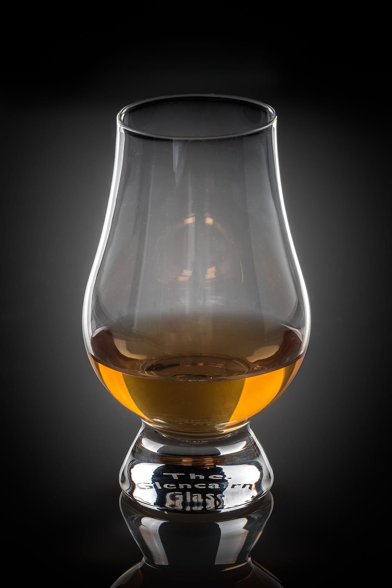

# Whisky Nosing Glass

A whisky nosing glass is a small tasting glass: a tulip-shaped bowl, a narrowed rim and a short, thick base. The shape is not decoration; it gathers the whisky's aroma at the rim so that nosing becomes more focused and layered. The short base is designed to sit in the palm, warming the spirit gently without a hand on the bowl.

The best-known example is the Glencairn glass. Designed by Glencairn Crystal in Scotland in the early 2000s, it drew on traditional whisky tasting glasses and the Spanish copita. Its arrival brought nosing out of the professional room and into ordinary bars and homes. For whisky itself, see [whisky](ref:whisky).

Figure: A Glencairn nosing glass. Image: Pjt56, CC BY-SA 4.0, via Wikimedia Commons ([source page](https://commons.wikimedia.org/wiki/File:Glencairn_Glass-pjt.jpg)).

## Shape and proportions

The core proportions are a tulip bowl, a narrowed rim and a short, thick base. The lower bowl is wide enough for the liquid to meet air; the upper bowl narrows to guide aroma to the rim; the rim is narrow to reduce sideways loss.

The glass holds little, and a pour of 20 to 30 millilitres is enough. Too much whisky and the aroma becomes overpowering, with alcohol masking detail; too little and the aroma is weak while the empty bowl lets it scatter. Small, repeated pours suit the glass.

The short, thick base makes the glass stable and fits the palm. Hand heat warms the whisky slightly and helps the aroma open; hold it too long and the alcohol grows stronger, so the timing is personal.

## Why the rim narrows

Whisky aroma comes from alcohol, esters, phenols, aldehydes and oak extractives. With an open rim the aroma scatters and the nose mostly finds alcohol and sweetness; with a narrow rim the aroma is directed to the nose and peat, vanilla, citrus, honey and wood become distinguishable.

The rim also changes the alcohol's sting. Too narrow and the alcohol concentrates in the nasal passage and feels sharp; slightly wider and the aroma is softer but less focused. A nosing glass balances focus against sting.

Different whiskies suit different shapes. A heavily peated whisky shows smoke and sea salt more clearly in a narrow glass; a floral whisky opens better with a slightly wider rim; a high-strength whisky can be amplified by a narrow rim, so a little water helps.

The difference from a copita is worth noting. The copita has a wider rim and a shallower bowl, suiting Spanish sherry; the nosing glass has a narrower rim and a deeper bowl, suiting whisky's more complex aroma. Both gather aroma, but to different degrees, and tasting the same whisky in both shows what rim width does.

## What it suits

The nosing glass suits neat whisky tasting, especially single malt, single cask and older whiskies. It also suits the nosing of other spirits: cognac, armagnac, rum and aged tequila. Any spirit that rewards nosing can use it.

It does not suit heavy ice drinking. Ice takes up space and the narrow rim makes large cubes awkward; for ice, a rocks glass is better. It also does not suit cocktails, especially those with juice, cream or bubbles.

With only one glass, a nosing glass can serve as the tasting glass and a rocks glass as the drinking glass. The division is simple: one for detail, one for comfort.

## Temperature and nosing

Whisky is usually drunk at room temperature, about 18 to 20 degrees Celsius. Too cool and the aroma is muted; too warm and the alcohol dominates and the aroma turns sharp. Do not heat the glass or leave it near a radiator.

Let the whisky settle for a few seconds, then bring the rim near the nose and inhale lightly. A deep inhalation stings the nasal passage and hides detail; short, gentle breaths reveal the layers. For the method, see [nosing](ref:nosing).

Add water sparingly. A few drops of room-temperature water open a high-strength whisky; too much thins the body and scatters the aroma.

## Holding and cleaning

Hold the base or the lower bowl. The palm can warm the whisky gently, but do not hold it too long; keep the fingers out of the rim to protect aroma and hygiene.

Wash with warm water and a little neutral detergent, rinse thoroughly and dry upside down. The narrow rim makes the base hard to rinse; rinse several times until no foam or scent remains.

Store away from strongly scented items. Glass adsorbs odours, especially when unused; rinse and dry before use. The rim gathers aroma without narrowing the opening so much that cleaning becomes difficult. For the wider principles of choosing a glass, see [glass selection](ref:glass).

## Common mistakes

First, filling the glass. A nosing glass needs only a small pour; a full glass overpowers the aroma and buries detail.

Second, sniffing hard. A deep sniff stings the nose and hides the aroma; short, gentle breaths work better.

Third, adding ice to a nosing glass. Ice takes up space and the narrow rim makes large cubes awkward; use a rocks glass for ice.

Fourth, assuming price equals performance. Shape, rim and cleanliness matter more than price; a clean ordinary nosing glass beats an expensive one with a stale smell. For other spirit glasses, see [copita](ref:copita) and [snifter](ref:snifter).

[Whisky](ref:whisky) explains material; [Snifter](ref:snifter) adds capacity. Put Whisky Nosing Glass between them before deciding what it is.

**In brief:** A small tasting glass with a tulip-shaped bowl and a narrowed rim, used for nosing and sipping whisky. The rim gathers aroma and the short base fits the palm.

For Whisky Nosing Glass, begin with the material and size, then the intended use, and finish with how it affects the drink; that order keeps the account grounded.

Treating Whisky Nosing Glass as a drink mixes two different questions: identity and use. Separate them before comparing.

The entry on Whisky Nosing Glass draws on Oxford University Press, Encyclopaedia Britannica, Corning Museum of Glass, Riedel.

The tulip bowl and narrow rim concentrate aroma; fill no more than a third and warm the glass in the hand.

A drop of water can open the aroma, but too much dilutes the structure.

**Key facts.**

| Item | Detail |
| --- | --- |
| In one line | A small tasting glass with a tulip-shaped bowl and a narrowed rim, used for nosing and sipping whisky. The rim gathers aroma and the short base fits the palm. |
| Material | Glass、Crystal glass |
| Use | Whisky nosing, small neat pours and other spirit tasting |

**Sources and limits.** The key claims about Whisky Nosing Glass are checked against the following sources: Oxford University Press (Used to check whisky tasting, nosing and glass background), Encyclopaedia Britannica (Used to check whisky categories and tasting background), Corning Museum of Glass (Used to check glass forms and craft background) and 5 sources in total. Prices, batches and status change; the body is project-written and does not reproduce source text.

For Whisky Nosing Glass, this glass was last checked in 2026; prices, batches and availability change, so confirm them against the sources below.
