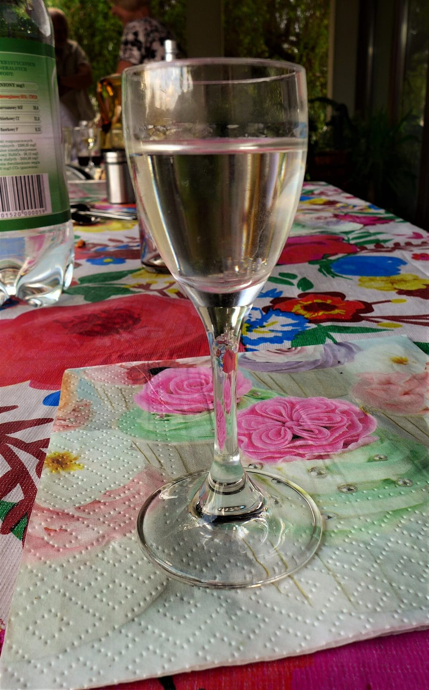

# White Wine Glass

The white wine glass is a size down from the red wine glass. Its bowl is narrower, its rim tighter and its stem often shorter. The point is not to save glass but to control oxidation: white wine's aromas are lighter and its acidity more prominent, and too much air strips the floral and fruit notes.

The name still covers several shapes. A Chardonnay glass has a slightly wider bowl for full-bodied whites; a Sauvignon or Riesling glass is narrower for crisp, high-acid wines. The shape follows aroma and acidity, not colour.

Figure: A glass of white wine. Image: BogTar201213, CC BY-SA 4.0, via Wikimedia Commons ([source page](https://commons.wikimedia.org/wiki/File:A_glass_of_white_wine.jpg)).

## Shape and proportions

The core proportions are a small bowl, a narrow rim and a moderate stem. The bowl usually holds 250 to 350 millilitres and the pour fills a third to a quarter; a small bowl means less contact with air and more focused aroma.

A narrow rim holds the floral and citrus notes. Too wide and the aroma escapes; too narrow and the alcohol dominates and the acidity turns sharp. The curve must work with the bowl, not just the rim diameter.

The stem is usually shorter than on a red wine glass but still long enough to hold. A short stem is stable and suits the table and daily use; a long stem is more elegant and suits formal tasting. Neither is inherently better.

## Why the bowl is smaller

White wine aroma is dominated by flowers, citrus, green apple and mineral notes, all volatile and easily carried away by air. A small bowl limits the surface area, slows the release and keeps the aroma in the glass; a narrow rim concentrates it before the first sip.

White wine is usually higher in acidity and served cooler. A small bowl brings the wine to temperature faster and reduces heat from the hand; a large bowl at low temperature can smother the aroma and make the wine taste flat.

White wine does not need to be "opened" like red. Its aroma is usually already forward and excess air flattens it. The small glass is therefore protection, not restriction.

Sweet wines and sparkling wines need separate thought. Noble rot and ice wines suit even smaller glasses that concentrate aroma and control temperature; Champagne and other sparkling wines need a tall, narrow vessel to hold the bubbles, and the wide rim of a white wine glass does not suit them. Choose by wine type first, then by glass shape.

## What it suits

The white wine glass suits crisp, aromatic and full-bodied whites. Sauvignon Blanc, Riesling and Albariño suit narrower shapes; Chardonnay, Chenin Blanc and Viognier suit slightly wider bowls; sweet and noble-rot wines suit smaller glasses that concentrate the aroma.

It does not suit red wine. Reds need a larger bowl and more air for tannin and aroma; in a white wine glass the aroma feels crowded and the tannin harsher.

It does not suit Champagne either. Sparkling wine needs a tall, narrow vessel to hold the bubbles, and the white wine glass rim is still too wide. Use a Champagne flute or a tulip glass.

## Temperature and pouring

White wine is usually served at 8 to 12 degrees Celsius, cooler for crisp styles and warmer for full-bodied ones. Too cold and the aroma is muted; too warm and the acidity feels loose and the alcohol shows. For temperature control, see [ice and temperature](ref:ice); for white wine itself, see [white wine](ref:white).

Pour to about one third of the bowl. A full glass leaves no aroma space and warms quickly; too little wine gives too small a surface and slow aroma release. For cold wine, pour less and refill, so the wine does not warm in the glass.

Pour slowly down the side rather than straight into the bottom. White wine usually has no sediment, but a direct pour still over-releases aroma; a slow pour is gentler and easier to control.

## Holding and cleaning

Hold the stem or foot, not the bowl. White wine is cold and body heat warms it within minutes; fingerprints on the bowl also spoil the look.

Wash with warm water and a little neutral detergent, rinse thoroughly and dry upside down. The narrow rim makes the bottom harder to rinse; rinse several times until no foam or scent remains.

Store away from strongly scented items. Glass adsorbs odours, especially when unused; rinse and dry before use. For more on choosing glasses, see [how to choose a glass](ref:glass).

## Common mistakes

First, using a red wine glass for white wine. The large bowl oxidises the aroma and makes the wine flat; white wine needs a smaller bowl and a tighter rim.

Second, filling the glass. A full glass has no aroma space and warms quickly; one third is the right starting point.

Third, freezing the glass. A sudden chill stresses the glass and frosts the rim; chill the wine, not the glass.

Fourth, assuming smaller is always better. A bowl too small cannot open the aroma and makes the acidity sharp; the shape must match the body. For the red counterpart, see [red wine glass](ref:red); for the logic of a narrowed rim, see [tulip glass](ref:tulip).

To read White Wine Glass, start with the material and size, then the intended use, then how it affects the drink; no single check settles it.

Start with [White wine](ref:white) for material, then read [Tulip glass](ref:tulip) for capacity. Seeing both keeps White Wine Glass from being confused with a neighbouring idea.

**In brief:** A stemmed glass with a smaller bowl and a narrower rim, used for white wine. The smaller bowl limits oxidation and the narrowed rim holds the floral and acidic freshness.

A narrower bowl than red-wine glass keeps the wine cool and focuses acidity; fill to a third.

Dishwasher heat and detergent residue can flatten the aroma, so rinse and air-dry.

A smaller bowl than a red-wine glass keeps the wine cool and concentrates the aroma.

**Key facts.**

| Item | Detail |
| --- | --- |
| In one line | A stemmed glass with a smaller bowl and a narrower rim, used for white wine. The smaller bowl limits oxidation and the narrowed rim holds the floral and acidic freshness. |
| Material | Glass、Crystal glass |
| Use | White wine and pale wines other than sparkling |

**Sources and limits.** The key claims about White Wine Glass are checked against the following sources: Oxford University Press (Used to check glass shapes, aroma and tasting background), Encyclopaedia Britannica (Used to check general wine tasting and service background), Corning Museum of Glass (Used to check glass forms and craft background) and 5 sources in total. Prices, batches and status change; the body is project-written and does not reproduce source text.

For White Wine Glass, this glass was last checked in 2026; prices, batches and availability change, so confirm them against the sources below.
