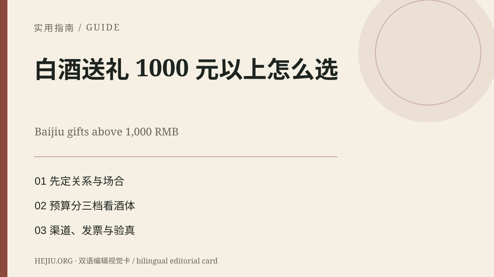

# 白酒送礼 1000 元以上怎么选

1000 元以上的白酒，已经不只是“买一瓶好喝的酒”。收礼人会把它放进某个场合：商务宴请、长辈寿宴、婚宴、收藏柜，或者一次重要的关系维护。价格越高，越需要对“送给谁、为什么送、对方喝不喝”有清楚判断；否则很容易把预算花在包装、故事或渠道溢价上。

图：白酒送礼 1000 元以上怎么选专属双语视觉卡。项目自制，用于识别主题，不是现场照片。

> **先给结论**
> **适合谁：** 预算在 1000 元以上，需要在商务、长辈、婚宴或收藏场景里送一瓶体面、来源清楚的白酒的人。
> **不适合谁：** 只想知道“最贵是哪瓶”、不准备核对渠道和发票的人；也不适合把送礼当成投资的人。
> **先看三点：** 先定关系与场合，再定香型与度数，最后才看包装；千元档优先选大单品或品牌主线，不追没有来源的“内部酒”。

## 先定关系，再定价格带

关系决定“要不要让对方一眼认出”。商务往来、长辈寿宴、婚宴这类场合，品牌识别度与包装完整度确实重要；但如果是懂酒的朋友，稀缺批次、单一园或地方酒厂的高配版本可能比大牌更合适。先问自己：对方会不会喝？有没有忌口？家里是否已经囤了同款？

场景决定“几个人喝、什么时候喝”。婚宴与宴席通常需要两瓶以上的同款，预算要按桌数算，而不是只算一瓶；长辈自饮更看重顺口、度数与饮后负担；收藏场景则要看批次、年份证明与保存条件。把这三件事写下来，价格带自然收窄。

## 1000 元以上怎么分档

| 预算带 | 适合场景 | 优先看什么 | 不要买什么 |
| --- | --- | --- | --- |
| 1000–2000 元 | 重要宴请、长辈礼 | 品牌主线大单品、完整礼盒、可开发票 | 只写“年份原浆”却没有执行标准与生产者 |
| 2000–5000 元 | 商务往来、婚宴主桌 | 品牌旗舰、限量批次、成对礼盒 | 无授权店的“特供”“内部酒” |
| 5000 元以上 | 顶级礼赠、收藏 | 稀缺批次、年份与来源证明、专业包装 | 没有 provenance 的拍卖酒或“故事酒” |

价格带不是质量等级。同一个品牌在不同价格带可能有不同产品线、度数与包装；先确认具体产品，再比较价格。千元档最常见的错误，是把“品牌名”当成“具体酒款”，付了溢价却买到低配产品。

## 钱花在酒体，不是盒子

礼盒当然有作用：它让礼物完整、方便携带，也传达重视。但盒子不是酒。判断一瓶千元以上的白酒，先看瓶标上的生产者、香型、酒精度、容量、原料与执行标准，再看瓶身工艺、封口、批次与防伪。盒子很大、瓶很小，或者盒子比酒更贵的组合，要特别谨慎。

如果预算有限，优先把酒体放在第一位：选品牌主线、度数明确、批次可查的产品；包装可以后配，但不要在来源不清的渠道买“豪华礼盒”。送礼时，发票与购买凭证要自己留一份，既方便售后，也能在对方追问来源时解释清楚。

## 年份、度数、批次怎么读

“年份”在白酒里至少有三种用法：瓶标上的年份、酒厂的历史叙事、基酒陈放时间。它们不是同一个概念，也不能直接等同于质量。看到“年份原浆”“洞藏”“窖藏”这类词，先找执行标准、生产许可、批次与生产者；如果没有，就把它当成营销语言，不要为它多付几千元。

度数方面，50 度上下是许多传统产品的常见区间，但低度产品也有自己的口感目标。高度酒香气浓、刺激感也强；低度酒更柔，却可能显得水。送礼时要考虑对方的饮用习惯，而不是只看“高度更值钱”。批次则影响风味稳定性：同一款酒不同批次可能有细微差异，收藏或重要场合可以记下批次。

## 渠道与验真

千元以上的白酒，渠道比价格更重要。优先品牌官方旗舰店、授权经销商、大型商超与有发票的烟酒行；不要相信“内部渠道”“特供”“领导用酒”这类说法。收到酒后，先看封口、喷码、防伪标识与瓶身做工，再用品牌官方防伪系统核对；价格明显低于市场价的，不要贪。

如果是异地送礼，提前确认物流对酒类的限制、保价与破损赔付。酒属于易碎品，包装要能抗压；夏天高温与冬天低温都可能影响口感，尽量选可追踪的快递，并提醒对方收货后直立、避光存放。

## 常见问题

### 1000 元以上一定要买茅台吗？

不一定。茅台是强识别度的选择，但适合的场景、预算与对方偏好更重要。商务场合可以选品牌主线；懂酒的朋友可能更喜欢同价位的酱香单一园或地方酒厂高配；长辈自饮则未必要追最贵的。先定关系，再定品牌。

### 年份越老越值钱吗？

不一定。老酒的价值取决于真实性、保存条件、批次稀缺度与市场需求；普通产品放久了未必升值，跑酒、暴晒或封口损坏还会让价值下降。送礼时，与其追“老”，不如选来源清楚、批次可查、对方愿意喝的产品。

### 礼盒越大越体面吗？

不是。礼盒的作用是完整与便利，不是质量证明。先看瓶标与酒体，再看盒子；如果盒子明显挤占预算，或者瓶身信息不全，宁愿选包装简单但来源清楚的产品。送礼时附一张手写卡片，比多一层盒子更有用。

> **继续读：** 先读[白酒](ref:baijiu)建立酒种框架，再比较[酱香](ref:sauce)与[浓香](ref:strong)的差异；预算在 300–800 元，可以回到[中端送礼指南](ref:gift300)。需要了解包装与运输，读[酒类礼盒](ref:box)；第一次喝白酒，按[入门指南](ref:first)小口试。想看具体产品，读[茅台](ref:moutai)与[五粮液](ref:wuliangye)。
